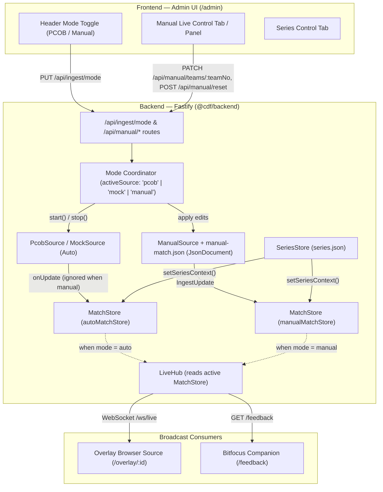

# Manual Mode — Proposed Architecture

This document describes how Manual Mode integrates into the existing `chicken-dinner-feed` monorepo (`@cdf/shared`, `@cdf/backend`, `@cdf/frontend`) while preserving ADR-0004 (JSON persistence), ADR-0005 (shared Zod contracts), ADR-0006 (ingestion adapter boundary), ADR-0007 (WebSocket snapshot fan-out), and ADR-0015 (multi-map series scoring).

> **Note:** Nothing in this document is implemented yet. It is the proposed design for Phase 5 review.

---

## 1. High-Level Architecture

Rather than creating a parallel rendering or scoring pipeline, Manual Mode plugs in at the **exact ingestion adapter boundary** ([ADR-0006](adr/0006-pcob-ingestion-adapter-boundary.md)) alongside `PcobSource` and `MockSource`, coordinated by a small runtime **Ingest Mode Controller** (or dual-store coordinator) on the backend.



### Why Two `MatchStore` Instances (or Mode-Scoped State) Behind One Active Projection?

Holding one `MatchStore` for the automatic source (`PcobSource` / `MockSource`) and one `MatchStore` for `ManualSource` (with a thin selector `activeMatchStore()` passed to `LiveHub`, `seriesRoutes`, and `feedbackRoutes`) guarantees **complete cross-mode isolation**:

1. **No cross-mode corruption:** Even if an in-flight PCOB HTTP request resolves a few milliseconds after the operator switches to Manual Mode, it writes at most to the inactive automatic store (and `PcobSource.stop()` already detaches `events`). It can **never** touch `manualMatchStore`.
2. **Instant non-destructive mode switching:** If an operator switches from PCOB Mode to Manual Mode to check something and switches back to PCOB Mode, neither mode's `eliminationOrder`, `seenTeams`, or `lastUpdate` has been wiped out by a `matchId` mismatch.
3. **Reversible manual eliminations without breaking PCOB's append-only rule:** In Manual Mode, each update is a complete snapshot of the manual state where placements of eliminated teams are passed explicitly via `IngestPlayer.rank`, or `manualMatchStore` resets its `eliminationOrder` from the manual state's ordered list of eliminated teams. Thus, un-eliminating a team (`0` → `2` alive) immediately restores it to alive with `placement: null`.

---

## 2. Shared Data Models & Contracts (`@cdf/shared`)

### 2.1 Extending `ingestSourceKindSchema`

In [`shared/src/domain/ingest.ts`](../shared/src/domain/ingest.ts):

```ts
export const ingestSourceKindSchema = z.enum(['mock', 'pcob', 'manual']);
export type IngestSourceKind = z.infer<typeof ingestSourceKindSchema>;
```

- `PROTOCOL_VERSION` in [`shared/src/versions.ts`](../shared/src/versions.ts) increments from `6` to `7` because `LiveSnapshot.ingest.source` can now be `'manual'`.
- `FEEDBACK_VERSION` (`2`) in `shared/src/protocol/feedback.ts` remains additive/compatible (`data.source` uses `ingestSourceKindSchema`).

### 2.2 Manual Match Document Schema (`shared/src/domain/manual.ts`)

```ts
import { z } from 'zod';

export const manualTeamStateSchema = z.object({
  teamNo: z.number().int().min(1).max(25),
  /** Whether this roster team is participating in the current match (`hasAppeared`). */
  present: z.boolean(),
  /** Standing players (0 = eliminated, 1..4 = alive). */
  aliveCount: z.number().int().min(0).max(4),
  /** Total team eliminations in the current match. */
  eliminations: z.number().int().min(0).max(999),
  /**
   * Monotonic sequence number assigned when `aliveCount` transitions to 0 (1 = first team wiped,
   * i.e. worst placement; 2 = second team wiped, etc.). Reset to `null` whenever `aliveCount > 0`.
   */
  eliminatedSeq: z.number().int().min(1).nullable(),
  /** Optional explicit placement override (1..25). When null, placement is derived automatically. */
  placementOverride: z.number().int().min(1).max(25).nullable(),
});
export type ManualTeamState = z.infer<typeof manualTeamStateSchema>;

export const operatingModeSchema = z.enum(['auto', 'manual']);
export type OperatingMode = z.infer<typeof operatingModeSchema>;

export const manualMatchDocumentSchema = z.object({
  schemaVersion: z.number().int().min(1),
  /** Whether the operator has selected Automatic (PCOB/Mock) or Manual mode. */
  mode: operatingModeSchema,
  /** Stable identifier for the current manual match, regenerated on manual match reset. */
  matchId: z.string().min(1),
  /** Next sequence counter for `eliminatedSeq`. */
  nextEliminatedSeq: z.number().int().min(1),
  /** Per-team manual state, keyed/ordered by `teamNo`. */
  teams: z.array(manualTeamStateSchema),
});
export type ManualMatchDocument = z.infer<typeof manualMatchDocumentSchema>;
```

---

## 3. Manual State to `IngestUpdate` Mapping

`ManualStore` converts `ManualMatchDocument` + `TeamRosterEntry[]` into a standard `IngestUpdate` consumed by `MatchStore`:

1. **Participating teams:** Only teams where `present === true` (and present in the current roster) emit `IngestPlayer` records. Teams with `present === false` emit no players, so `MatchStore.seenTeams` excludes them and `computeStandings` sets `hasAppeared = false` (dimmed to 25 % opacity, sorted last).
2. **4 Player Slots per Present Team:**
   For each present team (`teamNo`) with `aliveCount` ($0 \le \text{aliveCount} \le 4$) and `eliminations`:
   - For `slot` in `1..4`:
     - `isAlive = slot <= team.aliveCount`
     - `liveState = isAlive ? 'alive' : 'dead'`
     - `health = isAlive ? 100 : 0`
     - `healthMax = 100`
     - `kills = slot === 1 ? team.eliminations : 0` (all team kills carried on slot 1; `computeStandings` sums `player.kills` across the team, and individual player kills are never displayed on the overlay).
     - `rank = resolvedManualRankFor(teamNo)` (0 while alive without override; 1-based placement when eliminated or overridden).
3. **Placement Calculation in Manual Mode (`resolvedManualRankFor`):**
   - Total participating teams $P = \text{count}(\text{present} === \text{true})$.
   - Any team with a non-null `placementOverride` claims that exact placement slot (clamped to $1..P$).
   - Remaining eliminated teams (`aliveCount === 0`, ordered by `eliminatedSeq` ascending — earliest wiped first) are assigned the worst unclaimed slots from $P$ downward ($P, P-1, \dots$), identical to `MatchStore.resolvePlacements`.
   - Teams with `aliveCount > 0` and no `placementOverride` receive `rank: 0` ("still playing"), so `computeStandings` awards them guaranteed-minimum placement points while live, and survivor placement if the map is closed.
   - Because `rank` is computed statelessly from `ManualMatchDocument` on every edit (and `manualMatchStore` resets its internal `eliminationOrder` on each manual snapshot), changing `aliveCount` from `0` back to `1..4` **immediately and cleanly un-eliminates the team**.

---

## 4. API Lifecycle & Mode Transition Behavior

| Scenario                                                   | Behavior                                                                                                                                                                                                                                                                |
| ---------------------------------------------------------- | ----------------------------------------------------------------------------------------------------------------------------------------------------------------------------------------------------------------------------------------------------------------------- |
| **1. App startup**                                         | Loads `manual-match.json` (creates default with `mode: 'auto'`, `aliveCount: 4`, `eliminations: 0` for all roster teams if missing). Starts `PcobSource`/`MockSource` if `mode === 'auto'`; otherwise leaves automatic source stopped and projects `manualMatchStore`.  |
| **2. PCOB Mode → Manual Mode**                             | `PUT /api/ingest/mode { mode: 'manual' }` stops `PcobSource` (`await ingestSource.stop()`), switches active store pointer to `manualMatchStore`, refreshes series context, and calls `hub.publish()`. Open overlays immediately transition to the manual standings.     |
| **3. Operator edits team in Manual Mode**                  | `PATCH /api/manual/teams/:teamNo` (or bulk update) validates input, updates `manual-match.json` via `JsonDocument.write()`, applies the resulting `IngestUpdate` to `manualMatchStore`, refreshes series context, and calls `hub.schedulePublish()`.                    |
| **4. Manual Mode → PCOB Mode**                             | `PUT /api/ingest/mode { mode: 'auto' }` switches active store pointer back to `autoMatchStore`, calls `ingestSource.start(...)`, refreshes series context, and publishes. Manual state remains saved in `manualMatchStore` and `manual-match.json`.                     |
| **5. In-flight PCOB poll resolves after switch to Manual** | `PcobSource.stop()` clears `this.events = null` before returning, and the `onUpdate` callback in `app.ts` also checks `if (coordinator.mode !== 'auto') return;`. Double-guarded against race conditions.                                                               |
| **6. PCOB API is unavailable**                             | In PCOB Mode, header shows `Disconnected`. Operator can click **Manual** in the header at any time; status immediately becomes `Manual` (`state: 'connected'`, `source: 'manual'`) and manual controls work without PCOB.                                               |
| **7. Silence > 10 s in Manual Mode**                       | `LiveHub`'s stale check timer skips `markStaleIfSilent()` when `activeStore.source === 'manual'`. Manual Mode never turns `stale`.                                                                                                                                      |
| **8. Team Roster edited on Teams tab**                     | `configStore.subscribe('teams')` syncs newly added/removed roster `teamNo` entries into `ManualStore` (preserving existing manual stats for unchanged `teamNo`s, seeding new teams with `aliveCount: 4, eliminations: 0`), updates both stores' rosters, and publishes. |

---

## 5. Proposed Backend API Endpoints (`/api/manual`)

| Method & Path                     | Request Body                                                                                          | Response (`200`)      | Purpose                                                                                                                                       |
| --------------------------------- | ----------------------------------------------------------------------------------------------------- | --------------------- | --------------------------------------------------------------------------------------------------------------------------------------------- |
| `GET /api/manual`                 | —                                                                                                     | `ManualMatchDocument` | Read current operating mode (`auto` vs `manual`) and manual team states                                                                       |
| `PUT /api/manual/mode`            | `{ mode: 'auto' \| 'manual' }`                                                                        | `ManualMatchDocument` | Switch between PCOB/Mock Mode and Manual Mode                                                                                                 |
| `PATCH /api/manual/teams/:teamNo` | `{ present?: boolean, aliveCount?: 0..4, eliminations?: number, placementOverride?: number \| null }` | `ManualMatchDocument` | Fast single-team update (1-click counter/alive changes)                                                                                       |
| `PUT /api/manual/teams`           | `{ teams: ManualTeamState[] }`                                                                        | `ManualMatchDocument` | Bulk update all teams at once                                                                                                                 |
| `POST /api/manual/reset`          | `{ copyFromAuto?: boolean }`                                                                          | `ManualMatchDocument` | Reset manual match for a new map (fresh `matchId`, all teams `aliveCount: 4`, `eliminations: 0`), or optionally seed from the last PCOB state |

---

## 6. Proposed Admin UI Changes (`@cdf/frontend`)

1. **Header Mode Toggle (`AdminPage.tsx`):**
   - Located in the sticky top header right next to the connection indicator, so the operator can see and switch the mode from **any** tab (`Overlays`, `Teams`, `Scoring`, `Fonts`, `Series control`, `Manual control`, `Import & Export`).
   - Segmented pill toggle: **`PCOB API`** (or **`Mock`** when backend `INGEST_SOURCE=mock`) vs. **`Manual`**.
   - When `Manual` is active, the status badge shows a distinct indicator (e.g.violet/amber dot + `Manual mode — operator input active`) instead of `Disconnected`.
2. **Manual Control Surface (`ManualControl.tsx`):**
   - Accessible either as a dedicated **`Live / Manual`** tab in the main navigation bar (auto-focused or highlighted when switching to Manual Mode) or integrated into `SeriesControl` (see Decision D-08).
   - Displays a fast, operator-ergonomic table of all roster teams (ordered by `teamNo` or current rank, toggleable by the operator so rows don't jump under the mouse cursor while clicking):
     - **In Match (`present`)** checkbox
     - **Slot (`#teamNo`)**, **Logo**, and **Team Name**
     - **Alive Players (`0` `1` `2` `3` `4` segmented buttons)** — 1 click to set exact alive count or wipe (`0`)
     - **Eliminations (`-1` `[ value ]` `+1` `+2` `+4`)** — 1 click to increment kills during combat
     - **Placement (`Auto (calculated)` or override dropdown `1..25`)**
     - **Live Computed Columns (read-only):** `Kill Pts`, `Place Pts`, `Series Pts`, `Total PTS`, `Current Rank #`
   - Top toolbar with:
     - **New / Reset manual match** button (with `ConfirmDialog`)
     - **Close current map into series** button (reusing `api.closeMapNow()`)
     - Optional **Copy current PCOB state** button (for mid-match failover).

---

## 7. Shared vs. Mode-Specific Component Classification (Phase 3.3)

| Component / Module                                                                                | Classification                            | Notes                                                                                                                                              |
| ------------------------------------------------------------------------------------------------- | ----------------------------------------- | -------------------------------------------------------------------------------------------------------------------------------------------------- |
| `LeaderboardOverlay.tsx`, `TeamRow.tsx`, `AlivePlayerBars.tsx`                                    | **Shared between modes**                  | Consumes `MatchState` without knowing whether `IngestPlayer[]` came from `PcobSource` or `ManualSource` (optional legend tweak if D-05 is chosen). |
| `OverlayPage.tsx`, `OverlayPreview.tsx`, `appearance.ts`, `overlay-scale.ts`                      | **Shared between modes**                  | 100 % unchanged.                                                                                                                                   |
| `computeStandings` (`backend/src/scoring/standings.ts`)                                           | **Shared between modes**                  | 100 % unchanged.                                                                                                                                   |
| `SeriesStore` & `SeriesControl.tsx`                                                               | **Shared between modes**                  | Operates on the active `MatchStore` projection.                                                                                                    |
| `ConfigStore`, `TeamRosterEditor.tsx`, `ScoringEditor.tsx`, `FontManager.tsx`, `ImportExport.tsx` | **Shared between modes**                  | 100 % unchanged.                                                                                                                                   |
| `PcobSource` & `PcobMapper`                                                                       | **Disabled (paused) in Manual Mode**      | Stopped when Manual Mode is active; resumed when returning to PCOB Mode.                                                                           |
| `MatchStore.markStaleIfSilent`                                                                    | **Disabled in Manual Mode**               | Only runs for polling/streaming sources (`pcob` / `mock`).                                                                                         |
| `SeriesStore.shouldAutoCloseNow`                                                                  | **Disabled in Manual Mode (recommended)** | Prevents accidental map banking while the operator is mid-edit (Decision D-06).                                                                    |
| `AdminPage.tsx` header & `ManualControl.tsx`                                                      | **Modified / Added for Manual Mode**      | Adds mode toggle, mode status badge, and live manual team editor.                                                                                  |
