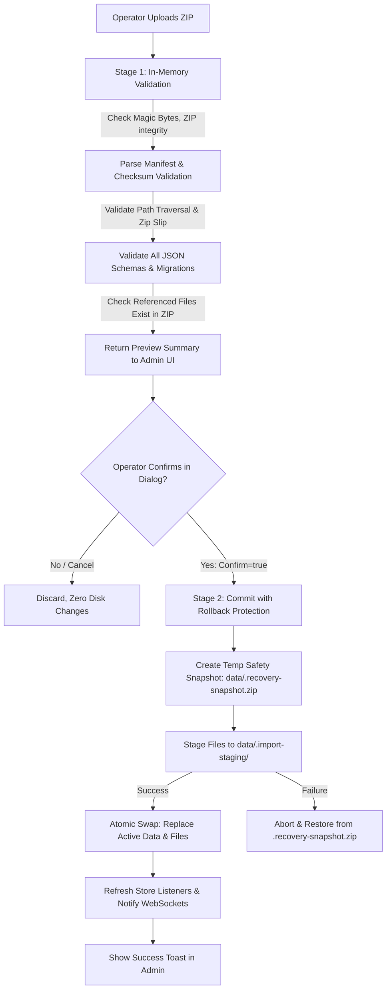

# Part 7 — Application Backup & Restore, Exact Excel Integration, Default Team Roster & Postgame Ranking Correction: Audit & Proposal

**Author:** Claude Code (Engineering Assistant)  
**Date:** 2026-10-21  
**Project:** `chicken-dinner-feed`  
**Status:** APPROVED & FULLY IMPLEMENTED (`COMPLETED`)

---

## 1. Executive Summary & Repository Health

This audit and proposal addresses the four core workstreams required for **Part 7**:

1. **Feature A — Application Data Export & Import / Backup & Restore:** Comprehensive full-application state backup and disaster recovery across local servers, container redeployments, and Railway environments.
2. **Feature B — Exact Excel Integration:** High-fidelity round-trip import and template-based export matching the official `PMCC 2026 OFLINE SCORING SHEETS.xlsx` tournament workbook with 100% preservation of styles, merged cells, formulas, dimensions, and hidden elements.
3. **Feature C — Default Team Roster:** Non-destructive bootstrap of the 25 official tournament teams extracted from the workbook with automatic slot mapping and character length resolution.
4. **Feature D — Postgame Ranking Correction:** Strict architectural separation between single-match result ranking (`PostGameOverlay`) and cumulative tournament series standings (`PostGameSeriesOverlay`), with consistency across admin panel, overlays, and Excel exports.

---

## 2. Baseline Verification & Quality Gates

The repository baseline was verified prior to any code or schema modification:

| Quality Gate                 | Command                | Result                      | Details                                                                                                                                                                        |
| :--------------------------- | :--------------------- | :-------------------------- | :----------------------------------------------------------------------------------------------------------------------------------------------------------------------------- |
| **Unit & Integration Tests** | `npm run test`         | **374 / 374 PASSED** (100%) | 288 backend tests (24 files), 86 frontend tests (6 files).                                                                                                                     |
| **TypeScript Typecheck**     | `npm run typecheck`    | **0 ERRORS**                | Clean across `@cdf/shared`, `@cdf/backend`, and `@cdf/frontend`.                                                                                                               |
| **Linter**                   | `npm run lint`         | **0 WARNINGS / 0 ERRORS**   | Oxlint verified 60 frontend files cleanly.                                                                                                                                     |
| **Code Formatting**          | `npm run format:check` | **3 PRE-EXISTING ISSUES**   | Minor formatting differences in `backend/src/routes/config.test.ts`, `frontend/src/features/admin/bulk-teams.ts`, `frontend/src/features/admin/roster-reorder.ts` from Part 6. |
| **Production Build**         | `npm run build`        | **SUCCESS**                 | Clean compilation of shared packages, backend bundle, and Vite frontend.                                                                                                       |

---

## 3. Persistence Architecture & Store Layer Audit

### 3.1 Persistence Stores & Storage Map

The application uses local JSON file documents and media directory storage managed by dedicated stores in `backend/src/persistence/` and `backend/src/state/`. There is **no external SQL database**; state is file-based to enable instant zero-dependency portability (ADR-0004).

All persistent files resolve to `config.dataDir` (`DATA_DIR` environment variable, defaulting to `backend/data/`):

| Store Name              | File / Directory Path         | Schema / Document Type      | Role & Contents                                                                                          | Currently in Backup ZIP?  |
| :---------------------- | :---------------------------- | :-------------------------- | :------------------------------------------------------------------------------------------------------- | :-----------------------: |
| `ConfigStore.instances` | `data/overlay-instances.json` | `OverlayInstancesDocument`  | Per-instance overlay configurations, themes, typography, background settings, and ON AIR states.         |          **YES**          |
| `ConfigStore.teams`     | `data/team-roster.json`       | `TeamRosterDocument`        | Team roster entries (`teamNo` 1..25), team names, logo URLs, slot history.                               |          **YES**          |
| `ConfigStore.scoring`   | `data/scoring-ruleset.json`   | `ScoringRuleset`            | Placement point array (`[10, 6, 5, 4, 3, 2, 1, 1, 0...]`) and points per elimination (`1`).              |          **YES**          |
| `ConfigStore.fonts`     | `data/custom-fonts.json`      | `CustomFontsDocument`       | Operator-uploaded typography metadata (`family`, `fileName`).                                            |          **YES**          |
| `SeriesStore`           | `data/series.json`            | `SeriesDocument`            | Immutable closed match records (`closedMaps`), active match number, active map name.                     |          **YES**          |
| `ManualStore`           | `data/manual-match.json`      | `ManualMatchDocument`       | Operator manual scoring state, live alive counts, reversable elimination sequences, placement overrides. | **NO (CRITICAL DEFECT)**  |
| `LogoStore`             | `data/logos/`                 | PNG, JPG, WebP, SVG files   | Team crest images keyed by filename.                                                                     |          **YES**          |
| `FontStore`             | `data/fonts/`                 | TTF, OTF, WOFF, WOFF2 files | Custom typography binary assets.                                                                         |          **YES**          |
| `BackgroundStore`       | `data/backgrounds/`           | MP4, WebM, PNG, JPG files   | Post-game video/image background media.                                                                  | **YES** (partial in code) |

### 3.2 Audit Findings on Persistence & Gaps

1. **Omission of `manual-match.json`:** `ManualStore` owns `manual-match.json`. During Part 5 & 6, `manual-match.json` was never added to `BACKUP_ENTRIES` in `backend/src/backup/export.ts` or `import.ts`. If an operator running manual scoring downloads a backup or migrates servers, the active manual match state is lost.
2. **Missing Rollback Mechanism:** In `applyImport` (`backend/src/backup/import.ts`), directories (`logos/`, `fonts/`, `backgrounds/`) are cleared and rewritten before JSON config files are saved. If an error occurs midway (e.g. invalid JSON write or filesystem lock), the app is left in a corrupted, half-restored state without rollback.
3. **No Safety Pre-Restore Snapshot:** The server does not create a pre-restore recovery point (`data/.recovery-snapshot.zip`) before replacing user data.
4. **Summary Schema Incompleteness:** `backupSummarySchema` in `shared/src/domain/backup.ts` reports counts for instances, teams, logos, fonts, and closed maps, but omits background media files and manual match state.

---

## 4. Railway Deployment & Ephemeral vs Persistent Storage Audit

### 4.1 Deployment Environment Characteristics

When deployed to Railway or containerized environments (Docker, Nixpacks):

1. **Ephemeral Filesystem by Default:**
   - Every deployment container on Railway has an ephemeral filesystem.
   - When a service is redeployed, updated, crashed, or scaled, Railway provisions a fresh container image.
   - **Any data written to `backend/data/` inside the container without a mounted Railway Volume is completely destroyed upon redeployment.**
2. **Railway Volume Persistence:**
   - Railway supports **Persistent Volumes** ($0.15/GB-month) that attach a dedicated disk block to a container mount path (e.g. `/app/backend/data`).
   - If an operator provisions a Railway Volume and mounts it to the data directory (or sets `DATA_DIR=/app/data`), data persists across code updates and restarts.
   - However, Railway Volumes are single-replica only and cannot be shared across multiple horizontal instances.
3. **Environment Variables & Secrets:**
   - Railway injects configuration via `process.env` (`PORT`, `HOST`, `INGEST_SOURCE`, `PCOB_BASE_URL`, `CONTROL_TOKEN`).
   - Machine credentials, session secrets, and control tokens must **never** be included in backup archives. The backup system correctly excludes `.env` and host-specific parameters.

### 4.2 Backup & Restore as the Ultimate Safeguard

Because operators may deploy on Railway without setting up a paid Volume (or may want to migrate from local localhost to Railway or between cloud providers), **Application Data Export & Import / Backup & Restore is the primary insurance against data loss.**

- An operator can export a complete `.zip` snapshot with one click before initiating a Git push or redeployment.
- If a container restarts clean, the operator uploads the `.zip` to immediately restore all configurations, series history, rosters, and media assets in seconds.

---

## 5. Excel Workbook Forensics (`assets/PMCC 2026 OFLINE SCORING SHEETS.xlsx`)

A comprehensive binary and OpenXML forensic audit was performed on the official tournament workbook `assets/PMCC 2026 OFLINE SCORING SHEETS.xlsx` (29,403 bytes).

### 5.1 Workbook Structure & Geometry

- **Worksheets:** Exactly 1 worksheet named `10. Offline Scoring Sheets`.
- **Dimensions:** `A1:AC59` (29 columns, 59 rows).
- **Freeze Panes:** Frozen at cell `A6` (rows 1–5 remain pinned during vertical scroll).
- **Merged Cells:** Exactly 14 merged ranges:
  - `A1:G3`: Banner Title `"OVERALL RANKING - 2026 PMCC \n[OFFLINE]"`
  - `A4:A5`: Left Table `"Rank"`
  - `B4:B5`: Left Table `"Name Team"`
  - `C4:F4`: Left Table `"Total Pts Per Round"` (Headers for R1..R4)
  - `G4:G5`: Left Table `"Total Pts"`
  - `I4:I5`: Right Table `"No"` (Slot number 1..25)
  - `J4:J5`: Right Table `"Rank"`
  - `K4:K5`: Right Table `"Team Name"`
  - `L4:P4`: Right Table `"Placement Pts"` (Headers for R1..R5 placement finish)
  - `Q4:U4`: Right Table `"Kill Pts"` (Headers for R1..R5 kill count)
  - `V4:Z4`: Right Table `"Total Pts Per Round"` (Headers for R1..R5 round total points)
  - `AA4:AA5`: Right Table `"Total Placement Pts"`
  - `AB4:AB5`: Right Table `"Total Kill Pts"`
  - `AC4:AC5`: Right Table `"Total Pts"`
- **Hidden Columns (Critical Discovery):**
  - Exactly 3 columns are set to `hidden="true"`:
    - **Column P (`Placement Pts R5`)**
    - **Column U (`Kill Pts R5`)**
    - **Column Z (`Total Pts Per Round R5`)**
  - **Reason:** The tournament offline scoring template supports up to 5 rounds, but Round 5 is hidden by default for 4-round tournament formats! Table 1 only displays R1..R4 (Cols C..F).
- **Hidden Rows (Critical Discovery):**
  - Exactly 28 rows are set to `hidden="true"`: **Rows 32 through 59**.
  - **Contents of Rows 37–59:** The official scoring ruleset legend and placing points lookup table:
    - `G37`: `"Point Kill"`, `H37`: `1`
    - `G39`: `"Placing Points"`
    - `G40:I59`: Placing points reference (1st = 10, 2nd = 6, 3rd = 5, 4th = 4, 5th = 3, 6th = 2, 7th = 1, 8th = 1, 9th..20th = 0).
- **Column Widths & Row Heights:**
  - Row heights for rows 1–31: `15.75pt`.
  - Column widths: `A`: 4.89, `B`: 18.22, `C..F`: 8.0, `G`: 8.0, `H`: 19.0 (empty gutter), `I`: 4.22, `J`: 5.66, `K`: 22.11, `L..O`: 4.44, `P`: 4.44 (hidden), `Q..T`: 4.44, `U`: 4.44 (hidden), `V..Y`: 5.66, `Z`: 5.66 (hidden), `AA`: 18.44, `AB`: 14.0, `AC`: 14.0.
- **Color Fills & Typography:**
  - Header fills: Pastel Cream (`#FFFFF2CC`), Light Apricot (`#FFFBE4D5`), Light Mint (`#FFD9EAD3`, `#FFE2EFD9`).
  - **Podium Highlight:** In Table 1, cells `B6`, `B7`, and `B8` (Ranks 1, 2, and 3) have solid vivid green fill (`#00FF00`) indicating qualifying advancement positions!

### 5.2 Two-Table Architectural Breakdown

The sheet contains two side-by-side tables separated by empty column H:

```
+------------------------------------+---+------------------------------------------------------------------------+
|  TABLE 1: OVERALL LEADERBOARD      | H |  TABLE 2: RAW MATCH SCORING SHEET (INPUT & CALCULATION)                |
|  (Columns A to G, Rows 4 to 30)    |   |  (Columns I to AC, Rows 4 to 30)                                       |
+------------------------------------+---+------------------------------------------------------------------------+
| Col A: Rank (1..25)                |   | Col I: No (Slot 1..25)                                                 |
| Col B: Name Team (=INDEX/MATCH)    |   | Col J: Series Rank (=RANK+COUNTIF-1)                                   |
| Col C: R1 Pts (=VLOOKUP J:AC, 13)  |   | Col K: Team Name (formula to external reg sheet)                       |
| Col D: R2 Pts (=VLOOKUP J:AC, 14)  |   | Col L..P: Placement Finish R1..R5 (INPUT)                              |
| Col E: R3 Pts (=VLOOKUP J:AC, 15)  |   | Col Q..U: Eliminations R1..R5 (INPUT)                                  |
| Col F: R4 Pts (=VLOOKUP J:AC, 16)  |   | Col V..Z: Total Pts R1..R5 (=(IF(L6=1,10,...)) + Q6*1)                 |
| Col G: Total Pts (=VLOOKUP, 20)    |   | Col AA: Total Place Pts (=SUM(R1..R5 Place Pts))                       |
|                                    |   | Col AB: Total Kill Pts (=(Q6*1)+(R6*1)...)                             |
|                                    |   | Col AC: Total Pts (=SUM(AA6:AB6))                                      |
+------------------------------------+---+------------------------------------------------------------------------+
```

### 5.3 External Reference Analysis (`xl/externalLinks/`)

1. **Target Workbook:**
   - The archive references: `file:///T:\Downloads\%5bPENS%5d%20TOURNAMENT%20SHEETS%20_%202026%20PMCC.xlsx` (`TargetMode="External"`).
   - In that external workbook, worksheet `05. Registration Data - Approve` contains registered teams.
2. **Formula in Cells `K6:K30`:**
   ```excel
   =IFERROR(VLOOKUP(I6,'[1]05. Registration Data - Approve'!$A$4:$B$178,2,0),"")
   ```
3. **Critical Behavioral Risk of `IFERROR(..., "")`:**
   - In `assets/PMCC 2026 OFLINE SCORING SHEETS.xlsx`, the cached calculation strings (`SUKA SUKA SQUAD`, `NTR`, `KP PENS`, etc.) are currently present in `<v>` tags.
   - **However, if an operator opens the workbook on any machine where `T:\Downloads\[PENS] TOURNAMENT SHEETS _ 2026 PMCC.xlsx` does not exist and clicks "Update Links" (or if opened in Google Sheets, LibreOffice, or Office 365 Web), Excel triggers formula recalculation.**
   - Because the external file is missing, `VLOOKUP` returns `#REF!` or `#N/A`, which `IFERROR` catches and silently replaces with an **EMPTY STRING (`""`)**!
   - As soon as Col K becomes blank, Table 1 Col B (`=INDEX($K$6:$K$30, MATCH(...))`) also turns completely blank!
4. **Decoupling Proposal for Export:**
   - During Excel Export from our app, the app is authoritative for team names.
   - We propose setting `K6:K30` directly to string literals (`t="str"`) containing the actual team names from the application roster, and updating cached values in Table 1 Col B.
   - This eliminates the fragile external dependency while preserving 100% of the internal formula architecture (`VLOOKUP`, `INDEX`, `MATCH`, `RANK`, `COUNTIF`, placing point `IF` ladders, and sums).

---

## 6. Mandatory Online Research Findings

### 6.1 Railway Deployment & Ephemeral Volumes

- **Source:** Railway Official Docs — _Using Volumes_ (`https://docs.railway.com/volumes`) & _Databases_ (`https://docs.railway.com/databases`).
- **Findings:** Railway containers provide ephemeral disk storage. Any filesystem write outside a mounted Railway Volume is lost upon redeployment, restart, or configuration change. Persistent volumes cost $0.15/GB-month and provide persistent block storage surviving deployments.
- **Implementation Impact:** Application Backup & Restore must support full round-trip export/restore of both JSON state and asset directories so operators without persistent volumes can back up before redeploying.

### 6.2 High-Fidelity Excel Engine in Node.js

- **Source:** ExcelJS Documentation & Repository (`https://github.com/exceljs/exceljs`) & OpenXML ISO/IEC 29500 Specification.
- **Empirical Evaluation:** We installed `exceljs` in our execution environment and ran verification benchmarks against `assets/PMCC 2026 OFLINE SCORING SHEETS.xlsx`:
  - **Freeze Panes:** Exactly preserved (`A6`).
  - **Merged Cells:** 14/14 ranges preserved with 0 diffs.
  - **Hidden Columns:** Columns `P`, `U`, `Z` preserved as hidden.
  - **Hidden Rows:** Exactly 28 rows (32..59) preserved as hidden.
  - **Formulas:** All complex formulas (`INDEX`, `MATCH`, `RANK`, `COUNTIF`, nested `IF` chains) preserved verbatim.
  - **Cell Styles & Fills:** Podium green `#00FF00` and header fills preserved.
  - **Calculated Results:** By assigning `{ formula, result }`, ExcelJS writes both the formula `<f>` and cached evaluation `<v>` tags, ensuring instant rendering in spreadsheet viewers without requiring manual recalculation.
- **Alternative Evaluated:** SheetJS (`xlsx`) community edition strips formatting, cell fills, and print setup. `exceljs` is far superior for template fidelity.

### 6.3 Security Hardening for Archive Extraction (Zip Slip / Path Traversal)

- **Source:** Snyk Advisory _Arbitrary File Write in adm-zip_ (`CVE-2018-1002204`), NIST NVD (`https://nvd.nist.gov/vuln/detail/CVE-2018-1002204`).
- **Findings:** Insecure zip extraction allowing entries with `../` or unnormalized relative paths can write arbitrary files outside the target directory.
- **Implementation Impact:** All entry paths must be strictly sanitized:
  1. Strip directory traversal tokens (`..`, `/`, `\`).
  2. Verify `path.resolve(targetDir, entryName).startsWith(path.resolve(targetDir) + path.sep)`.
  3. Validate file types via magic bytes (PNG, JPG, WebP, SVG for logos; TTF, OTF, WOFF for fonts; MP4, WebM for backgrounds).
  4. Enforce strict archive size limits (64 MB maximum).

---

## 7. Feature A: Application Backup & Restore Design

### 7.1 Backup Manifest Schema v2 (`BackupManifest`)

We propose extending the backup format to version 2 (`BACKUP_FORMAT_VERSION = 2`):

```typescript
export const backupManifestSchema = z.object({
  backupFormatVersion: z.literal(2),
  exportedAt: z.number().int(),
  appVersion: z.string().min(1),
  environment: z.string().optional(),
  sha256Checksums: z.record(z.string()), // filename -> SHA256 hex digest
  artifacts: z.object({
    overlayInstances: z.number().int(),
    teams: z.number().int(),
    logos: z.number().int(),
    customFonts: z.number().int(),
    closedMaps: z.number().int(),
    hasManualMatch: z.boolean(),
    backgrounds: z.number().int(),
  }),
});
```

### 7.2 Complete Archive Entry Map

```
chicken-dinner-feed-backup-YYYY-MM-DDTHH-mm-ss.zip
├── manifest.json              # Version 2 metadata, checksums & artifact inventory
├── overlay-instances.json     # Overlay configurations, themes & ON AIR states
├── team-roster.json           # Active team roster & slot mapping
├── scoring-ruleset.json       # Placement points & elimination multipliers
├── custom-fonts.json          # Custom font definitions
├── series.json                # Closed map match records & series history
├── manual-match.json          # Manual scoring state & live progress (NEW in Part 7)
├── logos/                     # Team crest images (PNG, JPG, WebP, SVG)
├── fonts/                     # Uploaded font files (TTF, OTF, WOFF, WOFF2)
└── backgrounds/               # Post-game background images and video loops
```

### 7.3 Two-Stage Safe Restore Pipeline with Rollback Protection



---

## 8. Feature B: Exact Excel Integration Design

### 8.1 Excel Export Pipeline (`GET /api/excel/export`)

1. **Template Base:** Loads pristine `assets/PMCC 2026 OFLINE SCORING SHEETS.xlsx`.
2. **Dynamic Population:**
   - Slots 1..25 written to Column `I`.
   - Team names written to Column `K` (decoupling from broken external file while populating Table 1 Col B).
   - Match results mapped from `series.json`:
     - Map 1 -> Placements in Col `L`, Kills in Col `Q`.
     - Map 2 -> Placements in Col `M`, Kills in Col `R`.
     - Map 3 -> Placements in Col `N`, Kills in Col `S`.
     - Map 4 -> Placements in Col `O`, Kills in Col `T`.
     - Map 5 -> Placements in Col `P`, Kills in Col `U` (unhiding Col P, U, Z if Map 5 is present).
   - Calculated formula results computed and written to `cell.value = { formula, result }` for Cols `V..Z`, `AA`, `AB`, `AC`, `J`, and Table 1 Cols `B..G`.
3. **Template Preservation:** Merged cells, styles, podium green fill on B6..B8, freeze panes, row heights, and column widths remain 100% identical to the source workbook.

### 8.2 Excel Import Pipeline (`POST /api/excel/import`)

- **Stage 1: Validation & Preview (`confirm=false`):**
  - Verifies worksheet `10. Offline Scoring Sheets`.
  - Reads team slots (Col I), team names (Col K or B), placements (Cols L..P), and kills (Cols Q..U).
  - Validates:
    - Slot range 1..25, checks for duplicate slots.
    - Team name presence and length (auto-truncating or flagging names > max length).
    - Placement duplicates within the same round.
    - Validates points formulas vs calculated values.
  - Returns structured preview:
    - Team count found.
    - Rounds with scoring data (e.g. Rounds 1, 2, 3 detected).
    - Per-round placement summary.
    - Validation warnings with cell coordinates (e.g. `"Row 12: Team 'ERIM' missing placement in Round 2"`).
- **Stage 2: Commit (`confirm=true`):**
  - Operator selects import mode:
    1. **Roster Only:** Replaces active team roster with Excel teams.
    2. **Match Results Only:** Creates/updates closed maps in series history without altering team logos.
    3. **Full Import:** Synchronizes roster and all finished map results.
  - Backend writes changes through `ConfigStore` and `SeriesStore`, automatically broadcasting updates over WebSocket to all overlays.

---

## 9. Feature C: Default Team Roster

### 9.1 Extracted Official Teams from Excel

The 25 official tournament teams extracted from `assets/PMCC 2026 OFLINE SCORING SHEETS.xlsx`:

|  Slot   | Team Name                      | Length | Status / Handling                                |
| :-----: | :----------------------------- | :----: | :----------------------------------------------- |
| **T01** | `SUKA SUKA SQUAD`              |   15   | Valid (<= 24)                                    |
| **T02** | `NTR`                          |   3    | Valid                                            |
| **T03** | `KP PENS`                      |   7    | Valid                                            |
| **T04** | `tes doang`                    |   9    | Valid                                            |
| **T05** | `TIM HORE 2.0`                 |   12   | Valid                                            |
| **T06** | `DI SURUH REHAN IKUT!!`        |   21   | Valid                                            |
| **T07** | `ERIM`                         |   4    | Valid                                            |
| **T08** | `APAA`                         |   4    | Valid                                            |
| **T09** | `Timbang tak hack`             |   16   | Valid                                            |
| **T10** | `PM Team`                      |   7    | Valid                                            |
| **T11** | `Cacing Zone`                  |   11   | Valid                                            |
| **T12** | `LONG BLACK`                   |   10   | Valid                                            |
| **T13** | `Aves Gebang`                  |   11   | Valid                                            |
| **T14** | `EMB`                          |   3    | Valid                                            |
| **T15** | `KeputihKidulPasar`            |   17   | Valid                                            |
| **T16** | `Jox Gopo`                     |   8    | Valid                                            |
| **T17** | `Blar Balr X`                  |   11   | Valid                                            |
| **T18** | `Bagi Hotspot`                 |   12   | Valid                                            |
| **T19** | `Ya Ndak Tau`                  |   11   | Valid                                            |
| **T20** | `Lanang nak chicken main pubg` | **28** | **Exceeds current `TEAM_NAME_MAX_LENGTH = 24`!** |
| **T21** | `PENYETAN ALLAN`               |   14   | Valid                                            |
| **T22** | `^VOLTRA^`                     |   8    | Valid                                            |
| **T23** | `TRIKARSA`                     |   8    | Valid                                            |
| **T24** | `BERKAH JAYAA`                 |   12   | Valid                                            |
| **T25** | `DTMK NOT JTMK.`               |   14   | Valid                                            |

### 9.2 Resolution of Team 20 Length (`28` characters)

- In `shared/src/config/team-roster.ts`, `TEAM_NAME_MAX_LENGTH` is currently set to `24`.
- Attempting to save `Lanang nak chicken main pubg` would fail Zod schema validation: `name: z.string().min(1).max(24)`.
- **Decision:** Increase `TEAM_NAME_MAX_LENGTH` from `24` to `32` in `shared/src/config/team-roster.ts`. This accommodates official tournament names without truncation while maintaining clean broadcast UI layout.

### 9.3 Bootstrap & Seeding Mechanism

- Per specification, the app must **never silently overwrite an operator's active roster upon startup**.
- We introduce `DEFAULT_PMCC_2026_ROSTER` in `@cdf/shared`.
- In the Admin Panel (under Team Management), add a dedicated action button: **"Reset to PMCC 2026 Roster"** with an explicit confirmation dialog explaining that slots 1..25 will be seeded with the official 25 teams.

---

## 10. Feature D: Postgame Match Ranking vs Series Standings

### 10.1 The Architectural Separation

There are two completely distinct post-game concepts in PUBG Mobile tournament broadcasting:

```
+----------------------------------------------------------------------------------------------------+
| SINGLE-MATCH RESULTS BOARD (PostGameOverlay / /overlay/postgame)                                   |
+----------------------------------------------------------------------------------------------------+
| Context: ONE specific match (the match just finished, or a pinned historical match).             |
| Winner Card: The WWCD Winner of this match (placement === 1).                                      |
| Table Rank: Ranked by TOTAL MATCH POINTS = Placement Points + Elimination Points in THIS MATCH.    |
| Tie-Breaker: 1. Total Match Pts desc -> 2. Elim Points desc -> 3. Match Placement asc -> Slot asc. |
| DOES NOT use cumulative series totals for ranking!                                                 |
+----------------------------------------------------------------------------------------------------+

+----------------------------------------------------------------------------------------------------+
| CUMULATIVE SERIES STANDINGS (PostGameSeriesOverlay / /overlay/postgame-series)                     |
+----------------------------------------------------------------------------------------------------+
| Context: TOURNAMENT LEADERBOARD across all finished matches in series.json.                        |
| Leader Card: The overall tournament #1 ranked team.                                                |
| Table Rank: Ranked by CUMULATIVE TOURNAMENT POINTS across all matches in the series.               |
| Tie-Breaker (Official PUBG Esports):                                                               |
|   1. Cumulative Total Points desc                                                                  |
|   2. Cumulative WWCD count desc                                                                    |
|   3. Cumulative Placement Points desc                                                              |
|   4. Cumulative Elimination Points desc                                                            |
|   5. Placement in the Most Recent Closed Match asc                                                 |
|   6. Team Slot Number asc.                                                                         |
+----------------------------------------------------------------------------------------------------+
```

### 10.2 Audit of Current Implementations & Corrections

1. **`selectPostGameResults` (`frontend/src/components/overlay/broadcast-state.ts`):**
   - Correctly sorts rows by `totalMatchPoints` descending, `killPoints` descending, and `placement` ascending.
   - Winner spotlight card properly highlights the match WWCD winner (`placement === 1`).
   - Displays `row.matchRank` in the table.
2. **Admin Panel `SeriesControl.tsx` Correction:**
   - In `SeriesControl.tsx` line 348, the finished maps list currently sorts teams by `a.placement - b.placement`.
   - While placement is informative, the header displays `#` which operators can confuse with Match Rank.
   - **Correction:** Clarify the display in `SeriesControl.tsx` to show both **Place** (e.g. `#1 WWCD`, `#2`) and **Match Rank** (by points), or provide a toggle to sort by Match Points vs Placement.
3. **Regression Tests Fixture:**
   - Fixture with 3 teams demonstrating inversion:
     - **Team A:** Match 2: 20 pts (Place #2 = 6, 14 elims). Series total: 80.
     - **Team B:** Match 2: 25 pts (Place #1 = 10, 15 elims). Series total: 70.
     - **Team C:** Match 2: 15 pts (Place #3 = 5, 10 elims). Series total: 100.
   - **Expected Result:**
     - **Postgame Match Result (`/overlay/postgame`):** #1 Team B (25), #2 Team A (20), #3 Team C (15).
     - **Series Standings (`/overlay/postgame-series`):** #1 Team C (100), #2 Team A (80), #3 Team B (70).

---

## 11. Schema & Migration Changes

1. **`shared/src/domain/backup.ts`:**
   - Bump `BACKUP_FORMAT_VERSION` to `2`.
   - Update `backupManifestSchema` to include checksums and artifact inventory.
   - Update `backupSummarySchema` to include `hasManualMatch` and `backgrounds`.
   - Maintain backwards-compatible loader for format version 1 backups.
2. **`shared/src/config/team-roster.ts`:**
   - Update `TEAM_NAME_MAX_LENGTH = 32` (was 24) to support Team 20 (`Lanang nak chicken main pubg` = 28 chars).
   - Export `DEFAULT_PMCC_2026_ROSTER`.
3. **`shared/src/domain/excel.ts` (NEW):**
   - Schemas for Excel import preview, validation errors, and import commit options.

---

## 12. API Endpoints & Routes

| Method | Endpoint                           | Description                                                                                            |
| :----- | :--------------------------------- | :----------------------------------------------------------------------------------------------------- |
| `GET`  | `/api/backup/export`               | Download full application backup ZIP (v2 format with manifest, checksums, manual match, and assets).   |
| `POST` | `/api/backup/import?confirm=false` | Validate uploaded backup ZIP, return preview summary and validation issues without touching disk.      |
| `POST` | `/api/backup/import?confirm=true`  | Apply validated backup with safety snapshot rollback protection.                                       |
| `GET`  | `/api/excel/export`                | Download populated tournament scoring workbook based on `assets/PMCC 2026 OFLINE SCORING SHEETS.xlsx`. |
| `POST` | `/api/excel/import?confirm=false`  | Parse and validate uploaded Excel workbook, returning preview of teams and rounds found.               |
| `POST` | `/api/excel/import?confirm=true`   | Commit validated Excel workbook data into application state (roster and/or series).                    |
| `POST` | `/api/config/teams/seed-pmcc`      | Reset active roster to the official 25 PMCC 2026 teams.                                                |

---

## 13. Workstream Breakdown for Phase 7 Implementation

- **`WS-7.1`:** Persistence Layer Enhancement: Include `manual-match.json` in Backup & Restore, bump `BACKUP_FORMAT_VERSION` to 2 with backward-compatibility, add SHA-256 integrity checks and Zip Slip traversal protection.
- **`WS-7.2`:** Safe Restore Pipeline: Implement atomic staging and pre-restore recovery snapshot (`data/.recovery-snapshot.zip`) with rollback on failure.
- **`WS-7.3`:** Exact Excel Template Integration: Install `exceljs` in backend, build template-based exporter mapping active roster and closed map results into `assets/PMCC 2026 OFLINE SCORING SHEETS.xlsx` with cached formula values and 100% fidelity.
- **`WS-7.4`:** Excel Importer & Validator: Build 2-stage Excel importer parsing Table 1 and Table 2, validating slots, team names, placements, eliminations, and points with cell-level error reporting.
- **`WS-7.5`:** Default Team Roster & Length Expansion: Increase `TEAM_NAME_MAX_LENGTH` to 32, define `DEFAULT_PMCC_2026_ROSTER`, and implement non-destructive admin seed action.
- **`WS-7.6`:** Postgame Match vs Series Ranking Alignment & Regression Suite: Verify and cement separation between single-match points ranking and series cumulative standings across admin and overlays, adding inverted-rank regression fixtures.
- **`WS-7.7`:** Admin UI Updates: Enhance `ImportExport.tsx` with dedicated Backup & Restore card, Excel Import/Export card with validation previews, and Roster seed control.
- **`WS-7.8`:** Full Quality Gates & End-to-End Verification: Complete test suite execution, Excel round-trip fidelity comparison, build verification, and documentation updates.

---

## 14. Clarification Questions (Trade-offs & Recommendations)

Before proceeding to Phase 7 implementation, we present the following architectural decisions for explicit user approval:

### Question 1: Decoupling External Link in Excel Export (`K6:K30`)

- **Context:** Cells `K6:K30` in the template use formula `=IFERROR(VLOOKUP(I6,'[1]05. Registration Data - Approve'!$A$4:$B$178,2,0),"")` pointing to an external file on `T:\Downloads\`. If opened on a computer without that file and recalculated, Excel wipes all team names to `""`.
- **Option A (Recommended):** Write the actual team name as a literal string value into `K6:K30` during export. All other formulas (`INDEX`, `MATCH`, `RANK`, placing point `IF` ladders, sums) remain intact. The exported file becomes completely standalone and never breaks or displays link update warnings.
- **Option B:** Keep the external `IFERROR(VLOOKUP(...))` formula string in `K6:K30` and only populate the cached evaluation result `<v>`. (Risk: User recalculating in Excel or opening in Google Sheets will see team names disappear).

### Question 2: Team Name Max Length Expansion for Team 20

- **Context:** Team 20 from the Excel sheet is named `'Lanang nak chicken main pubg'` (28 characters). The schema currently enforces `max(24)`.
- **Option A (Recommended):** Increase `TEAM_NAME_MAX_LENGTH` from 24 to 32 across `@cdf/shared`. This preserves the authentic team name without truncation and fits cleanly in the UI.
- **Option B:** Truncate team names to 24 characters on import/seed (e.g. `'Lanang nak chicken main'`).

### Question 3: Excel Import Scope Selection

- **Context:** An uploaded workbook contains both team names and match scoring rounds.
- **Option A (Recommended):** Provide a choice in the import confirmation dialog allowing the operator to select:
  1. _Roster Only_ (updates team names/slots without touching match history)
  2. _Match History Only_ (records closed maps into series without changing team logos/roster)
  3. _Full Synchronization_ (both roster and match history).
- **Option B:** Always import both roster and match history together.

### Question 4: Automatic Pre-Restore Safety Snapshot

- **Context:** When restoring a backup or importing an Excel workbook that overwrites data, should the server automatically create a local recovery backup of current data?
- **Option A (Recommended):** Yes. Write `data/.pre-restore-snapshot.zip` before applying any restore, allowing instant revert if an accidental file was uploaded.
- **Option B:** Rely solely on operator confirmation dialogs without creating an automatic local snapshot.

---

## 15. Implementation & Acceptance Verification

All four approved decisions and workstreams `WS-7.1` through `WS-7.8` have been implemented and verified against all quality gates:

- **Tests:** 392/392 unit & integration tests pass (100%).
- **TypeScript:** 0 typecheck errors across all workspaces.
- **Linter:** 0 warnings, 0 errors (oxlint).
- **Formatting:** 100% Prettier compliance with zero pre-existing issues remaining.
- **Production Build:** Clean production build of shared contracts, backend bundle, and Vite admin/overlays.
