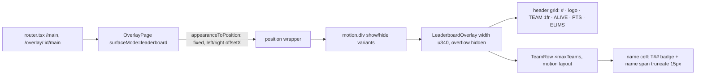

# Part 8 — Configurable Leaderboard Team Names, Extended Marquee Mode, Series Team Ordering & Additional Match Points: Audit & Proposal

**Author:** Claude Code (Engineering Assistant)
**Date:** 2026-10-22
**Project:** `chicken-dinner-feed`
**Status:** APPROVED 2026-10-22 and **IMPLEMENTED** (WS-8.1 – WS-8.8). See §15 for what was built, deviations from this proposal, verification evidence, and operator steps.

Evidence tags used throughout:

- **[CODE]** read directly from the repository (file + line range given).
- **[MEASURED]** observed by running the built app against an isolated copy of `backend/data` (see §2.2).
- **[RESEARCH]** taken from an external source linked in §3.
- **[INFERENCE]** a reasoned conclusion that has not been executed or observed.
- **[PROPOSAL]** a design decision put forward for approval.

---

## 1. Executive Summary

Part 8 adds four features that are mostly additive, but the audit turned up three constraints that the brief does not anticipate. Each one needs a decision before implementation (§13):

1. **The name column is far narrower than a 14-character default assumes.** [MEASURED] In the production `main` instance (right-anchored, logos off, slot badges on), the visible name text area is **77.3 design px**. Today 18 of the 25 roster names are already cut off by CSS at about 7 visible characters (`TIM HO…`). Fitting 14 characters into 77 px without changing the frame takes **≈ 8 px** text, against today's 15 px. With logos on, it takes **≈ 4.5 px**. Keeping the default of 14 and a fixed 340 px frame means the inner columns must be rebalanced, a small font must be accepted, or both (§6.2, Q1).
2. **Negative totals are currently impossible by schema.** [CODE] `ClosedMapTeamResult.totalPoints` and the live `Team.totalPoints` are both `.int().min(0)`. A snapshot that fails validation is silently dropped by every overlay, which freezes the overlay on air (`frontend/src/lib/live-connection.ts:110-119`). A penalty larger than a team's match points therefore needs an explicit policy: allow negative totals (relax both schemas and bump `PROTOCOL_VERSION`), or floor them at 0 (Q9).
3. **ADR-0015 forbids point overrides on closed-map edits.** [CODE] (`docs/adr/0015-multi-map-series-scoring.md:55-58`). Additional Points is designed as a separate, independently stored **input** that the existing re-derivation adds exactly once. It is not an override of derived totals. The ADR still has to be amended to record this (§9.5).

Everything else maps cleanly onto the existing architecture:

- **Settings** become per-instance `OverlayAppearance` fields with zod defaults. This is the pattern already used for `showLogos`, `maxTeams` and the other leaderboard settings.
- **Ordering** is a SeriesControl-owned view preference, persisted in `localStorage` (the existing `cdf.admin.*` pattern) and passed to `MapResultDialog` as a prop.
- **Additional Points** is a per-team field on each closed map. It feeds `totalPoints`, which every consumer already reads: series totals, live PTS, postgame, WWCD and the admin cards.

---

## 2. Baseline Quality Gates

### 2.1 Results (before any Part 8 change)

The baseline was run on 2026-10-22 against the working tree, which includes the user's uncommitted changes to `frontend/src/components/overlay/WwcdOverlay.tsx`, `frontend/src/components/overlay/overlays.test.tsx` and `CHANGELOG.md`, plus the untracked `Dockerfile` and `.dockerignore`. Part 8 will not revert or rewrite those changes.

| Gate                     | Command                | Result               | Notes                                                                                                                                    |
| :----------------------- | :--------------------- | :------------------- | :--------------------------------------------------------------------------------------------------------------------------------------- |
| Unit & integration tests | `npm run test`         | **398 / 398 passed** | Backend 308 tests / 26 files (16.2 s). Frontend 90 tests / 7 files (7.3 s).                                                              |
| Typecheck                | `npm run typecheck`    | **0 errors**         | `@cdf/shared`, `@cdf/backend`, `@cdf/frontend`.                                                                                          |
| Lint                     | `npm run lint`         | **0 diagnostics**    | oxlint (frontend only). It exits 0 and prints nothing on success.                                                                        |
| Formatting               | `npm run format:check` | **All files pass**   | No pre-existing Prettier issues (the 3 issues recorded in Part 7's baseline have since been fixed).                                      |
| Production build         | `npm run build`        | **Success**          | **Pre-existing warning:** the Vite chunk-size warning (`index-*.js` 713.94 kB > 500 kB). It is not a failure and is out of scope.        |
| E2E / browser tests      | —                      | **None exist**       | There is no Playwright or Cypress config. The frontend Vitest suite renders with `renderToStaticMarkup` (node), so it has no DOM layout. |

There are no pre-existing failures. Any Part 8 failure will be a regression.

### 2.2 Live layout measurement method

[MEASURED] `backend/data` was copied to a temp directory. The built backend (`node dist/index.js`) was started with `DATA_DIR=<temp>`, `PORT=4419` and `INGEST_SOURCE=mock`, and `/overlay/main` was opened in headless Chromium at **1920×1080**. Production data was only read, never written. The browser and server were shut down afterwards.

---

## 3. Research Findings

| #   | Source                                                                                                                                                                                                                                                                    | Finding                                                                                                                                                                                                                                                                                                                      | Applies here because                                                                                                                                                                                                                                                   |
| --- | ------------------------------------------------------------------------------------------------------------------------------------------------------------------------------------------------------------------------------------------------------------------------- | ---------------------------------------------------------------------------------------------------------------------------------------------------------------------------------------------------------------------------------------------------------------------------------------------------------------------------- | ---------------------------------------------------------------------------------------------------------------------------------------------------------------------------------------------------------------------------------------------------------------------- |
| R1  | [MDN — `text-overflow`](https://developer.mozilla.org/en-US/docs/Web/CSS/text-overflow)                                                                                                                                                                                   | The ellipsis is only painted when the block has `overflow` other than `visible` and `white-space: nowrap`. It is driven by **width**, not by character count.                                                                                                                                                                | `TeamRow`'s current Tailwind `truncate` is width-driven. It cannot enforce "max N characters", and its `…` is not counted. A JavaScript grapheme-based truncation is required. CSS overflow stays only as a last-resort guard against painting into the score columns. |
| R2  | [MDN — `Intl.Segmenter`](https://developer.mozilla.org/en-US/docs/Web/JavaScript/Reference/Global_Objects/Intl/Segmenter), [UAX #29](https://www.unicode.org/reports/tr29/)                                                                                               | `granularity: 'grapheme'` splits text into user-perceived characters (extended grapheme clusters). ZWJ emoji sequences, flags, and base + combining marks each count as one cluster.                                                                                                                                         | Counting graphemes means a family emoji or `e`+`◌́` is never split in half. It is available in Node 22 (backend tests) and Chromium (OBS CEF 127, R11).                                                                                                                 |
| R3  | [MDN — `<marquee>`](https://developer.mozilla.org/en-US/docs/Web/HTML/Reference/Elements/marquee)                                                                                                                                                                         | Deprecated. MDN recommends CSS animations with transforms, paired with `prefers-reduced-motion`.                                                                                                                                                                                                                             | The element itself is ruled out. The marquee will animate `transform` only.                                                                                                                                                                                            |
| R4  | [Ryan Mulligan — The Infinite Marquee](https://ryanmulligan.dev/blog/css-marquee)                                                                                                                                                                                         | A seamless loop uses two identical copies. The track is translated by exactly one copy plus its gap, then repeats. The duplicate is marked `aria-hidden`.                                                                                                                                                                    | This is the basis of the loop design. Because the end frame (−one copy) is pixel-identical to the start frame (0), the restart has no visible jump.                                                                                                                    |
| R5  | [MDN — `Element.animate()`](https://developer.mozilla.org/en-US/docs/Web/API/Element/animate), [Chromium `core/animation`](https://chromium.googlesource.com/chromium/src/+/aaddb9d9d236b7648e52be60180989c394515d00/third_party/blink/renderer/core/animation/README.md) | The Web Animations API takes per-element keyframe **offsets** and `iterations: Infinity`. Chromium drives CSS animations and WAAPI with the same timing engine.                                                                                                                                                              | Each name needs its own duration (distance ÷ speed) and its own hold offset. CSS `@keyframes` percentages cannot take a custom property, so WAAPI is the low-overhead way to get both. It has the same cost model as CSS animations and uses no React state per frame. |
| R6  | [web.dev — High-performance CSS animations](https://web.dev/articles/animations-guide)                                                                                                                                                                                    | `transform` and `opacity` animate on the compositor. Animating `width`/`left` triggers layout every frame.                                                                                                                                                                                                                   | The scrolling animates `transform` only. The panel width changes only when the configuration or roster changes, never per frame.                                                                                                                                       |
| R7  | [MDN — `prefers-reduced-motion`](https://developer.mozilla.org/en-US/docs/Web/CSS/Reference/At-rules/@media/prefers-reduced-motion)                                                                                                                                       | The media feature exposes the OS "reduce motion" setting.                                                                                                                                                                                                                                                                    | This conflicts with the project's existing policy (§5.4, Q7).                                                                                                                                                                                                          |
| R8  | [React — `useLayoutEffect`](https://react.dev/reference/react/useLayoutEffect)                                                                                                                                                                                            | Runs before the browser repaints, so a measured layout is applied without a visible intermediate frame. The docs warn about the cost and recommend using it sparingly.                                                                                                                                                       | Measurement runs once per **configuration/roster change**, not per live snapshot (2 Hz), so the first painted frame is already final.                                                                                                                                  |
| R9  | [MDN — `document.fonts`](https://developer.mozilla.org/en-US/docs/Web/API/Document/fonts), [MDN — `measureText`](https://developer.mozilla.org/en-US/docs/Web/API/CanvasRenderingContext2D/measureText)                                                                   | `FontFaceSet.ready` resolves once pending web fonts have loaded. Text metrics taken before that point describe the fallback font.                                                                                                                                                                                            | Fonts are loaded live from Google Fonts or uploaded (ADR-0016, FontStore). Measurement waits for `fonts.ready` and re-runs once on `loadingdone`.                                                                                                                      |
| R10 | [React — Sharing state between components](https://react.dev/learn/sharing-state-between-components)                                                                                                                                                                      | Lift shared state to the closest common parent as a single source of truth.                                                                                                                                                                                                                                                  | `SeriesControl` is the parent of `MapResultDialog` (§7.1), so the order mode lives there. No global store is needed.                                                                                                                                                   |
| R11 | [OBS 31.0 release notes](https://obsproject.com/blog/obs-studio-31-0-release-notes)                                                                                                                                                                                       | The OBS browser source uses CEF/Chromium **127**.                                                                                                                                                                                                                                                                            | `Intl.Segmenter` (Chromium 87+), WAAPI and CSS masks are all available in the broadcast renderer.                                                                                                                                                                      |
| R12 | [MDN — `Array.prototype.sort`](https://developer.mozilla.org/en-US/docs/Web/JavaScript/Reference/Global_Objects/Array/sort), [V8 — stable sort](https://v8.dev/features/stable-sort)                                                                                      | Sorting has been stable since ES2019. The comparator must still define a consistent total order.                                                                                                                                                                                                                             | Every ordering mode ends on `teamNo`, a unique key, so the order is deterministic no matter what the input order was.                                                                                                                                                  |
| R13 | [PUBG Esports — Penalty ruling, 17Gaming & Tianba (2024-12-16)](https://pubgesports.com/en/news/8107)                                                                                                                                                                     | The deduction was a discretionary administration ruling ("1 Warning (2-point deduction)") applied to **one specific match**: each team's first match of the next circuit.                                                                                                                                                    | This supports modelling the adjustment as a separate, per-team, per-match input with an audit trail, distinct from the ruleset-derived placement and kill points.                                                                                                      |
| R14 | [2026 PGS Tournament Rulebook (2026-03-12)](<https://wstatic-prod-boc.krafton.com/common/default/20260313/tt9LILaK/2026%20PUBG%20Global%20Series_Tournament_Rules(0312).pdf>), §8 "Types of Penalties", §11.13 "Tiebreaker"                                               | Penalties are "at the sole discretion of the Administration", e.g. "Warning — 2 PUBG points are deducted per instance". The tiebreaker chain is: match ranking by total match points, then placement; accumulated ranking by total, then placement points, then most-recent-match points, then most-recent placement points. | **These are PGS (PC) rules, not PMCC rules.** They show that deductions are discretionary and match-specific. They do not set a PMCC penalty value. PMCC's existing tie-break chain is kept as is (§9.6).                                                              |
| R15 | [Chakra UI — Marquee](https://chakra-ui.com/docs/components/marquee)                                                                                                                                                                                                      | Mature marquee components set speed in **px/s** (constant velocity), not as a fixed duration.                                                                                                                                                                                                                                | A long name gets a proportionally longer cycle at the same reading speed, as the brief requires ("a single fixed duration" is rejected).                                                                                                                               |

**Rejected after research:**

- A fixed 25 s CSS marquee, the existing `cdfWwcdMarquee` in `FullscreenWwcdOverlay.tsx:72-80`. It suits a decorative ribbon, but name lengths vary by 10× and would scroll at 10× different speeds.
- A JavaScript interval or `requestAnimationFrame` loop that sets React state. This is forbidden by the brief, and it also re-renders a table that already updates at 2 Hz.
- A third-party marquee dependency. The existing stack covers the need.

---

## 4. Current Architecture (Audit)

### 4.1 `/overlay/main` rendering path



| Concern                  | Location                                                                            | Fact                                                                                                                                                                                                                                                             |
| ------------------------ | ----------------------------------------------------------------------------------- | ---------------------------------------------------------------------------------------------------------------------------------------------------------------------------------------------------------------------------------------------------------------- |
| Panel geometry           | `frontend/src/components/overlay/overlay-scale.ts:33-53`                            | `panelWidth 340`, `paddingX 10`, `rowHeight 44`, columns: `rank 26`, `logo 28`, `alive 62`, `points 42`, `elims 50`. Units are design px × `--overlay-unit` (ADR-0011).                                                                                          |
| Panel                    | `LeaderboardOverlay.tsx:47-59`                                                      | `width: u(M.panelWidth)`, 1 px border, `overflow: hidden`.                                                                                                                                                                                                       |
| Grid columns             | `LeaderboardOverlay.tsx:40-42`, `TeamRow.tsx:37-39`                                 | The same template appears in two places: `rank [logo] 1fr alive points elims`, `columnGap 6`. The TEAM column is the only flexible (`1fr`) column.                                                                                                               |
| Name rendering           | `TeamRow.tsx:98-123`                                                                | Flex cell with `min-w-0`: an optional `T##` badge (`fontSize 9.5`, `shrink-0`) followed by the name span `truncate font-bold uppercase tracking-wide`, `fontSize u(15)`.                                                                                         |
| Row motion               | `TeamRow.tsx:45-46`                                                                 | `layout` (Motion) animates rank changes. It also animates **size** changes with a scale transform. **[INFERENCE]** A panel width change would therefore briefly stretch the row text unless this becomes `layout="position"`.                                    |
| Positioning              | `appearance.ts:42-55`; `OverlayPage.tsx:546-566`                                    | `position: fixed`, `left` or `right` = `offsetX × base-unit`, vertically centred or `offsetY`. The offset uses the **base** unit; the panel uses the **scaled** unit.                                                                                            |
| Ranking                  | `LeaderboardOverlay.tsx:25-31`                                                      | The overlay never sorts. The backend's ranked `match.teams` is rendered as given (ADR-0007).                                                                                                                                                                     |
| Settings schema          | `shared/src/config/overlay-instance.ts:121-173` (appearance), `:269-300` (defaults) | Every leaderboard option is a per-instance appearance field. Newer fields use `.default(...)` so older files parse.                                                                                                                                              |
| Persistence & validation | `backend/src/routes/config.ts:113-137`                                              | `PUT /api/config/instances/:id` validates the body with `overlayInstanceSchema` (zod) and saves `overlay-instances.json`. The live hub pushes instances to every browser source without a refresh.                                                               |
| Admin editor             | `frontend/src/features/admin/AppearanceEditor.tsx:340-470`                          | Numeric inputs (`offsetX`, `maxTeams`) use `Number(event.target.value)` with **no client-side validation** (L361-368, L459-466). Saving goes through `InstanceToolbar` → `AdminPage.saveInstance`.                                                               |
| Reduced motion           | `frontend/src/styles/globals.css:263-277`                                           | **A documented project policy:** overlays deliberately ignore `prefers-reduced-motion` ("an operator cannot opt out of motion on behalf of the audience"), while the admin respects it. The user's uncommitted `WwcdOverlay.tsx` does call `useReducedMotion()`. |
| Versions                 | `shared/src/versions.ts:16,24`                                                      | `PROTOCOL_VERSION = 10`, `CONFIG_SCHEMA_VERSION = 5`. ADR-0015 L71-75 records that bumping the shared config version once re-triggered every migration and corrupted `overlay-instances.json`. Additive fields therefore use zod defaults and no version bump.   |

### 4.2 Measured baseline at 1920×1080 (production `main` instance settings)

[MEASURED] Production `main` settings (read-only, from `backend/data/overlay-instances.json`): `anchor: right`, `offsetX: 24`, `scale: 1`, `showLogos: false`, `showTeamNumbers: true`, `maxTeams: 25`, font `Inter`.

| Quantity                              | Value                                                                                                  |
| ------------------------------------- | ------------------------------------------------------------------------------------------------------ |
| Panel box                             | x 1556 → 1896 (340 px); right edge 24 px from the canvas edge                                          |
| Name cell (`1fr`)                     | 112.0 px                                                                                               |
| `T##` badge + gap                     | 29.7 + 5 px                                                                                            |
| **Name text area**                    | **77.3 px**                                                                                            |
| Name font                             | Inter 700, 15 px, uppercase, letter-spacing 0.375 px (0.025 em)                                        |
| Names clipped today                   | **18 / 25** (e.g. `LANANG NAK CHICKEN MAIN PUBG` needs 274.8 px; ~7 characters are visible)            |
| Average glyph advance (Inter 700, UC) | 0.691 em (A–Z, 0–9, space); 0.726 em (A–Z); `...` = 1.077 em                                           |
| Example `Lanang nak ...` at 15 px     | 125.8 px (fits 77.3 px only at **≈ 9.2 px**)                                                           |
| Widest 14-char roster name            | `PENYETAN ALLAN` 141.3 px at 15 px                                                                     |
| Pre-existing defect (out of scope)    | 25 rows × 44 + header + legend = 1177 design px > 1080, so row 25 and the legend fall below the canvas |

Font size needed so that **L** average characters fit (`S = A ÷ (L × 0.691)`), in design px:

| Geometry                                                | Name area A | L = 8 | L = 10 | L = 12 | **L = 14** | L = 16 |
| ------------------------------------------------------- | ----------: | ----: | -----: | -----: | ---------: | -----: |
| Production (logos off, badges on), current columns      |        77.3 |  14.0 |   11.2 |    9.3 |    **8.0** |    7.0 |
| Logos on, badges on, current columns                    |        43.3 |   7.8 |    6.3 |    5.2 |    **4.5** |    3.9 |
| Logos off, badges off                                   |       112.0 |  20.2 |   16.2 |   13.5 |   **11.6** |   10.1 |
| Production + rebalanced columns (Q1 option B, ≈ +26 px) |      ≈103.3 |  18.7 |   15.0 |   12.5 |  **≈10.7** |    9.3 |
| Option B + badge moved under the rank (Q1 option C)     |      ≈134.0 |  24.2 |   19.4 |   16.2 |  **≈13.9** |   12.1 |

**Conclusion:** at a 14-character default, "frame width fixed" and "legible broadcast text" cannot both hold with today's inner columns. This is decision Q1.

### 4.3 Series Control, ordering and Correct This Map

| Concern                    | Location                                                                                              | Fact                                                                                                                                                                                                                                                                                                                                                                   |
| -------------------------- | ----------------------------------------------------------------------------------------------------- | ---------------------------------------------------------------------------------------------------------------------------------------------------------------------------------------------------------------------------------------------------------------------------------------------------------------------------------------------------------------------- |
| Component tree             | `AdminPage.tsx:1127` → `SeriesControl` → `MapResultDialog` (`SeriesControl.tsx:193-229`)              | The dialog is a direct child and takes every input as a prop. It renders `teamNos` "in the order they should be listed" (`MapResultDialog.tsx:24-25`).                                                                                                                                                                                                                 |
| Current standings          | `SeriesControl.tsx:49,59,303-327`                                                                     | No local sort. Rows follow `snapshot.match.teams`, which the backend ranks with `computeStandings` (`backend/src/scoring/standings.ts:201-210`): appeared first, then `totalPoints` (series-inclusive), then this map's `eliminations`, then `name`.                                                                                                                   |
| Finished-map cards         | `SeriesControl.tsx:353-359`                                                                           | Sorted locally by match points → kill points → placement → `teamNo` (Part 7 Feature D). The comparator is **duplicated** in `broadcast-state.ts:369-374` and `:419-424`.                                                                                                                                                                                               |
| Correct This Map row order | `SeriesControl.tsx:62-68`                                                                             | Edit mode follows the stored `map.teams` array order. That is the live rank at close time for an auto-closed or "Close now" map, ascending `teamNo` for a hand-added map, or the sheet order for an Excel import. Add mode uses ascending `teamNo`. The comment at L62-64 explains why: a list that reorders under the operator is the wrong thing to transcribe from. |
| Identity                   | `SeriesControl.tsx:120-160`, `MapResultDialog.tsx:92-123`                                             | Every row key, value map and change handler is keyed by **`teamNo`**. Row indexes are never used.                                                                                                                                                                                                                                                                      |
| Dialog team label          | `SeriesControl.tsx:84-85,204`                                                                         | **Defect relevant to identity:** the edit dialog labels each row with the **current** live roster name for that `teamNo`, but the card above it shows the closed map's snapshot `name` (`:368`). After a roster renumber, the dialog row "T05" can show a different team than the one the stored result belongs to.                                                    |
| Canonical team order       | `shared/src/config/team-roster.ts:12-29`; `roster-reorder.ts` (`applyRippleShift`, `applyDirectSwap`) | `teamNo` (1–25) is the only ordering key. Drag-and-drop renumbers `teamNo` itself and saves only on **Save teams**. Nothing reads the roster array order.                                                                                                                                                                                                              |
| View-preference precedent  | `ManualControl.tsx:24,42-49`; `MatchConfigBar.tsx:8`; `AdminPage.tsx:39`                              | Admin view preferences use `useState` + `localStorage` under `cdf.admin.*` keys. Admin uses no zustand preference slice and no URL params.                                                                                                                                                                                                                             |
| Series refresh             | `SeriesControl.tsx:70-82`                                                                             | `seriesDocument` comes from REST on mount and from mutation responses. **[INFERENCE, pre-existing]** A map closed automatically by the backend appears only after the tab remounts. Out of scope; noted.                                                                                                                                                               |

### 4.4 Scoring pipeline relevant to Additional Points

| Concern                  | Location                                                                                                   | Fact                                                                                                                                                                                                                                                                    |
| ------------------------ | ---------------------------------------------------------------------------------------------------------- | ----------------------------------------------------------------------------------------------------------------------------------------------------------------------------------------------------------------------------------------------------------------------- |
| Closed-map record        | `shared/src/domain/series.ts:12-26`                                                                        | Fields: `teamNo`, `placement`, `eliminations` (inputs); `killPoints`, `placementPoints`, `totalPoints` (derived, all `.int().min(0)`); `name`, `logoUrl` (identity snapshot).                                                                                           |
| Re-derivation            | `backend/src/state/series-store.ts:45-82` (`resultsFromEdits`)                                             | Shared by **edit** and **add by hand**. Points are recomputed from the inputs plus the current ruleset; `name`/`logoUrl` carry over from `existingTeams`. Duplicate placements and teams are rejected.                                                                  |
| Edit endpoint            | `backend/src/routes/series.ts:18-26,146-171`                                                               | `PUT /api/series/maps/:mapId`, body `{ teams: { teamNo, placement, eliminations }[] }`. A full replace; the team set must equal the original. No ETag, no audit log.                                                                                                    |
| Live close               | `series-store.ts` `persistClosedMap` (~L470-510)                                                           | `totalPoints = killPoints + placementPoints`; the series total is deliberately excluded (ADR-0015 L49-54).                                                                                                                                                              |
| Series totals            | `series-store.ts:144-152`                                                                                  | `getSeriesTotals` sums `closedMap.team.totalPoints`. It is recomputed on every call and never cached (ADR-0015).                                                                                                                                                        |
| Live PTS                 | `standings.ts:174-191`                                                                                     | `earnedKill + earnedPlacement + seriesPoints`. Banking (`series-store.ts:170-185`) nets only `killPoints`/`placementPoints` of the same `matchId`.                                                                                                                      |
| Postgame match           | `broadcast-state.ts:354-374`                                                                               | `totalMatchPoints = entry.totalPoints`; ranks by total → `killPoints` → placement → `teamNo`.                                                                                                                                                                           |
| Postgame series          | `broadcast-state.ts:485-590`                                                                               | Totals are summed from `entry.totalPoints`. Tie-breaks: total → WWCD → Σ placement pts → Σ kill pts → latest placement → `teamNo`.                                                                                                                                      |
| On-air arithmetic labels | `PostGameOverlay.tsx:493-494,639-644`; `PostGameSeriesOverlay.tsx:638-643`                                 | Columns `P.PTS` / `E.PTS` / `MATCH` (or `TOTAL`), plus the label `SINGLE-MATCH SCORE ({P}P + {E}E)`.                                                                                                                                                                    |
| Non-negative constraint  | `series.ts:17-19`, `shared/src/domain/team.ts:26-33`, `standings.ts:177-183`, `live-connection.ts:110-119` | A negative total fails `JsonDocument.write` validation, and a negative live total gets the snapshot dropped client-side, which freezes the overlay.                                                                                                                     |
| Migrations               | `backend/src/persistence/migrations.ts:225-232`                                                            | `series.json` uses `migrateSchemaVersionOnly`. A new field with `.default()` needs no migration. Precedent: `matchId ... .default(null)` (`series.ts:61`).                                                                                                              |
| Backup                   | `backend/src/backup/export.ts`, `import.ts` (scout report)                                                 | `series.json` is written verbatim and parsed with `seriesDocumentSchema` on import, so new fields round-trip. Old backups get the default. **[INFERENCE]** A newer backup restored into an older app version loses the field silently, because zod strips unknown keys. |
| Excel export             | `backend/src/excel/export.ts:93-146`                                                                       | Per-round and grand totals are **recomputed from placement + kills with the current ruleset**. Stored `totalPoints` is ignored, so any adjustment would be lost in the sheet.                                                                                           |
| Excel import             | `backend/src/excel/import.ts` (~L340-381, scout report)                                                    | Reads placement and kills only, rebuilds results from the ruleset, and **replaces all closed maps**.                                                                                                                                                                    |
| Audit log                | grep across all workspaces                                                                                 | **None exists.** The admin has no authentication (ADR-0008), so there is no operator identity.                                                                                                                                                                          |

---

## 5. Feature A — Configurable Team-Name Display (Normal Mode)

### 5.1 Settings [PROPOSAL]

Per-instance `OverlayAppearance` fields, edited in **Overlays → `main` → Typography & rows** (shown only for `leaderboard` instances, like `maxTeams`) and saved with the existing Save button:

| Field                  | Type / bounds                  | Default | Rationale                                                                                                                                                                                                                                                                                       |
| ---------------------- | ------------------------------ | ------: | ----------------------------------------------------------------------------------------------------------------------------------------------------------------------------------------------------------------------------------------------------------------------------------------------- |
| `teamNameMaxChars`     | integer **6 – 32** (graphemes) |  **14** | Below 6 leaves at most 3 name characters plus `...`. At 32 nothing is ever cut, because `TEAM_NAME_MAX_LENGTH = 32` (zod counts UTF-16 units, so a 32-unit name never has more than 32 graphemes).                                                                                              |
| `teamNameExtendedMode` | boolean                        | `false` | §6.                                                                                                                                                                                                                                                                                             |
| `teamNameMaxExtension` | integer **0 – 480** design px  | **200** | 200 fits the longest current roster name (`LANANG NAK CHICKEN MAIN PUBG`, 18.3 em) at any size up to the 15 px maximum in geometry B. 480 keeps the panel ≤ 820 px (≤ 43 % of 1920), so it can never reach the centre of the canvas from a side anchor. 0 means "scroll in place, never widen". |

- **Validation.** The backend enforces these bounds through `overlayInstanceSchema` (zod `.int().min().max()`; invalid input returns 400). The frontend validates with the same exported constants: inline error text, Save disabled while any field is invalid, and no silent coercion. The existing `offsetX`/`maxTeams` inputs are left unchanged (scope).
- **Backward compatibility.** Each field has a zod `.default()`, so an existing `overlay-instances.json` parses to `14 / false / 200`. No migration and no `CONFIG_SCHEMA_VERSION` bump, per the ADR-0015 lesson.
- **Scope.** Settings apply per instance, so every browser source of `main` (`/main`, `/overlay/main`, `/overlay/main/main`) shows the same result. Other leaderboard instances keep the defaults until edited. Final-4, WWCD, postgame, elimination, roster, database, history and exports are untouched. The stored team name is never modified.

### 5.2 Truncation algorithm [PROPOSAL]

```
display(name, L):
  n = name.trim() with internal whitespace runs collapsed to one space   // what HTML renders anyway
  g = graphemes(n) via Intl.Segmenter('grapheme')
  if |g| ≤ L: return n                                                   // short / exactly-at-limit: unchanged
  return join(g[0 .. L-3)) + "..."                                       // exactly L graphemes incl. the 3 dots
```

- `Lanang nak chicken main pubg`, L = 14 → `Lanang nak ...` (11 graphemes + `...` = 14). This matches the brief's example exactly, including the space before the dots (Q3 confirms whether that space is kept).
- Emoji and accents: `👨‍👩‍👧` and `é` (`e`+U+0301) each count as **1** and are never split.
- CSS `uppercase` still does the visual casing. **Known edge case:** `ß` uppercases to `SS`, so a German `ß` displays one glyph wider than it counts. This is documented and accepted.
- The full, untruncated name is exposed as the row's accessible name (`aria-label`/`title`), so truncation never changes identity for tooling or tests.

### 5.3 Font sizing across rows [PROPOSAL]

**One uniform name font size for every row, derived from the configured limit, never from which teams happen to be on screen:**

```
S = clamp(S_min, S_max, A ÷ (L × a_em))
```

- `A` is the normal-mode name text area in design px. It is computed from the metrics plus the measured badge width, not read back from a possibly-extended DOM, so there is no feedback loop.
- `L` is `teamNameMaxChars`.
- `a_em` is the instance font's average uppercase advance, measured once per font family with a hidden probe at 100 px after `document.fonts.ready`.
- `S_max = 15` is today's design size, so short limits never enlarge the text beyond the current look. `S_min` depends on Q1: **9 / 10 / 11 px**.

**Why limit-derived:** the brief says "a name must not become smaller simply because another row has a longer name". Sizing from the widest actual name would shrink every row whenever one long-named team was added. Sizing from the limit gives the operator one predictable rule: "limit 14 → names at X px".

**Per-row guarantee, no overlap and no font change:**

1. If a specific display string is still wider than `A` at `S` (only possible for unusually wide glyphs, e.g. `WWWWWWWWWWW...`, or when `S` hit `S_min`), **that row alone** is fit-truncated further. It keeps the largest grapheme prefix + `...` that fits `A`, found by binary search on measured widths. Its font size stays `S`.
2. The name span keeps `min-width: 0; overflow: hidden` as a final paint guard, so text can never paint into the ALIVE/PTS/ELIMS columns.

The displayed character count therefore never exceeds `L`, the font is the same on every row, and the right-side columns never move.

**Measurement lifecycle:**

- Inputs: font family, fonts-loaded event, limit, `showLogos`, `showTeamNumbers`, extended mode, max extension, anchor/offset/scale, and the **sorted list of all team names in the snapshot**. All teams are used, not only the visible `maxTeams`, so standings changes never resize anything.
- A memoised key over these inputs runs a single `useLayoutEffect` per change. One extra render when inputs change; zero work on the 2 Hz snapshot updates.
- SSR / static-markup tests (no layout) fall back to the grapheme truncation at `S_max` behind the CSS guard. The pure functions are unit-tested separately.

### 5.4 Geometry options for the fixed 340 px frame (Q1)

| Option                                    | Inner change (frame stays 340 px, right edge unchanged)                                                                                                   | Production config, L = 14                                           | Logos on, L = 14      |
| ----------------------------------------- | --------------------------------------------------------------------------------------------------------------------------------------------------------- | ------------------------------------------------------------------- | --------------------- |
| **A** — keep columns                      | None. `S_min = 9`.                                                                                                                                        | ≈ 8.0 px → floored to 9, long names fit-truncated to ≈ 12 graphemes | 9 px, ≈ 6–7 graphemes |
| **B** — rebalance slack (recommended)     | ALIVE 62→50 (the bars need 48), ELIMS 50→44 (the header needs ≈ 40), column gap 6→4. Header and rows share the metrics, so alignment holds. `S_min = 10`. | ≈ 10.7 px, all 14-char roster names fit                             | 10 px, fit-truncated  |
| **C** — B + slot badge stacked under rank | B, plus the `T##` badge moves from the name cell to under the rank number (rank column 26→30).                                                            | ≈ 13.9 px                                                           | ≈ 10.5 px             |

---

## 6. Feature B — Extended Mode & Continuous Marquee

### 6.1 Behaviour [PROPOSAL]

| State              | Frame                                                                                                                                                               | Name                                                                                                                                                                                                                    |
| ------------------ | ------------------------------------------------------------------------------------------------------------------------------------------------------------------- | ----------------------------------------------------------------------------------------------------------------------------------------------------------------------------------------------------------------------- |
| **OFF (default)**  | 340 px                                                                                                                                                              | §5: limit + `...`, uniform `S`.                                                                                                                                                                                         |
| **ON**             | `340 + ext`, where `ext = clamp(0, maxExt_eff, ceil(max_i W_i − A))` and `W_i` is the full width of team _i_'s normalised name at `S`, over **all** snapshot teams. | Same `S` as normal mode (never shrunk to fit). No `...`. A name with `W_i ≤ A + ext` is static and does not scroll; a longer name scrolls inside `A + ext` (Q4 confirms "extend first, scroll only if still too long"). |
| **ON → OFF**       | Back to 340 px on the next render. No stored extended state exists; width is derived from settings every render.                                                    | Truncation and `S` return immediately; each marquee unmounts and its animation is cancelled.                                                                                                                            |
| **OFF → ON again** | Recomputed from current settings. No refresh needed.                                                                                                                | New animations are created per row.                                                                                                                                                                                     |

- The **character limit stays active in extended mode** because it defines `S` (and therefore the normal-width baseline `A`). This is the literal reading of "font size remains consistent with the normal mode's intended name font size".
- The panel width changes only when settings or the roster change, never during play, so the overall geometry stays stable.
- **Row motion:** `TeamRow` switches from `layout` to `layout="position"`. Rank slides keep animating; width changes snap instead of scale-stretching text. To be verified in the browser.

### 6.2 Leftward extension and right-edge preservation [PROPOSAL]

- **Right-anchored** (production `main`): `right: offsetX` is already the fixed edge, so a wider panel grows leftward by construction. The right-side columns (ALIVE/PTS/ELIMS) and the panel's right edge do not move. This will be verified by measuring `getBoundingClientRect().right` before and after toggling.
- **Left-anchored:** the position wrapper keeps `left: offsetX`. The panel gets `margin-left: −ext`, so its right edge stays put. Because offsets use the base unit and the panel uses the scaled unit, the extension is clamped to `maxExt_eff = min(teamNameMaxExtension, offsetX ÷ scale)`, so the panel never leaves the canvas. With the default `offsetX 24` this allows only 24 px of extension; the admin shows the effective limit next to the field (Q6).
- The right-anchored clamp `ext ≤ (1920 − offsetX) ÷ scale − 340` keeps very large values on-canvas too.
- **Overlap with other broadcast elements:** this cannot be known in code. It is bounded by `teamNameMaxExtension` and visible in the admin preview (ADR-0013 embeds the real overlay; it shows the **saved** state, as it does today).

### 6.3 Marquee mechanics [PROPOSAL]

```
viewport (overflow:hidden, width A+ext, soft 6px edge masks)
└─ track (inline-flex, width max-content, will-change: transform)
   ├─ <span>NAME</span><span aria-hidden> • </span>
   └─ <span aria-hidden>NAME</span><span aria-hidden> • </span>
```

| Parameter      | Value                                                                                                                                                                         |
| -------------- | ----------------------------------------------------------------------------------------------------------------------------------------------------------------------------- |
| Direction      | Right → left (`translateX` 0 → −D).                                                                                                                                           |
| Distance `D`   | `W_i + G`, one copy plus its gap, measured in px. `G = 2 em` at `S`, with a muted centred `•` separator (removable).                                                          |
| Speed          | **40 design px/s** (× unit px, so it is resolution independent). Constant velocity: duration = `D ÷ v`, so longer names take proportionally longer, never faster.             |
| Hold           | **1.5 s at the start of every cycle**, with the first letter at the left edge: WAAPI keyframes `{0: x0}`, `{H/(H+T): x0}`, `{1: −D}`, linear, `iterations: Infinity`.         |
| Seamlessness   | At −D, copy 2 sits exactly where copy 1 started (R4), so the wrap from −D back to 0 is pixel-identical. The hold therefore happens on an identical frame and shows no jump.   |
| Staleness      | One `useLayoutEffect` per row with deps `[text, S px, D px, speed, hold]`. Cleanup calls `animation.cancel()`. Rows are keyed by `teamNo`, so no two rows share an animation. |
| Cost           | Transform-only, compositor-driven (R5/R6). No React state per frame; nothing re-measures on the 2 Hz snapshots.                                                               |
| A11y           | The duplicate copy and the separators are `aria-hidden`. The row's accessible name is the full team name.                                                                     |
| Reduced motion | See Q7. The project policy (`globals.css:263-277`) says overlays always animate. WAAPI is **not** covered by that CSS rule, so either choice must be implemented explicitly.  |

---

## 7. Feature C — Series Control Ordering Mode

### 7.1 Design [PROPOSAL]

- **State:** `type SeriesOrderMode = 'standings' | 'teamNo'`, owned by `SeriesControl`, persisted in `localStorage['cdf.admin.series.teamOrder']`, default `'standings'`. It follows the existing `cdf.admin.*` pattern (`ManualControl.tsx:24,42-49`). It is an **admin view preference**: per browser, never sent to the server, and it never affects overlays.
- **UI:** a segmented control ("Current standings | Team order T01→T25", copying the `ManualControl` `aria-pressed` group) above the Current standings table, mirrored inside `MapResultDialog` through its existing `children` slot. Both bind to the same state.
- **One helper, no new comparators:** `orderTeamNos(teamNos, mode, standingsTeamNos)`.
  - `'standings'` reuses the backend ranking already present in `snapshot.match.teams` (`computeStandings`). Teams absent from current standings (e.g. deleted since) are appended by `teamNo`.
  - `'teamNo'` sorts ascending by `teamNo`.
  - The function is pure, never mutates its input, and ends on the unique `teamNo`, so it is deterministic (R12).
- **Duplication cleanup:** the match-result comparator copied three times (`broadcast-state.ts:369-374`, `:419-424`, `SeriesControl.tsx:353-359`) becomes one exported `compareMatchResults`.

### 7.2 Where the mode applies

| Surface                 | `standings`                                                                   | `teamNo`                        |
| ----------------------- | ----------------------------------------------------------------------------- | ------------------------------- |
| Current standings table | Unchanged backend order                                                       | Slot order                      |
| Correct This Map dialog | Current standings order (the brief's "corresponding current standings order") | Slot order recorded in that map |
| Add map by hand dialog  | Current standings order                                                       | Slot order (today's behaviour)  |
| Finished-map cards      | Q8                                                                            | Q8                              |

### 7.3 Safety rules

1. **Identity:** rows, values and payloads stay keyed by the map's own `teamNo`. The display order is computed only from `teamNo` lists, never from indexes.
2. **Frozen order while editing:** the dialog's row order is captured when it opens and recomputed only when the operator switches the mode. A live snapshot that changes the standings mid-edit therefore cannot move a row under the cursor. This respects the existing rationale in `SeriesControl.tsx:62-64`.
3. **Snapshot labels:** the edit dialog shows each row's closed-map snapshot `name` (falling back to the roster name), matching the card. This fixes the renumber mislabel described in §4.3.
4. Switching modes performs **no writes**: no roster save, no series write, no score change. DnD/swap/step reorder in the Teams tab is untouched.
5. **After a roster renumber,** a closed map's `teamNo` is the slot at close time. In `standings` mode the row is positioned where that slot's **current** holder ranks. This is cosmetic only: the correction still targets the map's recorded `teamNo`, and the snapshot name makes this visible.

---

## 8. Feature D — Additional Points

### 8.1 Data model [PROPOSAL]

On `closedMapTeamResultSchema` (`shared/src/domain/series.ts`):

```ts
/** Discretionary admin bonus (+) or penalty (−) for this map. An independent input, never derived. */
additionalPoints: z.number().int().min(-100).max(100).default(0),
/** Optional operator reason, shown in admin (Q10). */
adjustmentNote: z.string().trim().max(120).optional(),
/** Epoch ms of the last change to additionalPoints/adjustmentNote; null if never adjusted. */
adjustedAt: z.number().int().nullable().default(null),
/** = killPoints + placementPoints + additionalPoints — always re-derived, never accepted. */
totalPoints: z.number().int() /* .min(0) only if Q9 = floor */,
```

- **Integers only.** Every scoring quantity in the app and the official workbook is an integer (`scoring.ts:17,23`; Excel ladders). Bounds are **−100 … +100**: a PMCC map yields at most ~10 placement points plus kills, so ±100 covers forfeiting a whole map's points with margin while still catching typos such as `500`.
- `killPoints` and `placementPoints` remain the **official** ruleset values. The adjustment is visible on its own for auditing.
- `.default(0)` / `.default(null)` mean every existing `series.json`, backup and Excel-imported map parses as **no adjustment**, and its stored `totalPoints` is read back **unchanged**. There is no recompute on load.

### 8.2 API & recalculation semantics [PROPOSAL]

- `PUT /api/series/maps/:mapId` and `POST /api/series/maps` accept `additionalPoints?: int −100…100` and `adjustmentNote?: string ≤ 120` per team. zod rejects strings, non-integers, NaN and Infinity (JSON cannot carry the latter two) with a 400.
- **Omitted ≠ zero on edit.** On `PUT`, an omitted `additionalPoints` **keeps the existing value**, carried over exactly like `name`/`logoUrl` in `resultsFromEdits`. A stale admin tab or older API client therefore cannot silently wipe a penalty. An explicit `0` clears it. On `POST` (new map), omitted means 0.
- `resultsFromEdits` computes `totalPoints = killPoints + placementPoints + additionalPoints` from the **inputs** every time. Replaying the same `PUT` (repeated finalise or recalc) yields byte-identical results, and nothing ever adds to a previous total, so nothing compounds.
- `adjustedAt` is set to `Date.now()` only when the value or note differs from the stored one; otherwise the stored value is carried over.
- `persistClosedMap` (live close) writes `additionalPoints: 0`, `adjustedAt: null`. Adjustments are applied only through Correct This Map or Add map by hand.
- Live PTS needs no change. `getSeriesTotals` sums `totalPoints`, so an adjustment enters live PTS exactly once through `seriesPoints`. Banking nets only kill/placement points, so a still-displayed, just-closed match is not double-counted ([INFERENCE] from `series-store.ts:170-185`, `standings.ts:184-191`; this becomes a regression test).
- **Server log line:** on every change, the series route logs `{mapId, mapNumber, teamNo, name, from, to, note}` through the existing pino logger. This is a zero-UI audit trail in the backend log.

### 8.3 Admin UX [PROPOSAL]

- **`MapResultDialog`** gets a third column, **"Adj. pts"**, with header help text: "Bonus (+) or penalty (−) added to this team's calculated match points. Placement and elims are not changed."
  - The input is `type="text"` with `inputMode="numeric"`. A `type="number"` field reports `""` while `-` is being typed, and the existing `parsedOr` turns that into `0`, which makes negative entry impossible.
  - A per-row draft string is validated strictly with `/^[+-]?\d{1,3}$/` plus the bounds. Errors are shown inline on the row, and **Save correction** stays disabled with a count of invalid rows.
  - An empty field is an **error**, not a silent zero. A per-row **Reset to 0** button clears an adjustment explicitly.
  - Optional reason field (Q10).
- **Finished-map cards** get an **Adj** column showing `+5` / `−10` (accent or destructive colour, `—` for 0), with the reason and time as a tooltip. `Match Pts` remains the final value.

### 8.4 Broadcast & export treatment

- **Overlays.** Values follow automatically from `totalPoints`: postgame match `MATCH`, postgame series `TOTAL`, the WWCD card and fullscreen `MATCH PTS`, and the main leaderboard PTS. **Arithmetic shown on air** (`P.PTS + E.PTS ≠ MATCH` once an adjustment exists) needs Q11.
- **Backup.** Round-trips automatically (verbatim `series.json` + schema parse). Old backups restore with 0.
- **Excel (decided, Q12 = official only + warnings).** The export keeps the official placement + kills formulas unchanged. When any closed map has a non-zero adjustment, the export reports which teams and maps carry adjustments that the sheet does not include, so the operator knows the sheet's totals and ranks will differ from the broadcast. The import preview warns that any existing adjustments in the maps it replaces will be reset to 0.

### 8.5 ADR

A new **ADR-0018 "Additional points as an independent closed-map input"** will amend ADR-0015 L55-58. Points are still never accepted as an override. `additionalPoints` is a fourth raw input, alongside `placement`/`eliminations`, from which `totalPoints` is re-derived.

### 8.6 Ranking & tie-breaking (unchanged keys)

| Ranking                                    | Primary key (now includes adjustment)                                                    | Tie-break chain (official, unaffected by adjustment)                                |
| ------------------------------------------ | ---------------------------------------------------------------------------------------- | ----------------------------------------------------------------------------------- |
| Main leaderboard + admin Current standings | `totalPoints` = live earned + Σ closed-map totals                                        | this map's eliminations → name (`standings.ts:204-209`)                             |
| Postgame match / finished-map card         | `totalMatchPoints` = map `totalPoints`                                                   | official `killPoints` → `placement` → `teamNo`                                      |
| Postgame series                            | Σ `totalPoints`                                                                          | WWCD → Σ official placement pts → Σ official kill pts → latest placement → `teamNo` |
| Excel `J`/Table 1                          | `AC`, official placement + kills only (Q12); differs from the app when adjustments exist | slot order                                                                          |

An adjustment changes **only** the total. It never changes placement, elimination counts, WWCD counts or the official placement/kill sums used as tie-breakers. PMCC's chain has no "most recent match points" key (unlike PGS §11.13, R14), so no tie-break reads an adjusted value.

---

## 9. Backward Compatibility & Historical Snapshots

| Data                        | Effect                                                                                                                                                                                                                                               |
| --------------------------- | ---------------------------------------------------------------------------------------------------------------------------------------------------------------------------------------------------------------------------------------------------- |
| `overlay-instances.json`    | New appearance fields default on parse. Rendering with defaults (limit 14, extended off) **does change today's look**, which is intended: today ≈ 7 visible characters with a CSS `…`.                                                               |
| `series.json` (closed maps) | `additionalPoints: 0`, `adjustedAt: null` on parse. Stored totals are untouched, and `name`/`logoUrl` snapshots are preserved by `resultsFromEdits` as today. Only the map being edited is rewritten.                                                |
| `manual-match.json`, roster | Unchanged.                                                                                                                                                                                                                                           |
| Live protocol               | **`PROTOCOL_VERSION` 10 → 11**: the closed-map shape gains fields and `Team.totalPoints` may go negative (Q9). A stale browser source then shows the existing visible protocol-mismatch screen instead of silently freezing or ignoring adjustments. |
| Backup v2                   | No format change. Old backups restore to 0. A newer backup restored into an older app version drops the field (documented limitation).                                                                                                               |
| Excel                       | Export unchanged: official placement + kills only, plus a warning listing the adjustments it leaves out. Import resets adjustments to 0 for the maps it replaces, with a preview warning (Q12).                                                      |
| Editing an old map          | Pre-existing behaviour, unchanged: placement and kill points are re-derived under the **current** ruleset. The adjustment is carried over unchanged.                                                                                                 |

---

## 10. File-by-File Implementation Plan

| WS        | Files                                                                                                                                                                                                           | Change                                                                                                                                                                                                           |
| --------- | --------------------------------------------------------------------------------------------------------------------------------------------------------------------------------------------------------------- | ---------------------------------------------------------------------------------------------------------------------------------------------------------------------------------------------------------------- |
| **8.1**   | `shared/src/config/overlay-instance.ts`                                                                                                                                                                         | 3 appearance fields with bounds constants and defaults; `DEFAULT_OVERLAY_APPEARANCE`.                                                                                                                            |
|           | `shared/src/domain/series.ts`, `shared/src/domain/team.ts`, `shared/src/versions.ts`                                                                                                                            | `additionalPoints`, `adjustmentNote`, `adjustedAt`; `totalPoints` sign per Q9; bounds constants; `PROTOCOL_VERSION = 11`.                                                                                        |
| **8.2**   | `frontend/src/components/overlay/team-name-fit.ts` (new)                                                                                                                                                        | Pure functions: `normalizeTeamName`, `graphemes`, `truncateTeamName`, `uniformNameFontSize`, `fitTruncate`, `nameExtension`, `marqueeTiming`.                                                                    |
|           | `frontend/src/components/overlay/useTeamNameLayout.ts` (new)                                                                                                                                                    | Font probe, `fonts.ready` / `loadingdone`, memoised input key, a single `useLayoutEffect`; returns `{ fontSize, extension, rows: Map<teamNo, {text, mode}> }`.                                                   |
|           | `overlay-scale.ts`                                                                                                                                                                                              | Rebalanced column metrics (Q1); `NAME_FONT_MIN/MAX`.                                                                                                                                                             |
|           | `TeamRow.tsx`, `LeaderboardOverlay.tsx`                                                                                                                                                                         | A plan-driven name cell; panel width `u(340 + ext)`; left-anchor margin compensation; `layout="position"`; one shared column template (removes the duplicate).                                                   |
|           | `AppearanceEditor.tsx`, `InstanceToolbar.tsx`, `AdminPage.tsx`                                                                                                                                                  | "Team names" controls, inline validation, Save gating, effective-extension hint.                                                                                                                                 |
| **8.3**   | `frontend/src/components/overlay/TeamNameMarquee.tsx` (new)                                                                                                                                                     | Duplicated track, WAAPI animation with hold, cleanup, aria-hidden copies, edge mask, reduced-motion branch (Q7).                                                                                                 |
| **8.4/5** | `frontend/src/features/admin/series-order.ts` (new), `SeriesControl.tsx`, `MapResultDialog.tsx`, `broadcast-state.ts`                                                                                           | Mode state + `localStorage`, `orderTeamNos`, frozen dialog order, toggle in table and dialog, snapshot labels, cards per Q8, shared `compareMatchResults`.                                                       |
| **8.6**   | `backend/src/state/series-store.ts`, `backend/src/routes/series.ts`, `frontend/src/lib/api.ts`                                                                                                                  | Edit/add schemas, carry-over semantics, derived total, `adjustedAt`, audit log line.                                                                                                                             |
| **8.7**   | `MapResultDialog.tsx`, `SeriesControl.tsx`, `PostGameOverlay.tsx`, `PostGameSeriesOverlay.tsx`, `broadcast-state.ts`, `backend/src/excel/{export,import}.ts`, `backend/src/routes/excel.ts`, `ImportExport.tsx` | Adj column + validation; card Adj column; conditional on-air `ADJ` column + `P + E ± A` label (Q11); Excel export warning listing omitted adjustments; import-preview warning that adjustments will reset (Q12). |
| **8.8**   | Tests (below), `docs/adr/0018-…md`, `docs/part8-audit-and-proposal.md`, `docs/checkpoint.md`, `CHANGELOG.md` (append, preserving the user's uncommitted entries), `specs/SCORING-LOGIC-UPDATE.md`               | Documentation and quality gates.                                                                                                                                                                                 |

Order: 8.1 → 8.6 (backend scoring, fully testable headless) → 8.4/8.5 → 8.2 → 8.3 → 8.7 → 8.8. Each workstream ends with targeted tests, a diff review and a docs update.

---

## 11. Testing Plan

Only behaviour a consumer can see is tested permanently; layout and animation are verified in a real browser.

**Shared / backend (Vitest)**

- Schema: a legacy appearance without the new fields → `14/false/200`. Limit 5 or 33, extension −1 or 481, and non-integers → rejected (route 400).
- Legacy `series.json` closed map → `additionalPoints 0`, `adjustedAt null`, `totalPoints` **unchanged**; legacy backup restore → same.
- `editClosedMap` with +5, −10 and 0: total = official + adj; `placement`/`eliminations`/`killPoints`/`placementPoints` unchanged; replaying the same PUT twice → identical document (no compounding); omitted field → value kept; explicit 0 → cleared; `adjustedAt` changes only on a real change.
- Route validation: `"5"`, `1.5`, `101`, `-101` → 400, and the document is unchanged.
- Negative totals per Q9: persisted and served, or floored.
- `getSeriesTotals` counts the adjustment once. A live `MatchStore` projection after closing the current match with an adjustment shows PTS = series total (no double count, no loss).
- `persistClosedMap` → adjustment 0. Server restart (re-instantiate the store on the same temp dir) → adjustment persists.
- Excel: the export's formulas and totals are unchanged when adjustments exist, and a warning is returned listing them. The import preview warns about adjustments it will reset, and after import the replaced maps carry `additionalPoints 0`. Backup round trip.

**Frontend (Vitest, pure functions + static markup)**

- `truncateTeamName`: `Team Alpha` unchanged; an exactly-14 name unchanged; `Lanang nak chicken main pubg` → `Lanang nak ...`; output grapheme count ≤ L for L = 6…32; ZWJ family, flag and combining-accent names never split; whitespace normalised.
- `uniformNameFontSize`: clamps to min/max; result independent of the other rows' names. `fitTruncate` never exceeds `A`. `nameExtension`: 0 when all names fit, capped at max, left-anchor clamp. `marqueeTiming`: duration ∝ distance, hold offset.
- `orderTeamNos`: standings order reused; slot order ascending; missing teams appended; input not mutated; deterministic.
- `selectSeriesStandings` / `selectPostGameResults` with adjustments: ranks by the adjusted total; tie-breaks unchanged (fixture: two teams equal after a penalty → separated by WWCD, then official P.PTS).
- The Part 7 inverted-ranking fixture and Part 6 roster DND tests keep passing unchanged.

**Browser verification (managed Chromium, 1920×1080, isolated `DATA_DIR` copy; screenshots reported)**

- Normal mode: panel 340 px; ALIVE/PTS/ELIMS right edges identical across limits 6 / 14 / 32; one font size on every row; no text past the name cell.
- Extended ON: panel grows left only (`right` unchanged to ±0.5 px); width ≤ max; long name scrolls right→left; positions sampled across 3 loop boundaries show no jump; short names static; rows independent.
- Toggling OFF → ON → OFF without reload restores 340 px and ellipses each time; changing the limit, font and extension while ON leaves no stale animation (`document.getAnimations()` count matches the scrolling rows).
- Test names: `Team Alpha`, `Lanang nak chicken main pubg`, an exact-limit name, a 32-unit name, `Équipe Été 🐔`.
- Admin: toggle → table and dialog order; save an adjustment → refresh → still there; restart server → still there; postgame and series overlays show the adjusted totals.
- Full gates: tests, typecheck, lint, Prettier, build.

---

## 12. Risks & Trade-offs

| Risk                                                                            | Mitigation                                                                                            |
| ------------------------------------------------------------------------------- | ----------------------------------------------------------------------------------------------------- |
| Legibility vs a 14-character default in a 77 px column                          | Q1 options B/C; `S_min` floor plus per-row fit-truncation keep the layout safe even under A.          |
| Web-font swap changes metrics after first paint                                 | One re-measure on `loadingdone`, the same reflow the page already does today.                         |
| Motion `layout` scale-stretching on width change                                | `layout="position"`; verified visually.                                                               |
| Negative totals reaching older clients                                          | `PROTOCOL_VERSION` bump → visible mismatch screen instead of a frozen overlay.                        |
| Silent loss of adjustments                                                      | Edit carry-over semantics; explicit Excel export and import warnings (Q12); backup round trip tested. |
| Operator mis-targeting a correction                                             | `teamNo` keys, frozen row order, snapshot labels.                                                     |
| Left-anchored panels have little room to extend left                            | Clamp + admin hint (Q6). Production is right-anchored.                                                |
| Pre-existing: 25 rows overflow 1080 px                                          | Out of scope; flagged. `maxTeams` or `scale` is the operator remedy.                                  |
| Pre-existing: auto-closed maps not shown until remount                          | Out of scope; flagged.                                                                                |
| Uncommitted user work in `WwcdOverlay.tsx`, `overlays.test.tsx`, `CHANGELOG.md` | Not reverted. Tests and changelog entries are appended; `WwcdOverlay.tsx` is not touched.             |

---

## 13. Clarification Questions (each with a recommendation)

| #   | Decision                                                 | Options                                                                                                                                                                                                                                               | Recommended                                                                                                                    |
| --- | -------------------------------------------------------- | ----------------------------------------------------------------------------------------------------------------------------------------------------------------------------------------------------------------------------------------------------- | ------------------------------------------------------------------------------------------------------------------------------ |
| Q1  | How to fit a 14-char default into the fixed 340 px frame | A keep columns (≈ 8 px → floor 9 px) · **B rebalance slack, floor 10 px (≈ 10.7 px)** · C B + slot badge under rank (≈ 13.9 px)                                                                                                                       | **B**: no element moves, frame unchanged, legible.                                                                             |
| Q2  | Font size across rows                                    | **Uniform, limit-derived + per-row fit fallback** · uniform from the widest actual name · per-row fit                                                                                                                                                 | **Limit-derived.** Matches "must not become smaller because another row is longer".                                            |
| Q3  | Ellipsis format                                          | **`Lanang nak ...` (space kept, 3 dots count)** · `Lanang nak...` (trim) · single `…` counted as 1 (`Lanang nak ch…`)                                                                                                                                 | **The brief's example verbatim.**                                                                                              |
| Q4  | Extended mode: when does a name scroll?                  | **Extend first; scroll only if still too long for `A + ext`** · every over-width name scrolls and the frame always extends to max                                                                                                                     | **Extend first.** Less motion; matches "names that already fit should not scroll".                                             |
| Q5  | Extended font size                                       | **Same uniform size `S` as normal mode** · design size 15 px                                                                                                                                                                                          | **`S`.** Toggling changes only width and scroll, never the text size.                                                          |
| Q6  | Left-anchored panels                                     | **Preserve the right edge, clamp to on-canvas** · extend inward (rightward) · preserve the right edge unclamped                                                                                                                                       | **Clamp.** Production is right-anchored, so it is unaffected.                                                                  |
| Q7  | `prefers-reduced-motion` in the overlay                  | **Follow the project policy: always animate on air** · respect the OS setting: fall back to ellipsis within the extended width                                                                                                                        | **Policy** (`globals.css:263-277`): an OBS PC with reduced motion enabled would otherwise silently disable the marquee on air. |
| Q8  | Finished-map cards and the order toggle                  | **Cards follow: standings mode = per-map result ranking (as today), team order = slot** · cards always keep the per-map ranking                                                                                                                       | **Follow.** Cross-checking against the slot-ordered paper/Excel sheet.                                                         |
| Q9  | Negative match/series totals                             | **Allow (relax `.min(0)`, protocol bump)** · floor each map total at 0                                                                                                                                                                                | **Allow.** A floor would silently drop part of a penalty.                                                                      |
| Q10 | Audit detail                                             | **Value + optional reason (≤ 120) + `adjustedAt` + server log** · value only · reason required for non-zero                                                                                                                                           | **Optional reason.** Lightweight; no new subsystem.                                                                            |
| Q11 | On-air display of adjustments                            | **Conditional `ADJ` column (postgame match & series) shown only when a non-zero adjustment exists; label `10P + 4E − 2A`** · no on-air breakdown · always show `ADJ`                                                                                  | **Conditional.** On-air arithmetic stays verifiable, and nothing changes for maps without adjustments.                         |
| Q12 | Excel                                                    | **Export appends `+(adj)` to the round-total and `AC` formulas (layout untouched, totals and ranks match the app); import parses that suffix back, otherwise 0 with a preview warning** · export official only + warnings; import resets with warning | **Embed + parse back.** Keeps the official sheet's totals and ranks consistent with the broadcast.                             |

Also proposed, but not a blocking question: the order mode persists per browser in `localStorage` (the existing `cdf.admin.*` pattern), and Add map by hand follows the same mode.

### 13.1 Recorded Answers (2026-10-22)

| #   | Answer                                                                       | Effect on the proposal                                                                                             |
| --- | ---------------------------------------------------------------------------- | ------------------------------------------------------------------------------------------------------------------ |
| Q1  | **B — trim column slack** (ALIVE 62→50, ELIMS 50→44, gaps 6→4; `S_min = 10`) | As proposed.                                                                                                       |
| Q2  | **Uniform size derived from the limit** + per-row fit fallback               | As proposed.                                                                                                       |
| Q3  | **`Lanang nak ...`** (space kept, 3 dots count toward the limit)             | As proposed.                                                                                                       |
| Q4  | **Extend first, then scroll** only if still too long                         | As proposed.                                                                                                       |
| Q5  | **Same size as normal mode**                                                 | As proposed.                                                                                                       |
| Q6  | **Keep right edge, clamp** to on-canvas for left-anchored panels             | As proposed.                                                                                                       |
| Q7  | **Follow policy: always animate** on overlay surfaces                        | As proposed. No reduced-motion branch in the marquee.                                                              |
| Q8  | **Finished-map cards follow the toggle**                                     | As proposed.                                                                                                       |
| Q9  | **Allow negative totals**                                                    | Relax `.min(0)` on closed-map and live `totalPoints`; `PROTOCOL_VERSION` 10 → 11.                                  |
| Q10 | **Value + optional reason** (≤ 120 chars) + `adjustedAt` + backend log line  | As proposed.                                                                                                       |
| Q11 | **Conditional `ADJ` column** on postgame match & series                      | As proposed.                                                                                                       |
| Q12 | **Official only + warnings** (not the recommended formula embedding)         | §8.4, §8.6, §9, §10 (WS-8.7), §11 and §12 updated. No formula changes; export warning plus import-preview warning. |

---

## 14. Approval Gate

**APPROVED** by the user on 2026-10-22, with nine additional safeguards: preserve uncommitted work; audit negative scores end to end; document and verify the protocol migration; Additional Points applied exactly once; fixed right edge and aligned columns; stable correction identity; no regressions to Part 7 or earlier; honest test reporting; and scope control. Implementation report: §15.

---

## 15. Implementation Report

### 15.1 What was built (workstream order as approved)

| WS        | Delivered                                                                                                                                                                                                                                                                                                                                                                                                                                                         |
| --------- | ----------------------------------------------------------------------------------------------------------------------------------------------------------------------------------------------------------------------------------------------------------------------------------------------------------------------------------------------------------------------------------------------------------------------------------------------------------------- |
| **8.1**   | `TEAM_NAME_DISPLAY_LIMITS` + `teamNameMaxChars` (6–32, default 14), `teamNameExtendedMode` (default off), `teamNameMaxExtension` (0–480, default 200) on `OverlayAppearance`. `additionalPoints` (int −100…+100), `adjustmentNote` (≤ 120) and `adjustedAt` on `ClosedMapTeamResult`. Both `totalPoints` schemas are signed. `PROTOCOL_VERSION` 10 → 11. `CONFIG_SCHEMA_VERSION` unchanged at 5.                                                                  |
| **8.6**   | `resultsFromEdits` derives `total = kill + placement + additional` from the inputs on every save. An omitted adjustment on an edit keeps the stored value; an explicit 0 clears it. `adjustedAt` changes only on a real change. Live closes write 0. The series routes validate the fields and log `series.additionalPoints`. Excel export sends the `x-cdf-omitted-adjustments` header; the import preview and result warn about adjustments that will be reset. |
| **8.4/5** | `series-order.ts` (`orderTeamNos`, localStorage `cdf.admin.series.teamOrder`). The toggle sits in Current standings and inside the map dialog. Dialog row order is frozen at open and re-ordered only on a toggle. Correction rows show the map's snapshot name. Finished-map cards follow the toggle. The single-match comparator is now one shared `compareMatchResults` (it was copied 3×).                                                                    |
| **8.2**   | `team-name-fit.ts` (pure rules) and `useTeamNameLayout.ts` (a measuring probe with `--overlay-unit: 1px`, re-measured on `fonts.ready`/`loadingdone`, keyed on names and settings, never on snapshots). Columns rebalanced (Q1 B: ALIVE 50, ELIMS 44, gap 4), with a single `leaderboardColumns()` shared by the header and rows. Rows use `layout="position"`. Admin `TeamNameSettings` with strict validation that blocks Save.                                 |
| **8.3**   | `TeamNameMarquee.tsx`: two copies in a WAAPI `translateX(0 → −50%)` loop, 40 design px/s, a 1.5 s hold on the first letter, a separator dot, edge fades, aria-hidden duplicates, and cancellation on any change. Extension is measured over all snapshot teams and clamped on-canvas.                                                                                                                                                                             |
| **8.7**   | `MapResultDialog` Adj. pts column (a text field with strict parsing, inline errors, Save disabled while invalid, a reset-to-0 button, and a reason field when the value is non-zero). An Adj column on the finished-map cards (value, reason and time in a tooltip). Conditional ADJ columns and the `P + E ± A` label on the postgame match and series screens. A callout in Import & Export listing the adjustments the Excel export omits.                     |
| **8.8**   | ADR-0018, CHANGELOG, this report, checkpoint, progress.                                                                                                                                                                                                                                                                                                                                                                                                           |

### 15.2 Deviations from the proposal (all within the approved behaviour)

1. **Adjustment fields are optional, not `.default(0)`.** They are read through `additionalPointsOf()` → 0. Old `series.json` files and backups are therefore never rewritten just to add `0`. Semantics are identical to the proposal.
2. **Stale-client guards, added beyond the proposal.**
   - `PUT /api/config/overlays/:id` keeps the stored team-name settings when a pre-Part-8 admin omits them. A schema default would otherwise reset them silently on any save.
   - Series edits keep a stored adjustment when the field is omitted.
   - Both guards are covered by tests and were exercised live against the v11 server.
3. **Left-anchored extension is applied to the positioned wrapper, not as a negative margin on the panel.** The browser check found that the production `wipe` show/hide animation clips to the wrapper's box (`clip-path: inset(0%)`), which would have hidden the widened part. `LeaderboardOverlay` reports `onExtensionChange`, and `appearanceToPosition(appearance, extension)` moves the wrapper's left edge.
4. **Reduced motion**: per Q7, the marquee always animates on overlay surfaces. There is no reduced-motion branch.

### 15.3 Negative-total audit (safeguard 2)

| Layer                   | Result                                                                                                                                                                                                                                    |
| ----------------------- | ----------------------------------------------------------------------------------------------------------------------------------------------------------------------------------------------------------------------------------------- |
| Shared schemas          | `ClosedMapTeamResult.totalPoints` and `Team.totalPoints` are now `int()`, unbounded. Official `killPoints`/`placementPoints` stay `≥ 0`. `feedback.ts` was already `int()`.                                                               |
| Persistence / API       | `JsonDocument` validates against the relaxed schema; routes return negative totals (`series.test.ts`, `series-store.test.ts`).                                                                                                            |
| Live scoring            | `computeStandings` clamps only this match's official earned points (banking). `seriesPoints` is added unclamped. Test: a −20 adjustment gives live PTS −8, the team ranks below, and the snapshot passes `teamSchema`.                    |
| Overlay state / ranking | Comparators subtract, so they are sign-safe. The preview fallback `totalPoints > 0` became `!== 0` (`broadcast-state.ts`). Browser: the main leaderboard showed `-7` with no dropped snapshot; the postgame screens showed `−10` / `-10`. |
| Series aggregation      | Sums are unclamped (`adjustments.test.ts`).                                                                                                                                                                                               |
| Historical data         | Unchanged on load (legacy fixture test).                                                                                                                                                                                                  |
| Excel                   | Official-only by decision (Q12), so no negative values reach the sheet.                                                                                                                                                                   |

### 15.4 Protocol migration (safeguard 3)

- `PROTOCOL_VERSION` 11. Persisted documents need no migration: they are additive and read with defaults or `?? 0`.
- **Verified live.** The preserved v10 frontend bundle was served by the v11 backend (`STATIC_DIR`):
  - The overlay rendered only `Overlay is out of date — the server speaks protocol v11. Reload this browser source.`
  - The admin showed `Admin UI is out of date … Reload this page.`
  - After switching back to the v11 bundle and reloading, the leaderboard rendered all 25 rows.
  - The v10-style writes did not lose anything: an instance save without the new fields kept `12 / ON / 150`, and a map edit without adjustments kept `−10 (Warning - late to lobby)`.
- **Operator steps after upgrading:**
  1. Stop the old server and start the new one. Data in `backend/data` is kept as is.
  2. In OBS, refresh every browser source: right-click → Refresh, or Properties → "Refresh cache of current page".
  3. Reload every open admin tab.
  4. Plan the upgrade between broadcast sessions. Until step 2, a stale source shows the red "out of date" notice instead of the leaderboard.

### 15.5 Verification evidence

**Unit / integration tests** (all ran and passed): **461 tests**. Backend 322 tests in 26 files (308 at baseline + 14). Frontend 139 tests in 12 files (90 at baseline + 49). Typecheck 0 errors. Lint (oxlint) 0 diagnostics. Prettier clean. Production build OK, with only the pre-existing Vite chunk-size warning.

**Browser checks** (headless Chromium at 1920×1080 against a temp copy of `backend/data`, `INGEST_SOURCE=mock`; production data untouched):

| Check                                                                         | Observed                                                                                                                                                                                                                                                                                                                                                                                                                                       |
| ----------------------------------------------------------------------------- | ---------------------------------------------------------------------------------------------------------------------------------------------------------------------------------------------------------------------------------------------------------------------------------------------------------------------------------------------------------------------------------------------------------------------------------------------- |
| Normal mode, production `main` (right, 24 px, logos off, badges on, 25 teams) | Panel x 1556 → 1896 (340 px, right edge identical to the baseline). One font size, **10.67 px**, on all 25 rows. ALIVE/PTS/ELIMS right edges identical on every row (1791/1837/1885). No row clipped. `Lanang nak ...`, `PENYETAN ALLAN` and `DTMK NOT JTMK.` are exact.                                                                                                                                                                       |
| Unicode                                                                       | `Équipe Été 🐔 ÉLITE squad` → `Équipe Été ...` at 14 (14 graphemes) and `Équipe Été 🐔 ...` at 16 (emoji intact).                                                                                                                                                                                                                                                                                                                              |
| Extended ON, max 200                                                          | Panel 1463 → 1896 (+93 px, only as much as the longest name needs). Right edge and columns unchanged. All names static and in full.                                                                                                                                                                                                                                                                                                            |
| Extended ON, max 40                                                           | Panel 380 px. Only `LANANG NAK CHICKEN MAIN PUBG` scrolls (1 animation, `iterations: Infinity`, 6.92 s cycle). Copy width equals half the track (216.8 px). Over 2.2 cycles (911 frames, 2 wraps), the largest phase step was 2 px per frame, including the wraps, so there was no jump.                                                                                                                                                       |
| Toggling / staleness                                                          | OFF → 340 px, `...` restored, 0 animations. ON again → 380 px, 1 animation. Limit 20 while ON → font 10 px, 1 animation. Max 0 → 340 px, 4 marquees and 4 animations. OFF with limit 10 → 0 animations, 14.94 px font.                                                                                                                                                                                                                         |
| Left anchor                                                                   | Offset 24: panel 0 → 364 (clamped to 24 px, right edge kept). Offset 300: 207 → 640 (+93). Rank cells visible (the wipe clip box covers the panel).                                                                                                                                                                                                                                                                                            |
| Admin                                                                         | Order toggle re-orders the standings table and cards and persists as `teamNo`. In the dialog: `abc` → inline error and Save disabled; `-10` typed key by key; reason saved; toggling order kept the values; card shows `−10` / `+5` with reason and time; backend logged 2 `series.additionalPoints` lines; values present in `series.json` after the server stopped. Team-name limit `5` → Save blocked with the reason; `18` → Save enabled. |
| Postgame                                                                      | ADJ header and `−10` / `+5` on both the postgame match and series screens; totals `-10` and `5`.                                                                                                                                                                                                                                                                                                                                               |

**Not verified visually**: the Barlow/Rajdhani web fonts (the headless browser had no Google Fonts access, so those fell back to a system font), and a real OBS CEF browser source. Both use the same code path, measured per font.

### 15.6 Remaining limitations

- Series totals are keyed by slot (`teamNo`). After a roster renumber, historical results count toward the slot's current holder in the live PTS column. This is pre-existing ADR-0015 behaviour, visible in the verification (T01 = a different team now). The postgame series screen uses snapshot names.
- The Excel workbook stays official-only (Q12). Its totals and ranks differ while adjustments exist, and this is flagged on export and import.
- An older app version loading a newer `series.json` or backup drops the adjustment fields.
- Out of scope and unchanged: 25 rows overflow 1080 px at scale 1; auto-closed maps appear in Series control only after the tab remounts.
