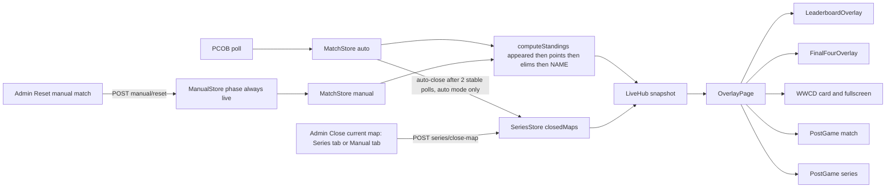

# Part 9 — Team Ordering, WWCD/Postgame Logic, Extended Name Animation, Final 4 Names & Reset After Close: Audit & Proposal

**Author:** Claude Code (Engineering Assistant)
**Date:** 2026-10-23
**Project:** `chicken-dinner-feed`
**Status:** **APPROVED (Revision 2, 2026-10-23) and IMPLEMENTED.** See §19 for what was built, deviations, verification evidence and remaining limitations.

| Revision | Date       | Change                                                                                                                                                                                                                                                                                                                                                                                                      |
| -------- | ---------- | ----------------------------------------------------------------------------------------------------------------------------------------------------------------------------------------------------------------------------------------------------------------------------------------------------------------------------------------------------------------------------------------------------------- |
| 1        | 2026-10-23 | Initial audit, reproduction, research and proposal for Issues A–D.                                                                                                                                                                                                                                                                                                                                          |
| 2        | 2026-10-23 | User decisions on Q1 (points first, Team Order as tie-break), Q3/Q4 (recorded WWCD → confirmed last standing → "not confirmed", provisional vs final), Q6 (roughness seen in **OBS and the admin preview**), Q5 on hold. New scope: **Reset Manual Match after a successful Close Current Map**. New measurements in the admin preview, the current-map → closed-map transition, and a double-close hazard. |

Evidence tags used throughout:

- **[CODE]** read directly from the repository (file + line range given).
- **[MEASURED]** observed by running the built app against an isolated copy of `backend/data` (§3).
- **[REPRO]** a throwaway script that called the real functions outside the repository (§3.3).
- **[RESEARCH]** taken from an external source listed in §11.
- **[INFERENCE]** a reasoned conclusion that has not been executed or observed.
- **[HYPOTHESIS — NOT REPRODUCED]** investigated but not confirmed.
- **[PROPOSAL]** a design decision put forward for approval.
- **[DECIDED]** a rule fixed by the user (Revision 2).

---

## 0. Decisions Recorded (Revision 2)

| #                | User decision                                                                                                                                                                                                                                                                                                                                | Effect on this proposal                                                                                                                                                                                                                               |
| ---------------- | -------------------------------------------------------------------------------------------------------------------------------------------------------------------------------------------------------------------------------------------------------------------------------------------------------------------------------------------- | ----------------------------------------------------------------------------------------------------------------------------------------------------------------------------------------------------------------------------------------------------- |
| **Q1**           | Vertical leaderboard: **higher total points first; equal points → Team Order (`teamNo`)**; all 0 → exactly Team Order; never alphabetical; do not change other components' official rules.                                                                                                                                                   | §5 rewritten. Eliminations stop being a tower tie-break. One remaining conflict (the "never appeared" pre-key) needs confirmation: **Q1a**.                                                                                                           |
| **Q3/Q4**        | Recorded and valid WWCD → that identity. Map still running and WWCD not recorded → the team **confirmable** as last standing from alive status. Never from points, rank or array order. Insufficient data → clear "not confirmed" status. **Provisional must be distinguishable from final.** Check the current-map → closed-map transition. | §6 rewritten: one resolver with states `final` / `provisional` / `unconfirmed` / `final-invalid`; every conflicting fallback removed (§6.4); provisional labelling; postgame `latest` follows the current map once it is finished but unclosed (Q4c). |
| **Q5**           | Screenshot will follow; do not guess the element and make no visual change on assumption.                                                                                                                                                                                                                                                    | The glow fix (B3) is **on hold** and removed from the implementation scope until confirmed (§6.7). An image was attached to the same message; its analysis is recorded, not acted on.                                                                 |
| **Q6**           | The roughness is seen in **OBS and in the admin preview**.                                                                                                                                                                                                                                                                                   | §7 extended with preview measurements, preview-specific mechanisms and verification on both surfaces.                                                                                                                                                 |
| **New scope R**  | After every **successful** Close Current Map, run the existing **Reset Manual Match**; never on failure; safe against double-click, retries, races and partial failure; consistent after refresh; reuse the existing mechanism.                                                                                                              | New §9. A proven double-close hazard makes two guards mandatory. Open scope points: **Q13–Q16**.                                                                                                                                                      |
| Not yet answered | Q2, Q7, Q8, Q9, Q10, Q11 (Revision 1).                                                                                                                                                                                                                                                                                                       | Recommendations kept (§17).                                                                                                                                                                                                                           |

---

## 1. Executive Summary

| Issue                                    | Proven root cause                                                                                                                                                                                                                                                                                                                                                                                                                                                                                                               | Proposed fix                                                                                                                                                                                                                                               |
| ---------------------------------------- | ------------------------------------------------------------------------------------------------------------------------------------------------------------------------------------------------------------------------------------------------------------------------------------------------------------------------------------------------------------------------------------------------------------------------------------------------------------------------------------------------------------------------------- | ---------------------------------------------------------------------------------------------------------------------------------------------------------------------------------------------------------------------------------------------------------- |
| **A** Tower order                        | The live ranking ends with `a.name.localeCompare(b.name)` (`standings.ts:201-210`), after an eliminations key. Tied teams render A–Z; an existing test pins this with the brief's own Zebra/Alpha example.                                                                                                                                                                                                                                                                                                                      | [DECIDED] `totalPoints` desc → `teamNo` asc. Q1a: whether the existing "never appeared → last" pre-key stays.                                                                                                                                              |
| **B1** Wrong WWCD before close           | The pre-close postgame fallback invents placements from the array index (`placement ?? idx + 1`, `broadcast-state.ts:431`) and picks `placement === 1 ?? rows[0]`, i.e. the top scorer (`:448`).                                                                                                                                                                                                                                                                                                                                | One resolver: recorded `#1` (final) → confirmed last standing (provisional) → "not confirmed". No synthetic placements, no points/rank/index fallback.                                                                                                     |
| **B2** WWCD fallbacks on closed maps     | A closed map without `#1` promotes `#2` (`:402-404`, `:216-218`); the WWCD closed-map fallback shows the slot's **current** roster name/logo (`:219-231`).                                                                                                                                                                                                                                                                                                                                                                      | Same resolver; "WWCD NOT RECORDED" state + admin warning; snapshot identity everywhere.                                                                                                                                                                    |
| **B3** Clipped gold glow                 | Proven clipping in the postgame winner card and series leader card when the logo box is hidden (content-sized gradient). **On hold (Q5).**                                                                                                                                                                                                                                                                                                                                                                                      | Deferred until the screenshot is confirmed.                                                                                                                                                                                                                |
| **C** Extended Name rough in OBS/preview | (1) Rows slide horizontally by the extension (≈ 93–113 px, ≈ 0.5 s) whenever the panel width changes — **reproduced in the admin preview and the standalone overlay**. (2) Name measurement under the `zoom-fade` scale. (3) Zero-tolerance exact fit at non-1080p or scale ≠ 1 → `…` without marquee. (4) Row remount when row animation is toggled. Preview-specific contributors: the slide is main-thread work shared with the admin page; `will-change` freezes the marquee bitmap under the preview's scale (hypothesis). | `layoutRoot` (fallback vertical-only reorder), transform-independent measurement at rendered size with tolerance, shared `OverflowMarquee` deciding from real overflow, stable row structure, `will-change` A/B.                                           |
| **D** Final 4 ellipsis                   | Plain CSS `truncate` (`FinalFourOverlay.tsx:287-297`); `LANANG NAK CHICKEN MAIN PUBG` needs 274.8 px in a 245.9 / 201.9 px box.                                                                                                                                                                                                                                                                                                                                                                                                 | Same `OverflowMarquee`.                                                                                                                                                                                                                                    |
| **R** Reset after close (new)            | Today reset is a separate manual step. **Proven hazard:** after a reset, another Close Current Map records the fresh, unplayed manual match as a new map with fabricated placements (T01 `#1` 10 pts, T02 `#2` 6 pts, …). The "nothing played" guard runs on the ended-forced projection, which gives every alive team a placement. Auto-reset would make this reachable with a double-click.                                                                                                                                   | Server-side: close → (only on success) existing `resetMatch()` → publish, under one lock, with `expectedMatchId` (409 on mismatch) and the existing "nothing played" guard moved to the live projection. Partial-failure handling and boot reconciliation. |

**Safety.** Only documentation changed (this file, `checkpoint.md`, `progress.md`). Production data hashes are identical before and after both audit sessions (§2.3).

---

## 2. Repository State & Baseline

### 2.1 Repository

| Item         | Value                                                                                                                                                                     |
| ------------ | ------------------------------------------------------------------------------------------------------------------------------------------------------------------------- |
| Branch       | `main`, tracking `origin/main` (`TzTypeC/chicken-dinner-feed`; `upstream` = `vargamolnarbertalan/chicken-dinner-feed`)                                                    |
| HEAD         | `6a89db9` "Add Part 8 overlay and scoring features"                                                                                                                       |
| Working tree | Clean before the audit (Part 6–8 work committed; no stash). Now: this document (new), `docs/checkpoint.md`, `docs/progress.md` (modified).                                |
| Formatting   | `backend/src/ingest/pcob/payload.ts` and `payload.test.ts` untouched. A full read-only `prettier --check .` passes. Prettier is only ever run on files this work changes. |

### 2.2 Quality gates (before any Part 9 change)

| Gate                     | Command                | Result               | Notes                                                                                  |
| :----------------------- | :--------------------- | :------------------- | :------------------------------------------------------------------------------------- |
| Unit & integration tests | `npm test`             | **461 / 461 passed** | Backend 322 / 26 files (28.6 s). Frontend 139 / 12 files (3.8 s).                      |
| Typecheck                | `npm run typecheck`    | **0 errors**         | shared, backend, frontend.                                                             |
| Lint                     | `npm run lint`         | **0 diagnostics**    | oxlint (frontend only); exit 0.                                                        |
| Formatting               | `npm run format:check` | **All files pass**   | Read-only.                                                                             |
| Production build         | `npm run build`        | **Success**          | Pre-existing Vite chunk-size warning (730.40 kB > 500 kB).                             |
| Browser tests            | —                      | **None exist**       | Vitest runs in `node` with `renderToStaticMarkup`; no DOM layout, Playwright or jsdom. |

### 2.3 Production data (read only)

[MEASURED] SHA-256 of all six `backend/data/*.json` files: identical before and after both audit sessions.

- `main`: right anchor, `offsetX 24`, `scale 1`, `showLogos false`, limit 14, Extended OFF, max extension 200, show/hide `wipe`.
- Every instance has `showLogos: false`; every team has `logoUrl: null`.
- `series.json`: 0 closed maps. Manual mode active. `manual-match.json` holds the reported WWCD case (T01 LONG BLACK out last with 11 elims; T04 tes doang 1 alive, 2 elims).

---

## 3. Reproduction Environment & Method

### 3.1 Isolated server

`backend/data` was copied to `%TEMP%\cdf-part9-audit\data` and served by the built backend (`node dist/index.js`, `DATA_DIR=<temp>`, `PORT=4419`, `HOST=127.0.0.1`, `INGEST_SOURCE=mock`, `NODE_ENV=production`). The startup log confirmed the temp `dataDir`. Two sessions were run (Revision 1 and Revision 2). After each, the server was stopped, the browser tab closed and the temp copy deleted.

### 3.2 Browser

Managed headless Chromium (device scale factor 1.25): standalone overlays at 1920×1080 (and 1280×720, 1366×768, 2560×1440 for the drift matrix), and **the real admin page** with its embedded preview iframe (Revision 2). Google Fonts reachable (`Inter 700` loaded). Tools: `getBoundingClientRect`, `Range` boxes, per-frame `requestAnimationFrame` samplers inside the preview iframe, and a `longtask` `PerformanceObserver` in the admin page.

### 3.3 Throwaway script

`repro.mts` (outside the repository, `npx tsx`) called the real `computeStandings` and `broadcast-state.ts` selectors with synthetic data. It was deleted after use.

### 3.4 Limits

- **OBS was not available.** OBS-specific statements come from OBS documentation and source code (§11) and are verification items for the operator (C13).
- Headless frame timing is main-thread `requestAnimationFrame` pacing, not compositor output. Visual smoothness of composited motion cannot be proven numerically here (§7.4).
- Q5: no element location is assumed (§6.7).

---

## 4. Data Flow (Audit)



| Concern              | Location                                                                                   | Fact                                                                                                                                                                                |
| -------------------- | ------------------------------------------------------------------------------------------ | ----------------------------------------------------------------------------------------------------------------------------------------------------------------------------------- |
| Live ranking         | `backend/src/scoring/standings.ts:196-212`                                                 | Appeared (this map or series) → points → eliminations → `name.localeCompare`; `rank = index + 1`.                                                                                   |
| Team Order           | `TeamRosterEditor.tsx:45-48`; `roster-reorder.ts`                                          | Teams section = `teamNo` ascending; drag-and-drop renumbers `teamNo`. **Team Order ≡ `teamNo`.**                                                                                    |
| Live placements      | `match-store.ts:332-373`                                                                   | API rank, then elimination order (one slot pool). Survivors placed only when phase is `ended` (`:351`).                                                                             |
| Alive status         | `standings.ts:81-87, 134-158`                                                              | `alive`, `knocked`, `disconnected` count as standing. A team that has appeared but has no players in the current update is **not eliminated and has 0 standing players** (unknown). |
| Manual mode          | `manual-store.ts:290-325` (`phase: 'live'` at `:322`); `app.ts:182-188, 226-253`           | Always `live`, never auto-closes (decision D-06); the winner's placement stays `null` until close.                                                                                  |
| Close                | `routes/series.ts:131-160`; `series-store.ts:313-343, 496-520`                             | Projection captured **before** the series mutex; `projectAsEnded()` gives survivors the best free slots; snapshot `name`/`logoUrl` stored.                                          |
| Reset manual match   | `routes/manual.ts:145-166`; `manual-store.ts:207-273`; `shared/src/domain/manual.ts:64-92` | See §9.1.                                                                                                                                                                           |
| Placement validation | `series-store.ts:64-72`; `excel/import.ts:237-247`; `manual-store.ts:52-63`                | Distinct placements enforced; a `#1` is **not** required.                                                                                                                           |
| Postgame `latest`    | `broadcast-state.ts:359-376, 416-457`                                                      | Latest closed map; the live fallback is used **only when no closed map exists at all**.                                                                                             |
| Admin preview        | `OverlayPreview.tsx:207-234`                                                               | Same-origin iframe, 1920×1080, `transform: scale(boxWidth/1920)` (0.403 at a 1920 px admin window).                                                                                 |

---

## 5. Issue A — Vertical Leaderboard: Points First, Team Order as Tie-Break

### 5.1 Evidence

- [CODE] `standings.ts:201-210`: `appeared → totalPoints → eliminations → a.name.localeCompare(b.name)`.
- [CODE] `standings.test.ts:184-196` pins "alphabetical even when that disagrees with team number order" (`['Alpha', 'Zebra']`).
- [REPRO] All tied (`T01 Zebra, T02 Alpha, T03 Bravo, T04 Delta`) → `Alpha | Bravo | Delta | Zebra`.
- [MEASURED] Production roster after a manual reset: the 0-point block renders `T22 ^VOLTRA^, T08 APAA, T13 Aves Gebang, T18 Bagi Hotspot, T24 BERKAH JAYAA, …` in the standalone overlay **and** in the admin preview.

### 5.2 Decided rule [DECIDED]

```
compare(a, b) = b.totalPoints − a.totalPoints  ||  a.teamNo − b.teamNo
```

- Higher total first (series points, this map's earned points and adjustments, as today; signed totals keep working).
- Equal totals → lower `teamNo` first. **Eliminations no longer break ties in the tower.** The name is never used.
- All totals 0 → exactly Team Order.
- Brief's example: Team A (order 1, 10) above Team B (order 2, 10); Team B with 15 above Team A.

### 5.3 Remaining conflict — the "never appeared" pre-key (Q1a)

The current first key puts teams that have **never appeared** (this map or earlier in the series) below every team that has. It was added deliberately (`standings.test.ts:238-252`, `:333-349`; `match-store.test.ts:78-89`): a small lobby using part of a larger roster must not have unused slots above real teams.

It conflicts with "all 0 → exactly Team Order" in one situation: **while a PCOB lobby is still loading** (or a roster has unused slots), teams that have been reported float above the others, and rows reorder as teams connect.

| Option                           | All-0 behaviour                                       | Trade-off                                                                                                                                                                                                                                                                 |
| -------------------------------- | ----------------------------------------------------- | ------------------------------------------------------------------------------------------------------------------------------------------------------------------------------------------------------------------------------------------------------------------------- |
| **Q1a-(a) strict (recommended)** | Always exactly Team Order.                            | Unused/not-yet-joined slots sit in Team Order among 0-point teams (still dimmed to 25 % opacity via `hasAppeared`). The three tests above are replaced. Once a team earns any point it rises (in a live match, joined teams receive guaranteed-minimum placement points). |
| Q1a-(b) keep the pre-key         | Exactly Team Order only once every team has appeared. | Matches the old guard; contradicts "all 0 → exactly Team Order" during lobby loading.                                                                                                                                                                                     |

### 5.4 Blast radius

| Consumer                                                         | Effect                                                                                        |
| ---------------------------------------------------------------- | --------------------------------------------------------------------------------------------- |
| Tower (`LeaderboardOverlay`) and admin preview                   | Target behaviour.                                                                             |
| Admin Series → "Current standings" (standings mode)              | Same source array → same order as the tower, by design. The "Team order" toggle is unchanged. |
| Final-4 cohort selection among tied survivors, preview samples   | Order among exactly tied teams follows `teamNo`. The locked cohort is unchanged.              |
| `/api/feedback` `leader`                                         | On a tie at the top, the lower `teamNo`.                                                      |
| Postgame match, series standings, closed maps, placements, Excel | **Unchanged** (their own official chains; `rank` is never persisted).                         |

### 5.5 Tests (all permanent, `standings.test.ts` / `match-store.test.ts`; see §14 A1–A16)

Higher points beat lower `teamNo`; equal points → `teamNo`; equal points with different eliminations → still `teamNo`; all 0 → `teamNo`; roster array shuffled → same output; sparse `teamNo`; alphabetical names reversed vs `teamNo`; 25 teams with several tie groups (expected order = points desc, `teamNo` asc, checked against a reference comparator over shuffled inputs); negative totals; series points included; Team Order change via `MatchStore.setRoster` re-projects in the new order; Q1a behaviour; rank numbering unchanged (Q2).

---

## 6. Issue B — WWCD Identity, Provisional vs Final, Current → Closed Map

### 6.1 Evidence

| #   | Scenario                                                                                               | Observed                                                                                                                                                                                                                                                                                         |
| --- | ------------------------------------------------------------------------------------------------------ | ------------------------------------------------------------------------------------------------------------------------------------------------------------------------------------------------------------------------------------------------------------------------------------------------ |
| B-1 | [MEASURED] Production state, no closed maps, `/overlay/postgame-match`                                 | Spotlight **LONG BLACK, badge `#2`, 17 pts**; table `T01 #2 11 6 11 17`, `T04 #2 2 10 2 12`. Two teams at `#2`, none at `#1`.                                                                                                                                                                    |
| B-2 | [MEASURED] Same moment, `/overlay/wwcd`, `/overlay/wwcd-fullscreen`                                    | Both **tes doang**.                                                                                                                                                                                                                                                                              |
| B-3 | [REPRO] Team A 6 kills (out 2nd) vs Team B 0 kills (standing), `live`                                  | Postgame winner **Team A `#2`**; `selectWwcdWinner` → **Team B**.                                                                                                                                                                                                                                |
| B-4 | [MEASURED] **Transition** (Revision 2): T0 before close → T1 after close → T2 after Reset Manual Match | T0: postgame **LONG BLACK `#2`**, WWCD card/fullscreen **tes doang**. T1: postgame **tes doang `#1`** (closed map), WWCD overlays tes doang. T2: postgame tes doang `#1`; **WWCD card and fullscreen no longer visible**; tower visible again. Closed map byte-identical before/after the reset. |
| B-5 | [MEASURED] Rename T04 after close + new match, `/overlay/wwcd?preview=1`                               | WWCD card **"RENAMED AFTER MATCH"** vs postgame snapshot **"tes doang"**.                                                                                                                                                                                                                        |
| B-6 | [MEASURED] Closed map edited so no team has `#1` (HTTP 200)                                            | Postgame crowns **LONG BLACK `#2`**; WWCD preview shows T01's current roster name.                                                                                                                                                                                                               |
| B-7 | [CODE] Postgame `latest` with earlier closed maps (`broadcast-state.ts:367-368`)                       | While map N is finished but unclosed, `latest` shows **map N−1** (stale); the live fallback is reached only for the first map of a series.                                                                                                                                                       |

### 6.2 Root causes (proven)

1. Synthetic placement from the array index (`:425-431`), which is the live ranking incl. series points.
2. Points-based winner fallback (`:448`); header badge `#{winner.placement}` (`PostGameOverlay.tsx:358`) and highlight `placement === 1` (`:676`) expose it.
3. Best-placement fallback on closed maps (`:402-404`, `:216-218`).
4. Current-roster identity for a historical winner (`:219-231`).
5. Inconsistent `latest` semantics (B-7): first map → provisional live board; later maps → previous map.

### 6.3 The rule [DECIDED] and its precise definition [PROPOSAL]

One pure resolver in `broadcast-state.ts`, used by postgame match, WWCD card, fullscreen WWCD and the automatic WWCD layout trigger. Its input is the displayed map: a closed map, or the current live map.

```
resolveWinner(map):
  if map is a closed map (recorded):
     ones = teams with placement === 1
     ones.length === 1 → state 'final',         winner = ones[0] (snapshot identity)
     otherwise         → state 'final-invalid', winner = null  ("WWCD NOT RECORDED")

  current map (its matchId is not in closedMaps):
     if phase === 'idle'                         → state 'none'
     appeared   = teams with hasAppeared
     eliminated = appeared with isEliminated
     standing   = appeared, not eliminated, standingPlayerCount > 0   (positive alive evidence)
     unknown    = appeared, not eliminated, standingPlayerCount === 0 (no player data this snapshot)
     firsts     = appeared with placement === 1
     if standing.length ≥ 2                      → state 'running'
     if eliminated.length ≥ 1 and standing.length === 1 and unknown.length === 0
        and (firsts empty or firsts == [standing[0]])
                                                 → state 'provisional', winner = standing[0]
     otherwise                                   → state 'unconfirmed', winner = null
```

- **Never** reads `rank`, points, array order or `teamNo` to pick a winner.
- **"Confirmable" = positive alive evidence.** Today an appeared team with no players in the current PCOB response counts as standing. The resolver requires `standingPlayerCount > 0` for the winner and **no** team of unknown status. A partial PCOB poll (`specs/PCOB-API.md` §6) therefore yields "not confirmed", never a wrong winner. Manual mode always reports all four slots, so it is never "unknown".
- **Nobody standing** (for example the last two teams wiped in the same poll, or an operator setting the winner to 0 alive by mistake) → `unconfirmed`. The live elimination order for simultaneous wipes is arbitrary, so it is not used. Once the map is closed, the recorded `#1` decides (and can be corrected).
- **Conflict** (a live placement `#1` from the API on a team other than the sole survivor) → `unconfirmed`.
- **Automatic WWCD layout** (`resolveLeaderboardLayoutMode`) switches to `'wwcd'` only when the resolver says `provisional` or `final`. Final-4 and tower thresholds are unchanged. This removes the case where the current trigger counts an unknown-status team as "the last standing".

### 6.4 Fallbacks removed (they contradict the rule)

| Removed                                                                      | Location                       | Replaced by                                                                                                                                     |
| ---------------------------------------------------------------------------- | ------------------------------ | ----------------------------------------------------------------------------------------------------------------------------------------------- |
| `placement ?? idx + 1` (live and preview postgame rows)                      | `broadcast-state.ts:431`       | Real placement or `—`; the provisional winner is displayed as `#1 (provisional)`.                                                               |
| `rows.find(placement === 1) ?? rows[0]`                                      | `:448`                         | Resolver.                                                                                                                                       |
| `find(placement === 1) ?? sort(placement)[0]` on closed maps                 | `:402-404`, `:216-218`         | Resolver (`final-invalid` when no `#1`).                                                                                                        |
| Roster name/logo/series total/players for a closed-map winner                | `:219-231`                     | Snapshot `name`/`logoUrl` (roster only for pre-Part-6 maps without a snapshot); live players only if `lastClosedMap.matchId === match.matchId`. |
| Preview WWCD = `match.teams[0]` (top-ranked team)                            | `:236-239`                     | Resolver; when no winner, a clearly labelled **"PREVIEW SAMPLE — NOT A RESULT"** placeholder with a synthetic name, never a roster team.        |
| Highlight `isWinner = placement === 1`; header badge from `winner.placement` | `PostGameOverlay.tsx:676, 358` | Highlight by `teamNo === winner.teamNo`; badge from the resolver state.                                                                         |

### 6.5 Provisional vs final

| Resolver state   | Postgame match                                                                                                                                                | WWCD card / fullscreen                                                                                      |
| ---------------- | ------------------------------------------------------------------------------------------------------------------------------------------------------------- | ----------------------------------------------------------------------------------------------------------- |
| `final`          | Normal board (closed map).                                                                                                                                    | Normal.                                                                                                     |
| `provisional`    | Header banner **"PROVISIONAL — MAP NOT CLOSED"**; winner shown `#1`; other unresolved placements `—`.                                                         | Identity shown (confirmed last standing). Q4b: mark the points block "PROVISIONAL" until the map is closed. |
| `unconfirmed`    | Provisional banner; spotlight **"WWCD NOT CONFIRMED YET"**; table still shown.                                                                                | Not shown (the automatic layout no longer triggers).                                                        |
| `final-invalid`  | Spotlight **"WWCD NOT RECORDED"**; table shown; admin warning (finished-map card, map dialog, Excel import preview) — Q3-(a), consistent with "do not guess". | Not shown.                                                                                                  |
| `running`/`none` | Existing awaiting/empty state.                                                                                                                                | Not shown.                                                                                                  |

**Postgame `latest` (Q4c, recommended):** show the **current map** when it is finished but not yet recorded (resolver `provisional` or `unconfirmed`, `matchId` not in `closedMaps`); otherwise the latest closed map. Every map then follows the same path: finished → provisional board of that map → close → final board of the same map. Pinned selections are unchanged (closed maps only).

**Transition (B-4) after this change:**

```mermaid
stateDiagram-v2
  [*] --> Running
  Running --> Provisional: one confirmed survivor and at least one eliminated
  Running --> Unconfirmed: no confirmable survivor
  Provisional --> Final: Close Current Map succeeds (placement 1 recorded)
  Unconfirmed --> Final: Close Current Map succeeds
  Final --> FinalInvalid: closed map edited or imported without placement 1
  Final --> Running: manual reset or next PCOB match (live view); postgame keeps showing Final
```



`projectAsEnded()` gives the sole survivor the best free slot, which is `#1` unless the API already claimed it for another team. The resolver treats that same conflict as `unconfirmed`, so a provisional winner never changes at close; only an unconfirmed state can resolve into a recorded winner.

### 6.6 Model decision

[RESEARCH R11] WWCD = "winning the first placement". No schema change and no `PROTOCOL_VERSION` bump for Issue B (frontend selectors and rendering only). ADR-0019: "WWCD identity is the recorded placement #1, or a confirmed last-standing team while the map is unclosed; never inferred."

### 6.7 Q5 — gold glow: on hold

- [MEASURED, Revision 1] The postgame winner card's glow is a content-sized `radial-gradient` (`PostGameOverlay.tsx:363-372`; identical in `PostGameSeriesOverlay.tsx:348-357`). Without the logo box the gradient is cut at the block edges (gold alpha 0.076 at the bottom, 0.132 at the top).
- **Image attached to the Revision 2 message** (442×255 crop): the postgame winner card ("WINNER WINNER CHICKEN DINNER", `#1`, SLOT T13, AVES GEBANG, no logo box). Pixel analysis: background luminance 45.0; at the bottom of the identity block the luminance drops abruptly from ≈ 55 to 45 within 1–2 px across x ≈ 90–345 (≈ +10 units, matching the computed 0.076 alpha); directly under the header border it is ≈ 64 (cut at the top); the left and right sides fade smoothly to background (no vertical cut).
- **Not acted on.** Per the instruction, the location is not treated as confirmed and **no visual change is in the implementation scope** until you confirm which element "di sisi paling kanan" means (Q5). If confirmed, the Revision 1 design (a fixed-size decorative layer whose gradient reaches 0 inside its own box, applied to both cards) would be added as WS-9.5.

### 6.8 Related finding (not fixed unless Q9-b)

Logos are stored per slot (`team-${teamNo}.ext`, `logo-store.ts:85`). A closed map's snapshot `logoUrl` follows the slot's current file after a renumber or upload (`:193-195`). Snapshot names are immutable; snapshot logos are not.

---

## 7. Issue C — Extended Name Rough in OBS and the Admin Preview

### 7.1 Evidence

| #    | Surface / scenario                                                                            | Observed [MEASURED]                                                                                                                                                              |
| ---- | --------------------------------------------------------------------------------------------- | -------------------------------------------------------------------------------------------------------------------------------------------------------------------------------- |
| C-1  | Standalone overlay, Save toggling Extended **ON**                                             | Panel 340 → 433 px in one frame; row `translateX` 93 → 85.5 → 74.7 → 50.7 → 22.8 → 7.6 → 1.1 → 0 over ≈ 520 ms; right columns slide in from the clipped edge.                    |
| C-1p | **Admin preview** (real admin page, iframe at `scale(0.403)`), Save toggling Extended **OFF** | Panel 433 → 340; rows −93 → 0 over ≈ 550 ms (35 sampled steps).                                                                                                                  |
| C-1q | **Admin preview**, Save toggling Extended **ON**                                              | Panel 340 → 433; rows +93 → 0 over ≈ 550 ms; one 33.5 ms frame inside the iframe during the save; no ≥ 50 ms long task in the admin page.                                        |
| C-2  | Standalone, page load with Google Fonts delayed 3 s                                           | Rows +113 → 0 in the first ≈ 430 ms; when Inter arrives, panel 453 → 442 and rows −11 → 0 (≈ 490 ms).                                                                            |
| C-3  | HIDE → ON AIR with extension 93                                                               | No slide (matches "smooth via hidden/ON AIR, rough after Save").                                                                                                                 |
| C-4  | Extended max 0, `zoom-fade` remount                                                           | `PENYETAN ALLAN` 111.78 > box 103.31, `DTMK NOT JTMK.` 109.66 > 103.31: static with `…`, no marquee.                                                                             |
| C-5  | Normal mode, `zoom-fade` remount                                                              | Font 10.67 → 11.87 px; two names clipped.                                                                                                                                        |
| C-6  | Extended max 200, viewports × scales                                                          | Widest static name overflows at 1920×1080 s 0.7, 1280×720 s 1/0.85/0.7, 1366×768 s 0.85/0.7 (0.02–1.6 px) → `…` without marquee. Clean at 1920×1080 s 1/0.85/1.15 and 2560×1440. |
| C-7  | Saves of non-layout settings                                                                  | Same node, same `Animation`, continuous `currentTime`.                                                                                                                           |
| C-8  | Save toggling `rows.enabled`                                                                  | Marquee restarts (rows remount).                                                                                                                                                 |
| C-9  | 0 / 7 / 20 marquees (headless, standalone)                                                    | p95 ≤ 17.1 ms frames; no main-thread cost.                                                                                                                                       |

### 7.2 Root causes (proven)

- **C-RC1 — horizontal layout slide** (`TeamRow.tsx:51-56`, `layout="position"`): any panel width change moves every row's page position, and Motion animates it for 0.55 s inside an `overflow: hidden` panel. Proven on **both** surfaces (C-1, C-1p, C-1q, C-2).
- **C-RC2 — measurement under an ancestor transform** (`useTeamNameLayout.ts:113, 120`; `appearance.ts:93-94`).
- **C-RC3 — zero-tolerance exact fit** (`team-name-fit.ts:147-154`; `useTeamNameLayout.ts:155`), measured at 1 px units while rendering at the real unit (non-linear glyph advances [R3]).
- **C-RC4 — row key structure** (`LeaderboardOverlay.tsx:152-181`).

### 7.3 Surface-specific contributors

| Surface       | Fact                                                                                                                                                                                                                                                                                                                    | Status                                       |
| ------------- | ----------------------------------------------------------------------------------------------------------------------------------------------------------------------------------------------------------------------------------------------------------------------------------------------------------------------- | -------------------------------------------- |
| Admin preview | The preview iframe is same-origin, so it runs on the **same event loop** as the admin page [R16]. Motion's layout slide is computed per frame on the main thread; admin work during Save (state updates, toasts) competes with it (one 33.5 ms frame in C-1q).                                                          | [MEASURED] + [INFERENCE]                     |
| Admin preview | The iframe is downscaled by `transform: scale(≈0.40)`. The marquee track has `will-change: transform`, which makes Chromium raster it into a fixed bitmap that is not re-rastered when its transform scale changes [R15]. A fixed bitmap, downscaled and moved by ≈ 0.27 screen px per frame, can look soft or shimmer. | [HYPOTHESIS — NOT VERIFIED VISUALLY]         |
| Admin preview | Inside the iframe the unit is 1, so C-RC3 does not trigger at instance scale 1 (it does at scale ≠ 1, C-6).                                                                                                                                                                                                             | [MEASURED]                                   |
| OBS           | The browser source renders at the canvas FPS unless "Use custom frame rate" is on (default FPS 30 when on) [R9, R10]. At 30 FPS a 40 px/s scroll moves 1.33 px per frame.                                                                                                                                               | [RESEARCH]; operator check C13               |
| OBS           | A 1280×720 (or similar) source gives a 0.667 unit → C-RC3 drift (C-6). The source size is still unknown (Q6).                                                                                                                                                                                                           | [MEASURED] for the browser; OBS size unknown |
| Both          | The WAAPI marquee itself runs and stays continuous across ordinary Saves (C-7); WAAPI transform animations are eligible for compositor execution [R7, R15], so they do not depend on the main thread.                                                                                                                   | [MEASURED] + [RESEARCH]                      |

Ruled out (unchanged from Revision 1): ordinary Save remounting the overlay; stale font metrics; WAAPI not running; main-thread cost of many marquees. Still unverified: stale `onAir` in an admin draft reverting a Companion toggle on Save.

### 7.4 Proposal [PROPOSAL]

- **C-P1 (C-RC1, both surfaces):** make the panel's Motion container a `layoutRoot` [R5]. Row animations become panel-relative and the panel's own size/position change applies instantly (Motion source `create-projection-node.mjs:315-333, 1522-1537`). **Gate:** |row `translateX`| < 0.5 px on every frame after Save (OFF→ON, ON→OFF), after a font load and on first load, measured **in the admin preview and in a standalone 1920×1080 overlay**, while a rank swap still animates `translateY` over 0.55 s. **Fallback** if the gate fails (Q10): vertical-only reorder (`translateY(index × rowHeight)` with the same 0.55 s easing); horizontal changes are then never animated. Removing the JS-driven slide also removes the preview's main-thread contention for that motion.
- **C-P2 (C-RC2):** transform-independent measurement: `ancestorScale = ruler.getBoundingClientRect().width / ruler.offsetWidth` [R1]; every probe width is divided by it.
- **C-P3 (C-RC3):** measure names at the actual rendered size (real `--overlay-unit`), convert to design px with the ruler, and add tolerance: `extension = ceil(widest − area + ε)`, `ε = max(1, 1 device px in design units)`.
- **C-P4 (`OverflowMarquee`):** viewport `min-w-0 flex-1 overflow-hidden`, `text-overflow: clip` (never `…`); initial decision in `useLayoutEffect` [R13], then `ResizeObserver` on viewport and text (layout sizes, unaffected by transforms [R2]); overflow > 0.5 px → marquee (existing WAAPI loop, 40 design px/s, 1.5 s hold, `•`), otherwise static; speed `= 40 × unitPx` with `unitPx = computed font-size ÷ design font-size` (works for `u()` and `ub()`); duplicates `aria-hidden`; cancel on unmount/change; no JS loop [R7, R8]. Extended-mode rows always render through it, so a name that still overflows scrolls instead of showing `…`.
- **C-P5 (C-RC4):** constant row element structure.
- **C-P6 (`will-change` A/B, preview):** remove `will-change: transform` from the track (WAAPI transform animations are composited without it [R15]) **only if** the A/B shows sharper/steadier text in the scaled preview and in a 1:1 viewport, with no frame-pacing regression (C-9 method). Otherwise keep it.
- **C-P7 (operations):** user-guide note: keep OBS "Use custom frame rate" off, or equal to the canvas FPS; "Shutdown source when not visible" reloads the page (animations restart) [R9, R10].
- **Verification on both surfaces (C-V):** every Issue C check runs in (1) the admin preview, canvas mode and actual-size mode, through the real admin Save button, and (2) the standalone overlay at 1920×1080 and 1280×720. Smoothness evidence = row-offset samplers (above), iframe frame pacing during Save, and a frame-by-frame screen recording of the marquee region with per-frame horizontal displacement (cross-correlation): no backward jumps except the designed wrap, and no frame-to-frame displacement outside the expected cadence. Headless recordings have irregular frame timing, so the final smoothness judgement in OBS is the operator check C13.

---

## 8. Issue D — Final 4 Names Must Not End in a Permanent Ellipsis

Unchanged from Revision 1.

- [MEASURED] Card 351.5 px wide. `LANANG NAK CHICKEN MAIN PUBG`: box 245.9 px (logos off) / 201.9 px (logos on) vs natural 274.8 px → permanent `LANANG NAK CHICKEN ...`. Other cards fit; the knocked-out `OUT #n` pill narrows the box.
- [CODE] `FinalFourOverlay.tsx:287-297`: `truncate font-extrabold uppercase tracking-wide` at `ub(15)`; no scroll path. Only the horizontal top bar exists; the tower hides in `final-four` mode (`OverlayPage.tsx:550`).
- [PROPOSAL] Use `OverflowMarquee` with the card's class, the knocked-out colour and the tower's timing (Q7). The viewport is `flex-1 min-w-0`, so cards never resize; the observer re-evaluates when the pill appears, logos toggle or the cohort changes. Keys, cohort locking and order are untouched.

---

## 9. New Scope R — Reset Manual Match After a Successful Close Current Map

### 9.1 Audit of the existing Reset Manual Match

[CODE] `POST /api/manual/reset` (`routes/manual.ts:145-166`) → `ManualStore.resetMatch({})` (`manual-store.ts:207-219`) → `createDefaultManualMatchDocument(newMatchId, roster, currentMode)` (`shared/src/domain/manual.ts:79-92`) → `onManualStateChanged` (`app.ts:323-326`: `syncManualProjection()` + `hub.schedulePublish()`).

| State                                                                                                                        | After reset                                                                                                                                                                                                                                         |
| ---------------------------------------------------------------------------------------------------------------------------- | --------------------------------------------------------------------------------------------------------------------------------------------------------------------------------------------------------------------------------------------------- |
| `manual-match.json` `matchId`                                                                                                | New `manual-<uuid>`.                                                                                                                                                                                                                                |
| `nextEliminatedSeq`                                                                                                          | 1.                                                                                                                                                                                                                                                  |
| Every roster team                                                                                                            | `present: true`, `aliveCount: 4`, `eliminations: 0`, `eliminatedSeq: null`, `placementOverride: null`. **Note:** teams previously marked not present become present again, although the dialog says "Every participating team will be reset" (Q15). |
| `mode`                                                                                                                       | Preserved.                                                                                                                                                                                                                                          |
| Manual `MatchStore` (in memory)                                                                                              | New `matchId` → elimination history and seen-teams reset (`match-store.ts:139-150`); banked points of the closed map no longer apply; live PTS = series totals + new guaranteed-minimum points.                                                     |
| `series.json`, roster, logos, overlay instances and ON AIR states, scoring, fonts, backgrounds, the auto (PCOB) `MatchStore` | **Not touched.** [MEASURED] the closed map was byte-identical before and after a reset (B-4).                                                                                                                                                       |
| Writes                                                                                                                       | `JsonDocument` writes are atomic and queued per document (`json-document.ts:24-46`); manual mutations are serialised (`manual-store.ts:328-335`). There is no transaction across `series.json` and `manual-match.json`.                             |

The existing **"Copy from PCOB"** (`seedFromAuto`) variant is a different action (failover seeding) and is not used here.

### 9.2 Close Current Map today

[CODE] Two admin buttons (Series control "Close current map now", `SeriesControl.tsx:171-180, 396-402`; Manual control "Close map now", `ManualControl.tsx:119-131`) both call `POST /api/series/close-map` (`routes/series.ts:131-160`). PCOB auto-close runs only in auto mode (`app.ts:240-245`). Neither button is disabled while its request is in flight. The Manual tab's success toast tells the operator to click Reset manual match.

### 9.3 Proven hazard: closing an unplayed match

[MEASURED] After close + reset in the temp copy, a second `POST /api/series/close-map` returned **200** and recorded **map 2** from the fresh manual match: T01 `#1` (10 pts), T02 `#2` (6), T04 `#4` (4), …, T25 `#25` (0). Placements were assigned by `projectAsEnded()` (all alive teams placed, ties by `teamNo`).

[CODE] The route's guard `teams.some(hasAppeared && placement !== null)` (`series-store.ts:337-339`) is evaluated on the **ended-forced** projection, where every alive team has a placement, so it never fires. Today this needs a manual reset between two closes. With automatic reset, **a double-click or a retried request** is enough. The guards below are therefore mandatory parts of R.

### 9.4 Design [PROPOSAL]

**One orchestrated server operation**, used by both admin buttons:

```
POST /api/series/close-map   body: { expectedMatchId?: string }
  under closeLock (one at a time, covers close AND reset):
    1. if warmup                                   → 400 (unchanged)
    2. live = match.project()
       if expectedMatchId given and ≠ live.matchId → 409 "That map is no longer running (already closed or a new match started)."
       if no appeared team has a placement in live → 400 "No team has been eliminated yet, so there is nothing to record."  (existing intent, now on the live projection — Q14)
    3. closed = series.closeMapNow(match.projectAsEnded(), now)    (fails → 400, no reset)
    4. onSeriesChanged()
    5. if Q13 condition holds (default: mode is manual and closed.matchId === manual.matchId):
         try   resetManualMatch()          // the SAME function POST /manual/reset uses
         catch → log error; header x-cdf-manual-reset: failed
       else header x-cdf-manual-reset: skipped
    6. publish; respond 200 with the series document (shape unchanged) + x-cdf-manual-reset: done|skipped|failed
```

- **Single mechanism (requirement 8):** extract `resetManualMatch()` in `app.ts` = `manualStore.resetMatch({})` + `syncManualProjection()` + `hub.schedulePublish()`. Both `POST /manual/reset` and the close orchestration call it. Any change to reset semantics (Q15) applies to both.
- **Reset only after success (requirements 2, 4):** step 5 runs only after step 3 resolved (`series.json` persisted).
- **Closed results stay intact (requirement 3):** the reset writes only `manual-match.json` and in-memory manual state; the closed map, `activeMatchNumber` (incremented once by the close), roster and other documents are untouched.
- **Double-click / repeated requests / races (requirement 5):**
  - Frontend: both Close buttons disabled while the request is in flight; the Manual tab's team controls are disabled during close; the request sends `expectedMatchId` (Manual tab: `document.matchId`; Series tab: `snapshot.match.matchId`).
  - Backend: `closeLock` serialises close+reset, so a second request starts only after the first finished. It is then rejected by `expectedMatchId` (409) or by the live-projection guard (400); an old client without `expectedMatchId` is still stopped by the guard. The existing `hasClosedMapFor(matchId)` duplicate guard stays.
  - A manual patch arriving during the operation is queued by `ManualStore.mutate`. If it lands after the reset it applies to the new match, which is why the Manual tab disables its controls during close.
- **Partial failure (requirement 5):**
  - Close fails → nothing changes (no reset).
  - Reset fails after a successful close → 200 + `x-cdf-manual-reset: failed`; the admin shows a warning toast ("Map closed, but the manual match could not be reset — click Reset manual match"). The stale manual match is already recorded, so another close is rejected (duplicate guard) and cannot double-count. Retrying Reset is safe.
  - Process stops between close and reset → **boot reconciliation**: at startup, if mode is manual and `manual.matchId` is already in `closedMaps`, run `resetManualMatch()` once and log it.
- **Consistency after reset and refresh (requirement 6):** both documents are on disk; after success **or** failure the Manual tab re-fetches `GET /api/manual` and the Series tab re-fetches `GET /api/series`; both tabs reload on mount. Live overlays update through the normal publish. Toast and dialog texts change: the close dialog states that a fresh manual match starts afterwards (Manual mode), and the "click Reset manual match" hint is removed.
- **Versioning:** no shared-schema change. `expectedMatchId` is an optional request field; the result is reported in a response header, the same pattern as Part 8's `x-cdf-omitted-adjustments`. `PROTOCOL_VERSION` stays 11.

### 9.5 Interactions to decide

| Interaction                     | Fact                                                                                                                                                                            | Decision                                                                                                                                                                                                          |
| ------------------------------- | ------------------------------------------------------------------------------------------------------------------------------------------------------------------------------- | ----------------------------------------------------------------------------------------------------------------------------------------------------------------------------------------------------------------- |
| Which closes trigger the reset  | In auto (PCOB) mode the manual document can still hold an **unclosed manual map** (or a failover copy). Resetting it there would delete manual data that is still needed.       | **Q13-(a) recommended:** reset only when the closed map _is_ the manual match (mode manual, `closed.matchId === manual.matchId`), from either admin button. (b) every successful close incl. PCOB and auto-close. |
| WWCD celebration in manual mode | [MEASURED] B-4 T2: once the manual match resets, the automatic WWCD card/fullscreen and Final-4 end immediately (the live match is new); postgame shows the closed map (final). | **Q16:** accept "closing the map ends the live celebration" (recommended; operators close when ready to move on), or ask for a different flow.                                                                    |
| Lobby presence                  | Reset re-marks every roster team present.                                                                                                                                       | **Q15-(a) recommended:** preserve `present` flags in the single reset mechanism (both the button and the auto path), matching the dialog text. (b) keep today's behaviour.                                        |
| "Nothing played" guard          | Moving the existing guard to the live projection also rejects a PCOB close with zero eliminations.                                                                              | **Q14-(a) recommended:** apply in all modes (it is the guard's documented intent). (b) manual mode only.                                                                                                          |

---

## 10. Cross-Feature Interactions & Data Integrity

| Interaction                          | Finding                                                                       | Part 9 effect                                                  |
| ------------------------------------ | ----------------------------------------------------------------------------- | -------------------------------------------------------------- |
| Team Order vs standings              | Team Order ≡ `teamNo`.                                                        | Tower: points → Team Order; other rankings unchanged.          |
| `teamNo` vs stable identity          | No team ID beyond `teamNo`; series totals slot-keyed (ADR-0015).              | Unchanged; snapshot identity used consistently for WWCD.       |
| Historical results vs roster         | Names immutable; logos follow the slot file.                                  | Documented (Q9).                                               |
| WWCD vs rank/points                  | Coupled in four fallbacks.                                                    | Decoupled; one resolver also drives the automatic WWCD layout. |
| Provisional vs final                 | Not distinguished today.                                                      | Explicit states and labels (§6.5).                             |
| Current map → closed map             | First map: provisional live board; later maps: previous map until close.      | Same path for every map (Q4c).                                 |
| Close → reset                        | Manual reset ends live celebrations; unguarded second close fabricates a map. | Guards + Q13/Q16.                                              |
| Manual vs PCOB                       | Manual never auto-closes; PCOB auto-closes after 2 stable polls.              | Resolver identical; reset trigger per Q13.                     |
| Extended Name vs Save, hidden/ON AIR | Save slides rows; remount does not; `zoom-fade` mis-measures.                 | C-P1/C-P2 on both surfaces.                                    |
| Marquee vs scale                     | Drift at non-1 units; preview downscale + fixed bitmap.                       | C-P3/C-P4/C-P6.                                                |
| Tower vs Final 4 marquee             | Two implementations.                                                          | One component.                                                 |
| Scoring / Additional Points          | Untouched by A–D and R. The reset never writes `series.json`.                 | Byte-equality checks on `series.json` in tests.                |

---

## 11. Research Findings

| #   | Source                                                                                                                                                                         | Relevant finding                                                                                                                                                          | Applied to                                                             |
| --- | ------------------------------------------------------------------------------------------------------------------------------------------------------------------------------ | ------------------------------------------------------------------------------------------------------------------------------------------------------------------------- | ---------------------------------------------------------------------- |
| R1  | [MDN — Determining the dimensions of elements](https://developer.mozilla.org/en-US/docs/Web/API/CSS_Object_Model/Determining_the_dimensions_of_elements)                       | With a transform, `offsetWidth` = layout width, `getBoundingClientRect()` = rendering width; `offsetWidth` is integer-rounded.                                            | C-RC2, C-P2.                                                           |
| R2  | [W3C Resize Observer](https://www.w3.org/TR/resize-observer/)                                                                                                                  | "Observations will not be triggered by CSS transforms"; layout box sizes.                                                                                                 | `OverflowMarquee`.                                                     |
| R3  | [MDN — text-rendering](https://developer.mozilla.org/en-US/docs/Web/CSS/Reference/Properties/text-rendering)                                                                   | Font aspects such as kerning do not scale linearly; size rounding gives stair-steps.                                                                                      | C-RC3, C-P3.                                                           |
| R4  | [MDN — text-overflow](https://developer.mozilla.org/en-US/docs/Web/CSS/text-overflow)                                                                                          | Signals hidden inline overflow (`clip`, `ellipsis`); does not prevent overflow.                                                                                           | `clip` + marquee instead of `…`.                                       |
| R5  | [Motion — Layout animation](https://motion.dev/docs/react-layout-animations.md)                                                                                                | Transform-based, parent-relative; `layoutRoot` for fixed containers; `layout="position"`.                                                                                 | C-RC1, C-P1.                                                           |
| R6  | [Motion — motion component](https://motion.dev/docs/react-motion-component)                                                                                                    | `layoutDependency` limits measurements to value changes.                                                                                                                  | Rejected for C-P1.                                                     |
| R7  | [web.dev — High-performance CSS animations](https://web.dev/articles/animations-guide)                                                                                         | Animate `transform`/`opacity`; avoid layout/paint properties.                                                                                                             | Transform-only marquee and reorder fallback.                           |
| R8  | [MDN — Page Visibility API](https://developer.mozilla.org/en-US/docs/Web/API/Page_Visibility_API)                                                                              | rAF stops in background tabs/hidden iframes; timers throttled.                                                                                                            | No rAF/timer animation loop.                                           |
| R9  | [OBS — Browser Source](https://obsproject.com/kb/browser-source)                                                                                                               | Custom frame rate (off; FPS 30 when on), shutdown when not visible, refresh on scene activation.                                                                          | C-P7, C13.                                                             |
| R10 | [obs-browser source](https://github.com/obsproject/obs-browser/blob/master/obs-browser-source.cpp)                                                                             | `windowless_frame_rate = fps_custom ? fps : canvas_fps`.                                                                                                                  | C-P7.                                                                  |
| R11 | [PUBG MOBILE Official Competition Rulebook v1.3.1, App. 2 §2.2](https://esports.pubgmobile.com/Documents/Competition%20Rulebook%20PUBGM%20V1.3.1_clean.pdf)                    | First tie-breaker: times "winning the first placement".                                                                                                                   | WWCD ≡ placement #1.                                                   |
| R12 | [MDN — radial-gradient()](https://developer.mozilla.org/en-US/docs/Web/CSS/gradient/radial-gradient)                                                                           | Size defaults to `farthest-corner` of the gradient box.                                                                                                                   | B3 analysis (on hold).                                                 |
| R13 | [React — useLayoutEffect](https://react.dev/reference/react/useLayoutEffect); [React — Preserving and Resetting State](https://react.dev/learn/preserving-and-resetting-state) | Layout effects run before paint; a different component type at the same position resets state.                                                                            | Initial overflow decision; C-RC4.                                      |
| R14 | [MDN — FontFaceSet](https://developer.mozilla.org/en-US/docs/Web/API/FontFaceSet)                                                                                              | `ready`, `loadingdone`.                                                                                                                                                   | Existing re-measure kept.                                              |
| R15 | [Chrome for Developers — Re-rastering composited layers on scale change](https://developer.chrome.com/blog/re-rastering-composite)                                             | `will-change: transform` rasters content into a fixed bitmap that is not re-rastered under transform updates; the re-raster rule does not apply to CSS or Web Animations. | Preview hypothesis; C-P6 A/B.                                          |
| R16 | [HTML Standard — Agents and agent clusters](https://html.spec.whatwg.org/multipage/webappapis.html)                                                                            | A "similar-origin window agent" contains Window objects that can reach each other; an agent has one event loop.                                                           | Same-origin preview iframe shares the admin page's main thread (§7.3). |

---

## 12. Impact: Historical Data, Compatibility, Configuration, Versioning

- **Persisted data:** no migration. Historical closed maps render from snapshots; a map without `#1` shows "WWCD NOT RECORDED" (intended, per the clarified rule).
- **Schemas / versions:** `PROTOCOL_VERSION` 11 and `CONFIG_SCHEMA_VERSION` 5 unchanged. R adds an optional request field and a response header only.
- **Behaviour changes on deploy:** tower tie order (points → Team Order; eliminations no longer break ties); postgame `latest` follows the finished-but-unclosed current map (Q4c); provisional labels; automatic WWCD layout requires a confirmable survivor; Close Current Map in manual mode starts a fresh manual match; closing an unplayed map is rejected; a stale/double close returns 409.
- **Configuration:** none. User guide (en/hu): OBS frame-rate note; close-then-reset flow; provisional/not-confirmed states.

---

## 13. Implementation Plan (after approval)

| WS       | Scope                                                                                                                                                                                                                                                        | Files (expected)                                                                                                                                                                                                                                                                                   |
| -------- | ------------------------------------------------------------------------------------------------------------------------------------------------------------------------------------------------------------------------------------------------------------ | -------------------------------------------------------------------------------------------------------------------------------------------------------------------------------------------------------------------------------------------------------------------------------------------------- |
| **9.1**  | Tower comparator (points → `teamNo`, Q1a) + full A test set (failing first with the brief's examples).                                                                                                                                                       | `backend/src/scoring/standings.ts`, `standings.test.ts`, `state/match-store.test.ts`                                                                                                                                                                                                               |
| **9.2**  | WWCD resolver; postgame/WWCD selectors; `latest` rule (Q4c); removal of the fallbacks in §6.4; automatic WWCD layout trigger.                                                                                                                                | `frontend/src/components/overlay/broadcast-state.ts`, `overlays.test.tsx`, new `wwcd-resolver.test.ts`                                                                                                                                                                                             |
| **9.3**  | Provisional/unconfirmed/not-recorded rendering; highlight by identity; preview placeholder; Q4b marker.                                                                                                                                                      | `PostGameOverlay.tsx`, `WwcdOverlay.tsx`, `FullscreenWwcdOverlay.tsx`, `pages/OverlayPage.tsx`                                                                                                                                                                                                     |
| **9.4**  | Admin warnings for maps without `#1` (Q3-(a)).                                                                                                                                                                                                               | `SeriesControl.tsx`, `MapResultDialog.tsx`, `ImportExport.tsx`                                                                                                                                                                                                                                     |
| **9.5**  | _(Only if Q5 confirms)_ glow layer.                                                                                                                                                                                                                          | `PostGameOverlay.tsx`, `PostGameSeriesOverlay.tsx`                                                                                                                                                                                                                                                 |
| **9.6**  | Measurement (ruler scale, rendered size, tolerance).                                                                                                                                                                                                         | `useTeamNameLayout.ts`, `team-name-fit.ts`, `team-name-fit.test.ts`, `LeaderboardOverlay.tsx`                                                                                                                                                                                                      |
| **9.7**  | `OverflowMarquee` (replaces `TeamNameMarquee`); stable row structure; `will-change` A/B.                                                                                                                                                                     | `OverflowMarquee.tsx` (new), `TeamNameMarquee.tsx` (removed), `TeamRow.tsx`, `LeaderboardOverlay.tsx`, `part8-overlays.test.tsx`                                                                                                                                                                   |
| **9.8**  | Row slide: `layoutRoot` spike against the gate on both surfaces; fallback vertical-only reorder (Q10).                                                                                                                                                       | `OverlayPage.tsx` and/or `LeaderboardOverlay.tsx`, `TeamRow.tsx`                                                                                                                                                                                                                                   |
| **9.9**  | Final 4 via `OverflowMarquee`.                                                                                                                                                                                                                               | `FinalFourOverlay.tsx`                                                                                                                                                                                                                                                                             |
| **9.10** | Close → reset orchestration: `closeLock`, `expectedMatchId`, live-projection guard, shared `resetManualMatch()`, response header, boot reconciliation, Q13/Q15 behaviour; admin buttons in-flight state, re-fetch, texts. Failing tests first (§9.3 hazard). | `backend/src/app.ts`, `routes/series.ts`, `routes/manual.ts`, `state/manual-store.ts` (Q15), `state/series-store.ts` (expose duplicate check), `routes/series.test.ts`, `routes/manual.test.ts`, `state/manual-store.test.ts`; `frontend/src/lib/api.ts`, `SeriesControl.tsx`, `ManualControl.tsx` |
| **9.11** | Full gates; scripted browser matrix on a temp data copy (standalone + admin preview); docs.                                                                                                                                                                  | `CHANGELOG.md`, `docs/adr/0019-…md` + README row, `docs/user/user-guide.en.md` / `.hu.md`, implementation report in this document, `checkpoint.md`, `progress.md`                                                                                                                                  |

Not touched: `payload.ts`, `payload.test.ts`, ADR-0018 scoring logic, persistence schemas.

---

## 14. Test Matrix

U = permanent Vitest test. B = scripted headless-Chromium check against a temp data copy (standalone overlay and/or real admin page with preview). O = operator check in OBS. ✔ = current (bug) behaviour observed in this audit.

### A — Tower ordering [DECIDED rule]

| ID  | Case                                                    | Type | Expected                                                       | Today         |
| --- | ------------------------------------------------------- | ---- | -------------------------------------------------------------- | ------------- |
| A1  | Brief example: A (order 1, 10) vs B (order 2, 10)       | U    | A, B                                                           |               |
| A2  | Brief example: A (order 1, 10) vs B (order 2, 15)       | U    | B, A                                                           |               |
| A3  | All 0, names Zebra/Alpha/Bravo/Delta at T01–T04         | U+B  | Zebra, Alpha, Bravo, Delta (standalone **and** admin preview)  | ✔ A–Z         |
| A4  | Equal points, different eliminations                    | U    | Team Order (eliminations ignored)                              | ✔ elims first |
| A5  | Equal points, names alphabetical vs reverse `teamNo`    | U    | Team Order                                                     |               |
| A6  | Identical / near-identical names                        | U    | Team Order, deterministic                                      |               |
| A7  | Sparse `teamNo` (1, 5, 12) after deletions              | U    | 1, 5, 12                                                       |               |
| A8  | Roster array shuffled                                   | U    | Same output                                                    |               |
| A9  | 25 teams, several tie groups, many shuffles             | U    | Equals reference comparator (points desc, `teamNo` asc)        |               |
| A10 | Negative total (penalty)                                | U    | Below 0-point teams                                            |               |
| A11 | Series points + this map's points                       | U    | Ordered by combined total                                      |               |
| A12 | Team Order change (`setRoster` renumber, drag-and-drop) | U+B  | Re-projected in the new order; vertical reorder animation only |               |
| A13 | Team added / deleted                                    | B    | Takes its Team Order position among equal totals               |               |
| A14 | Never-appeared slots (Q1a)                              | U    | (a) Team Order among 0-point teams; (b) last                   | ✔ last        |
| A15 | Rank numbers                                            | U    | Consecutive 1…N (Q2)                                           |               |
| A16 | Other components                                        | U    | Postgame, series, Final-4 lock, Excel suites unchanged         |               |

### B — WWCD, provisional/final, transition

| ID  | Case                                                                     | Type | Expected                                                                 | Today                |
| --- | ------------------------------------------------------------------------ | ---- | ------------------------------------------------------------------------ | -------------------- |
| B1  | Unclosed map, one confirmed survivor with 0 elims, top scorer eliminated | U+B  | `provisional`, survivor `#1`, banner shown; WWCD overlays same team      | ✔ top scorer `#2`    |
| B2  | Non-WWCD has most elims/points                                           | U    | Table rank 1 = top scorer; spotlight = WWCD                              | ✔                    |
| B3  | Survivor + one appeared team with no player data                         | U    | `unconfirmed`; WWCD layout not triggered                                 | ✔ triggered          |
| B4  | Nobody standing, no closed map                                           | U    | `unconfirmed`                                                            |                      |
| B5  | Live API `#1` on a team ≠ survivor                                       | U    | `unconfirmed`                                                            |                      |
| B6  | Placement tie in input                                                   | U    | Rejected by backend (unchanged); never synthesised                       | ✔ synthesised        |
| B7  | Total-points tie / equal elims                                           | U    | Table by `compareMatchResults`; winner unchanged                         |                      |
| B8  | Closed map with exactly one `#1`                                         | U+B  | `final`, no banner                                                       | ✔ correct            |
| B9  | Closed map without `#1`                                                  | U+B  | `final-invalid` "WWCD NOT RECORDED" + admin warning                      | ✔ `#2` crowned       |
| B10 | Rename / renumber after close                                            | U+B  | Snapshot name on postgame and WWCD                                       | ✔ new name on WWCD   |
| B11 | Old snapshot without `name`                                              | U    | Roster fallback (unchanged)                                              |                      |
| B12 | Transition manual: finished → close → reset                              | B    | provisional → final (same team) → live view resets; postgame stays final | ✔ wrong before close |
| B13 | Transition PCOB (mock): last elimination → auto-close                    | B    | provisional → final, same team; no map N−1 shown in between (Q4c)        | ✔ map N−1 shown      |
| B14 | Preview with no winner                                                   | U+B  | Labelled placeholder, never a roster team                                | ✔ rank-1 team        |
| B15 | Postgame vs WWCD card vs fullscreen vs series `wwcdCount`                | B    | Same team                                                                | ✔ disagree           |
| B16 | Scoring untouched                                                        | U+B  | `series.json` byte-equal; totals incl. `additionalPoints` unchanged      |                      |
| B17 | Q5 glow                                                                  | —    | **Not tested until Q5 is confirmed**                                     |                      |

### C — Extended Name (every B-type check on both the standalone overlay and the admin preview)

| ID  | Case                                                                    | Type | Expected                                                                                     | Today               |
| --- | ----------------------------------------------------------------------- | ---- | -------------------------------------------------------------------------------------------- | ------------------- |
| C1  | Short / medium / very long names                                        | U+B  | Static if it fits; otherwise marquee; never `…` in extended mode                             |                     |
| C2  | Save Extended OFF→ON and ON→OFF via the real admin Save, repeated       | B    |                                                                                              | row `translateX`    | < 0.5 px every frame in the preview iframe and standalone | ✔ ±93 px slides |
| C3  | Save of non-layout settings                                             | B    | Same `Animation`, continuous `currentTime`                                                   | ✔ OK                |
| C4  | Toggle row animation                                                    | B    | No marquee restart                                                                           | ✔ restart           |
| C5  | HIDE → ON AIR, all four show/hide types                                 | B    | Steady-state font; 0 clipped rows                                                            | ✔ `zoom-fade` fails |
| C6  | Max extension 0/40/200, logos on/off, limit 6–32                        | B    | Every overflowing row runs a marquee                                                         |                     |
| C7  | 1920×1080, 1280×720, 1366×768, 2560×1440 × scale 0.7/0.85/1/1.15        | B    | 0 static rows with natural > box + 0.01 px                                                   | ✔ 6 failures        |
| C8  | Font delayed 3 s / unavailable                                          | B    | Re-measure without row slide                                                                 | ✔ slides            |
| C9  | Emoji / accents / ZWJ                                                   | U+B  | Grapheme rules unchanged; copies intact                                                      |                     |
| C10 | 20+ marquees                                                            | B    | p95 ≤ 17.5 ms; one animation per marquee row, cancelled on unmount                           | ✔ OK                |
| C11 | Extended OFF                                                            | U+B  | Part 8 normal mode unchanged                                                                 |                     |
| C12 | Left anchor                                                             | B    | Right edge fixed; no slide                                                                   |                     |
| C13 | OBS: canvas FPS, custom FPS 30 vs 60, source size, shutdown-when-hidden | O    | Smooth at canvas FPS; restart on reload expected                                             | not possible here   |
| C14 | Preview canvas mode vs actual-size mode                                 | B    | Same decisions; iframe frame pacing during Save without frames > 34 ms caused by the overlay | ✔ 33.5 ms frame     |
| C15 | `will-change` A/B                                                       | B    | Keep the variant with sharper/steadier text and equal pacing                                 |                     |
| C16 | Marquee cadence (screen recording)                                      | B    | No backward jump except the wrap; displacement within the expected cadence                   |                     |

### D — Final 4

| ID  | Case                            | Type | Expected                                  | Today |
| --- | ------------------------------- | ---- | ----------------------------------------- | ----- |
| D1  | Four short names                | B    | All static                                |       |
| D2  | Four long names (28–32)         | B    | All scroll; no `…`                        | ✔ `…` |
| D3  | Mixed                           | B    | Only overflowing cards scroll             |       |
| D4  | Logos on/off                    | B    | Card width 351.5 px constant              | ✔ `…` |
| D5  | 4 → 3 → 2 alive (`OUT #n`)      | B    | Re-evaluated; cohort order/keys unchanged |       |
| D6  | 1280×720 / 2560×1440            | B    | No clipped static name                    |       |
| D7  | Entrance/exit and card `layout` | B    | Correct decision mid-animation            |       |

### R — Reset after Close Current Map

| ID  | Case                                                        | Type | Expected                                                                                        | Today                     |
| --- | ----------------------------------------------------------- | ---- | ----------------------------------------------------------------------------------------------- | ------------------------- |
| R1  | Manual mode close succeeds (Series tab and Manual tab)      | U+B  | Manual doc reset (fields per §9.1, Q15), mode kept, header `done`; closed map persisted once    | Reset is manual           |
| R2  | Closed map intact                                           | U    | Closed map byte-equal before/after reset; series totals include it; `activeMatchNumber` +1 once | ✔ intact (manual reset)   |
| R3  | Close fails (warmup, nothing played, already closed, 409)   | U    | Manual doc byte-equal; no reset                                                                 |                           |
| R4  | Double-click: two concurrent requests                       | U    | Exactly one new map; one reset; second gets 409/400                                             | ✔ second fabricates map 2 |
| R5  | Repeated request after reset with old `expectedMatchId`     | U    | 409; no map                                                                                     |                           |
| R6  | Old client (no `expectedMatchId`) after reset               | U    | 400 "nothing to record"; no map                                                                 | ✔ fabricates map          |
| R7  | Reset write fails after close (injected)                    | U    | 200 + header `failed`; closed map intact; later close rejected; retry reset works               |                           |
| R8  | Restart between close and reset                             | U    | Boot reconciliation resets once; idempotent on the next boot                                    |                           |
| R9  | PCOB/auto mode close (button) and auto-close                | U    | Per Q13: (a) manual doc untouched                                                               |                           |
| R10 | Unclosed manual map while in auto mode                      | U    | Untouched (Q13-(a))                                                                             |                           |
| R11 | Manual patch during close                                   | U    | Queued; UI controls disabled during close                                                       |                           |
| R12 | Lobby presence                                              | U    | Per Q15                                                                                         | ✔ all present             |
| R13 | UI after close, after failure and after refresh (both tabs) | B    | Manual control shows the fresh match; Series shows the new map; buttons disabled in flight      |                           |
| R14 | Overlays after close+reset                                  | B    | Postgame final; tower back; WWCD celebration ends (Q16)                                         | ✔ (after manual reset)    |
| R15 | Banked points after reset                                   | U    | New map PTS = series totals + guaranteed-minimum; no double count                               | ✔ (existing test)         |
| R16 | Single mechanism                                            | U    | `POST /manual/reset` and the close path produce identical documents (except `matchId`)          |                           |

### E — Regression gates

`npm test`, `npm run typecheck`, `npm run lint`, `npm run format:check` (read-only), `npm run build`; scripted checks on a temp data copy (standalone + admin preview); production data hashes unchanged; OBS check C13 by the operator.

---

## 15. Risks & Mitigations

| Risk                                                                        | Mitigation                                                                               |
| --------------------------------------------------------------------------- | ---------------------------------------------------------------------------------------- |
| One-time reorder of tied rows on deploy (eliminations no longer break ties) | Deploy between sessions; CHANGELOG note.                                                 |
| "Not confirmed" visible on air when data is incomplete                      | Intended (no guessing); brief for partial PCOB polls only; operator can close the map.   |
| Automatic WWCD layout now waits for positive alive evidence                 | Manual mode unaffected (always known); PCOB delay only while a team's status is unknown. |
| Postgame `latest` changes semantics (Q4c)                                   | Explicit provisional banner; pinned selections unchanged.                                |
| Close in manual mode ends the WWCD celebration (reset)                      | Q16 decision; documented in the user guide and the close dialog.                         |
| Reset deletes manual data still needed                                      | Q13-(a): reset only when the closed map is the manual match.                             |
| Double/stale close fabricates a map                                         | `closeLock` + `expectedMatchId` + live-projection guard + disabled buttons (R4–R6).      |
| Cross-file partial failure                                                  | Header + warning toast + boot reconciliation (R7, R8).                                   |
| `layoutRoot` fails the gate                                                 | Pre-agreed vertical-only fallback (Q10).                                                 |
| `OverflowMarquee` threshold flip-flop / first-frame flash                   | 0.5 px hysteresis; decision in `useLayoutEffect`.                                        |
| Visual smoothness cannot be proven headless                                 | Numeric proxies (row offsets, pacing, recorded cadence) + operator OBS check.            |

---

## 16. Acceptance Criteria (objective)

1. **A:** the comparator equals `points desc, teamNo asc` for all A cases (Q1a as decided); A3 holds in the standalone overlay and the admin preview.
2. **B:** in the production scenario and the A/B fixture every WWCD surface names the confirmed survivor, labelled provisional until close and final after close, with no duplicate placements; incomplete or conflicting data shows "not confirmed"; a closed map without `#1` shows "not recorded" plus the admin warning; snapshot identity everywhere; `series.json` scoring fields unchanged.
3. **C:** on both surfaces — zero frames with |row `translateX`| ≥ 0.5 px after Save, font load or first load; zero static extended rows with natural > box + 0.01 px across C5/C7/C8; every overflowing row has a running marquee; ordinary Saves keep `currentTime` continuous; toggling row animation does not restart marquees; 20 marquees p95 ≤ 17.5 ms.
4. **D:** no Final 4 name clipped static; long names scroll, short names do not; card width constant.
5. **R:** R1–R16 pass; in particular, a second close after a reset never records a map, and the closed map is byte-identical before and after the reset.
6. **Gates:** all tests, typecheck, lint, format check and build pass; production data hashes unchanged; `payload.ts`/`payload.test.ts` untouched.

---

## 17. Open Questions

| #       | Decision                                                         | Options                                                                                                                                | Recommended                 |
| ------- | ---------------------------------------------------------------- | -------------------------------------------------------------------------------------------------------------------------------------- | --------------------------- |
| **Q1a** | "Never appeared" pre-key in the tower                            | (a) remove — all 0 is always exactly Team Order · (b) keep — exact only once every team has appeared                                   | **(a)**                     |
| **Q2**  | Rank numbers for tied teams                                      | (a) consecutive 1…N · (b) shared rank                                                                                                  | **(a)**                     |
| **Q3**  | Closed map without `#1`                                          | Adopted per the clarification: allow + warn + "WWCD NOT RECORDED". Say so if you want rejection instead.                               | adopted                     |
| **Q4b** | Provisional marker on the WWCD card/fullscreen                   | (a) mark the points block "PROVISIONAL" until close · (b) no marker on the celebration overlays                                        | **(a)**                     |
| **Q4c** | Postgame `latest` while the current map is finished but unclosed | (a) show the current map (provisional) · (b) keep showing the previous closed map                                                      | **(a)**                     |
| **Q5**  | Which glow is meant ("di sisi paling kanan")                     | Confirm whether the attached image is the intended screenshot and which element                                                        | on hold                     |
| **Q6**  | OBS details                                                      | Browser source width/height and "Use custom frame rate"/FPS                                                                            | needed for C7/C13 weighting |
| **Q7**  | Final 4 marquee timing                                           | (a) same as the tower · (b) different                                                                                                  | **(a)**                     |
| **Q8**  | Browser tests                                                    | (a) scripted checks recorded in the report · (b) add Playwright                                                                        | **(a)**                     |
| **Q9**  | Historical logo immutability                                     | (a) out of scope · (b) content-addressed logos                                                                                         | **(a)**                     |
| **Q10** | If `layoutRoot` fails the gate                                   | (a) vertical-only reorder · (b) stop and ask                                                                                           | **(a)**                     |
| **Q11** | Tower tie chain vs official series chain                         | Superseded by Q1: points → Team Order                                                                                                  | closed                      |
| **Q13** | Which closes trigger the reset                                   | (a) only when the closed map is the manual match (manual mode, either admin button) · (b) every successful close incl. PCOB/auto-close | **(a)**                     |
| **Q14** | Scope of the "nothing played" guard                              | (a) all modes · (b) manual mode only                                                                                                   | **(a)**                     |
| **Q15** | Lobby presence on reset (both reset paths)                       | (a) preserve `present` flags · (b) keep "all present"                                                                                  | **(a)**                     |
| **Q16** | Live WWCD celebration ends when close resets the manual match    | (a) accept · (b) request a different flow (would extend scope)                                                                         | **(a)**                     |

---

## 18. Approval Gate

**APPROVED** by the user on 2026-10-23 (Revision 2), with the decisions recorded in §19.1. Implementation report: §19.

---

## 19. Implementation Report

### 19.1 Decisions applied (approval message, 2026-10-23)

Q1 points → `teamNo`, "never appeared" pre-key **removed** (Q1a-a), eliminations and names not used; Q2 consecutive ranks; WWCD rule as §6.3; Q4b provisional marker on the WWCD overlays incl. points; Q4c postgame `latest` follows the finished-but-unclosed current map; Q5 glow fix on the postgame winner card (the confirmed screenshot); Q7 Final 4 tempo = tower; Q8 scripted Chromium checks, no Playwright; Q9 out of scope; Q10 fallback allowed (not needed); Q13 reset only when the closed map is the Manual Match; Q14 "nothing played" guard in all modes; Q15 presence kept; Q16 accepted.

### 19.2 What was built

| WS   | Delivered                                                                                                                                                                                                                                                                                                                                                                                                                                                                                                                                                                                                                                                                                                                                        |
| ---- | ------------------------------------------------------------------------------------------------------------------------------------------------------------------------------------------------------------------------------------------------------------------------------------------------------------------------------------------------------------------------------------------------------------------------------------------------------------------------------------------------------------------------------------------------------------------------------------------------------------------------------------------------------------------------------------------------------------------------------------------------ |
| 9.1  | `computeStandings` sorts `totalPoints desc, teamNo asc`. The series "has appeared" plumbing (`seriesHasAppeared`, `getSeriesHasAppeared`) existed only for the removed pre-key and was deleted end to end (`standings.ts`, `match-store.ts`, `series-store.ts`, `app.ts`, tests).                                                                                                                                                                                                                                                                                                                                                                                                                                                                |
| 9.2  | `wwcd-resolver.ts` (pure): `resolveLiveWwcd`, `resolveClosedWwcd`, `findClosedMapForMatch`. `selectWwcdWinner` / `selectPostGameResults` rebuilt on it; every fallback of §6.4 removed; `placement` is `number \| null` on postgame rows; `compareMatchResults` sorts a missing placement last; the automatic WWCD layout uses the resolver; preview shows a labelled sample, never a roster team.                                                                                                                                                                                                                                                                                                                                               |
| 9.3  | Postgame: status banner (`PROVISIONAL — MAP NOT CLOSED`, `WWCD NOT RECORDED`, `PREVIEW SAMPLE — NOT A RESULT`), `NoWinnerCard`, provisional title/points label, highlight by `teamNo`, `—` for missing placements. WWCD card and fullscreen: provisional/preview tags and "(provisional)" on points/series total; squad line hidden when unknown. Admin: finished-map card flag and map-dialog warning for no #1; Excel import preview warning.                                                                                                                                                                                                                                                                                                  |
| 9.5  | Postgame winner glow moved to its own absolutely positioned layer (`radial-gradient(ellipse closest-side at 50% 40%, … transparent 100%)`, `isolation: isolate`, z −1). Series leader card and other WWCD overlays unchanged (no proven defect there was in scope).                                                                                                                                                                                                                                                                                                                                                                                                                                                                              |
| 9.6  | `useTeamNameLayout`: probe drawn at the real `--overlay-unit`, two rulers (1000 px, 1000 design px) cancel ancestor transforms and convert to design px; names measured at the rendered font size; `nameExtension` gets a margin of 2 design px + 1 device px; identical layouts keep the same object.                                                                                                                                                                                                                                                                                                                                                                                                                                           |
| 9.7  | `OverflowMarquee.tsx` replaces `TeamNameMarquee.tsx`: decision from the rendered overflow (> 0.5 px) in `useLayoutEffect` + `ResizeObserver`, `text-overflow: clip`, WAAPI loop, speed = 40 design px/s × real unit; no `will-change` (WAAPI transforms are composited). Rows always use one keyed wrapper (variants only when row stagger is on).                                                                                                                                                                                                                                                                                                                                                                                               |
| 9.8  | Rows container is `motion.div layout layoutRoot`. `layoutRoot` alone did **not** pass the gate (rows still slid 96 px); with `layout` added the container becomes a projecting parent and the gate passes. The vertical-only fallback (Q10) was not needed.                                                                                                                                                                                                                                                                                                                                                                                                                                                                                      |
| 9.9  | Final 4 names through `OverflowMarquee` (`ub(15)`, extrabold, tower tempo).                                                                                                                                                                                                                                                                                                                                                                                                                                                                                                                                                                                                                                                                      |
| 9.10 | `POST /series/close-map`: optional `expectedMatchId` (409 on mismatch or already recorded), live-projection "no team eliminated yet" guard (400), one close queue covering close + reset, `afterMapClosed` hook, `x-cdf-manual-reset: done \| skipped \| failed` header. `app.ts`: one `resetManualMatch()` used by `POST /manual/reset` and by the close path; reset only when mode is manual and the closed map's `matchId` is the manual match's; boot reconciliation `finishPendingManualReset`. `ManualStore.resetMatch` keeps `present`. Frontend `useCloseMap` hook shared by both pages: in-flight lock, `expectedMatchId` from the live snapshot, outcome toasts, re-fetch after every attempt; manual controls ignored during a close. |

### 19.3 Deviations

1. **`layout layoutRoot`** on the rows container instead of `layoutRoot` alone (measured; §19.2 WS 9.8).
2. **`seriesHasAppeared` removed** rather than left unused (cut-over after Q1a-a).
3. **Speed/hold unchanged; `will-change` removed** without a visual A/B screenshot comparison (C15): pacing was measured (§19.5) but crispness in the scaled preview was not quantified.
4. **Series leader card glow untouched**: the approval scoped the glow fix to `/overlay/postgame-match`.

### 19.4 Tests (all run; all pass)

| Gate                   | Result                                                                                                                                                                                                             |
| ---------------------- | ------------------------------------------------------------------------------------------------------------------------------------------------------------------------------------------------------------------ |
| `npm test`             | **521 passed**: backend 343 / 27 files (baseline 322 / 26), frontend 178 / 14 files (baseline 139 / 12). No baseline failure.                                                                                      |
| `npm run typecheck`    | 0 errors                                                                                                                                                                                                           |
| `npm run lint`         | 0 diagnostics                                                                                                                                                                                                      |
| `npm run build`        | OK (pre-existing chunk-size warning)                                                                                                                                                                               |
| `npm run format:check` | All files pass. (Earlier the external Obsidian vault folder produced warnings; once the user listed it in `.gitignore`, which Prettier honours, the repository-wide check is clean. The vault was never modified.) |

New permanent tests: tower ordering (10 cases incl. the brief's examples, 25-team shuffles, negatives, series points); close + reset (11 route cases incl. double-click, 409, old client, reset failure, PCOB draft untouched, PCOB nothing-played); boot reconciliation (4); Excel no-#1 warning; WWCD resolver/selectors (28); postgame/WWCD rendering incl. glow (10); `nameExtension` margin. Replaced tests that pinned removed behaviour (alphabetical tie-break, never-appeared-last).

### 19.5 Browser verification (headless Chromium, isolated temp copy of `backend/data`, built app)

| Check                                                                                          | Observed                                                                                                                                                             |
| ---------------------------------------------------------------------------------------------- | -------------------------------------------------------------------------------------------------------------------------------------------------------------------- |
| Production WWCD state, before close                                                            | Postgame: `PROVISIONAL — MAP NOT CLOSED`, spotlight **tes doang**, table `T01 #2 17`, `T04 #1 12`. WWCD card and fullscreen: tes doang + provisional tags.           |
| Double close (two simultaneous requests with the same `expectedMatchId`)                       | 200 (`done`) + 409; exactly 1 map; winner entry T04 placement 1; manual match reset (new id, mode manual, presence identical, all 4 alive / 0 elims).                |
| Stale request / old client after reset                                                         | 409 / 400 ("No team has been eliminated yet"); nothing recorded.                                                                                                     |
| After close                                                                                    | Postgame final (no banner), same team; WWCD overlays end (Q16); tower visible.                                                                                       |
| Tower order                                                                                    | After reset: points desc then `teamNo` (verified programmatically, ranks 1…25). After a series reset with T01 "Zebra Esports", T02 "Alpha Team": slots exactly 1…25. |
| Save Extended ON/OFF (standalone, 3 toggles)                                                   | Panel 340 ↔ 436 px; **max row `translateX` 0 px** on every frame (was 93–96 px).                                                                                     |
| Rank change                                                                                    | T25 moved to the top: `translateY` 1056 → 0 over ≈ 530 ms, `translateX` 0.                                                                                           |
| Admin preview (real admin, Save button, ×2)                                                    | Panel 340 ↔ 478 px; max row `translateX` 0; no iframe frame > 34 ms (worst 18 ms).                                                                                   |
| `zoom-fade` and `wipe` HIDE → ON AIR, normal and extended                                      | Font 10.67 px before and after; 0 clipped or stuck rows.                                                                                                             |
| Drift matrix (1920×1080, 1280×720, 1366×768, 2560×1440 × scale 1/0.85/1.15/0.7 × max 200/40/0) | 48 cases, **0 failures** (no static row overflowing > 0.5 px; every scrolling row running).                                                                          |
| Google Fonts delayed 3 s, first load                                                           | Panel 446 → 436 when Inter arrived; max row `translateX` 0.                                                                                                          |
| Row stagger toggled on                                                                         | Same marquee node, `currentTime` continuous (2500 → 3733 ms).                                                                                                        |
| 22 running marquees                                                                            | Standalone p50 16.7 / p95 16.9 / max 17.2 ms; preview iframe p50 16.7 / p95 16.9 / max 18.2 ms.                                                                      |
| Final 4, logos off/on                                                                          | Short names still; 31/32-char names scrolling (running, 9.5 s / 10.6 s cycles); card width 351.5 px throughout; knocked-out card scrolls with the `OUT #4` pill.     |
| Glow (logo box hidden)                                                                         | Computed alpha 0 at all four edges of the layer; contrast-boosted screenshot shows a soft ellipse with no band.                                                      |
| Manual control UI close                                                                        | Toast "Map closed and manual match reset"; after a page reload the tab shows 25/25 standing, 0 elims, match 2.                                                       |
| Production data                                                                                | SHA-256 of all `backend/data/*.json` unchanged.                                                                                                                      |

### 19.6 Remaining limitations

- **OBS not verified** (not available here): smoothness at the operator's canvas FPS and source size remains to be checked (C13).
- Visual crispness of the marquee in the downscaled admin preview was not compared numerically (C15/C16).
- Boot reconciliation was verified by unit tests, not by killing a live process between close and reset.
- Logos after renumber (Q9), series totals keyed by slot (ADR-0015) and Appendix A items unchanged.

### 19.7 Deployment

1. Stop the server, deploy the build, start it. No data migration; `PROTOCOL_VERSION` unchanged (11).
2. Refresh every OBS browser source and reload the admin (new frontend bundle).
3. OBS: keep "Use custom frame rate" off (or equal to the canvas FPS) and "Shutdown source when not visible" off.
4. Expect one reorder of tied rows on the leaderboard (Team Order now breaks ties).
5. Operator check: close a manual map once and confirm the provisional → final postgame transition and the fresh manual match; watch Extended Name and Final 4 in OBS.

## Appendix A — Pre-existing defects observed (out of scope, not fixed)

- `FullscreenWwcdOverlay.tsx:414, 427`: ``marginRight: `-${ub(7)}` `` and `-${ub(3)}` produce `-calc(…)`, invalid CSS that is dropped; `overlays.test.tsx:1282` pins the invalid string.
- Postgame tables, the WWCD card and the fullscreen box still use CSS `truncate` for names.
- 25 rows overflow 1080 px at scale 1 (Part 8 §15.6).
- Logo snapshot mutability (§6.8).
- Close buttons are not disabled while a request is in flight (fixed by R).
