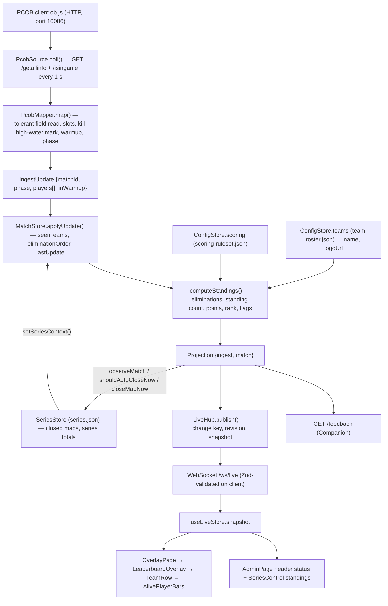

# Repository audit — chicken-dinner-feed (for Manual Mode)

- **Audited:** 2026-10-19, against `HEAD` = `8ab3f12` (v1.2.0), clean working tree.
- **Scope:** everything that produces, transforms or renders live match data, plus the persistence,
  configuration and test infrastructure a Manual Mode would have to touch.
- **Method:** source read end to end along the data path; no application code changed, no API called.
- **Not executed:** `node_modules/` is not installed in this checkout, so the build, type-check, lint
  and test commands below were **not run** during the audit. Their existence is verified from
  `package.json` and `.github/workflows/ci.yml`, not their current pass/fail state.

Legend used throughout: **Verified** = read in source. **Inferred** = follows from source but not
exercised. **Unverified** = claimed by docs/specs only.

---

## 1. Architecture at a glance

| Aspect             | Finding                                                                                                                 | Evidence                                                                                   |
| ------------------ | ----------------------------------------------------------------------------------------------------------------------- | ------------------------------------------------------------------------------------------ |
| Product            | Local Windows bundle that polls the PUBG Mobile **PCOB** observer API and renders broadcast overlays as browser sources | [`README.md`](../README.md), [ADR-0001](adr/0001-local-windows-bundle-over-cloud-stack.md) |
| Language           | TypeScript everywhere, ESM, Node ≥ 22.19                                                                                | [`package.json`](../package.json), `.nvmrc`                                                |
| Layout             | npm workspaces: `shared` (Zod contracts) → `backend` (Fastify 5) → `frontend` (React 19 + Vite 8)                       | [ADR-0005](adr/0005-monorepo-with-shared-contracts.md)                                     |
| Backend            | Fastify + `fastify-type-provider-zod`, `@fastify/websocket`, `@fastify/static`, Swagger at `/api/docs`                  | [`backend/src/app.ts`](../backend/src/app.ts)                                              |
| Frontend           | React 19, TanStack Router, Zustand, Motion, Tailwind 4, shadcn conventions, lucide icons                                | [`frontend/package.json`](../frontend/package.json)                                        |
| Persistence        | Schema-validated JSON files in `backend/data/`, atomic writes, no database                                              | [ADR-0004](adr/0004-json-file-persistence.md), `persistence/json-document.ts`              |
| Live transport     | Backend → browser over WebSocket `/ws/live`, **full snapshots**, sent only on real change                               | [ADR-0007](adr/0007-websocket-state-fanout.md), `ws/live-hub.ts`                           |
| Data source choice | **Fixed at process start** by env `INGEST_SOURCE` (`pcob` default, or `mock`). There is no runtime switch today.        | [`backend/src/config.ts#L39`](../backend/src/config.ts#L39), `app.ts#L125-L136`            |
| Auth               | None on admin (loopback/LAN tool). Optional `CONTROL_TOKEN` guards only overlay-control and `/feedback` endpoints.      | [ADR-0008](adr/0008-admin-as-protected-frontend-route.md), `routes/control-token.ts`       |

### 1.1 Entry points

| Entry            | File                                                                                            | Role                                                           |
| ---------------- | ----------------------------------------------------------------------------------------------- | -------------------------------------------------------------- |
| Backend process  | [`backend/src/index.ts`](../backend/src/index.ts)                                               | Builds the app, calls `start()` / `shutdown()`                 |
| App composition  | [`backend/src/app.ts` `buildApp()`](../backend/src/app.ts#L41-L322)                             | Wires config → stores → ingest source → hub → routes           |
| Frontend         | [`frontend/src/main.tsx`](../frontend/src/main.tsx), [`router.tsx`](../frontend/src/router.tsx) | Routes `/` → `/admin`, `/admin`, `/overlay/$instanceId`        |
| Operator scripts | `install-dependencies.bat`, `startup.bat`                                                       | Release-bundle install and launch                              |
| Developer tool   | `tools/capture-pcob.ps1`                                                                        | Captures raw PCOB responses for analysis (not part of runtime) |

### 1.2 Directory map (runtime-relevant only)

```
shared/src/
  domain/      team.ts, player.ts, match.ts, ingest.ts, series.ts, overlay.ts, backup.ts
  protocol/    live.ts (WebSocket messages), feedback.ts (/feedback public contract)
  config/      team-roster.ts, scoring.ts, overlay-instance.ts, fonts.ts
  versions.ts  PROTOCOL_VERSION = 6, CONFIG_SCHEMA_VERSION = 3
backend/src/
  ingest/      source.ts (adapter interface), index.ts (factory), mock-source.ts,
               pcob/pcob-source.ts (HTTP poller), pcob/payload.ts (PcobMapper), pcob/field-lookup.ts
  state/       match-store.ts (live match, in memory), series-store.ts (map history, persisted),
               overlay-control-store.ts (show/hide, in memory)
  scoring/     standings.ts (computeStandings — points, rank, flags)
  ws/          live-hub.ts (fan-out, change detection, stale timer), routes.ts
  routes/      config, series, feedback, overlay-control, logos, fonts, backup, health
  persistence/ json-document.ts, config-store.ts, migrations.ts, logo-store.ts, font-store.ts,
               team-logo-ini.ts
  backup/      export.ts, import.ts
frontend/src/
  pages/       AdminPage.tsx, OverlayPage.tsx, OverlayRoute.tsx
  components/overlay/  LeaderboardOverlay.tsx, TeamRow.tsx, AlivePlayerBars.tsx, appearance.ts,
                       overlay-scale.ts
  features/admin/      SeriesControl, TeamRosterEditor, TeamLogoCell, ImportIniButton,
                       ScoringEditor, AppearanceEditor, FontManager, ImportExport, ...
  stores/      live-store.ts (Zustand, WebSocket state), toast-store.ts
  lib/         api.ts (REST client), live-connection.ts (WebSocket client), ...
```

---

## 2. Complete data flow (verified)



Step by step, with the exact code:

1. **Poll.** [`PcobSource.start()`](../backend/src/ingest/pcob/pcob-source.ts#L68-L74) fires `poll()`
   immediately and on `setInterval(pollMs)` (default 1000 ms,
   [`config.ts#L51`](../backend/src/config.ts#L51)). Overlapping polls are coalesced onto one promise
   ([L93-L101](../backend/src/ingest/pcob/pcob-source.ts#L93-L101)). Each request has an
   `AbortController` timeout (default 800 ms via `PCOB_REQUEST_TIMEOUT_MS`).
2. **Map.** [`PcobMapper.map()`](../backend/src/ingest/pcob/payload.ts#L119-L174) reads `GameID`,
   `TotalPlayerList`, `FinishedStartTime` through alias lists
   ([`F`, L39-L54](../backend/src/ingest/pcob/payload.ts#L39-L54)); per player it produces an
   `IngestPlayer` ([L217-L229](../backend/src/ingest/pcob/payload.ts#L217-L229)). `TeamInfoList` is
   **not** read (team stats are derived from players).
3. **Emit.** `onUpdate(update)` / `onStatus(state, message)` callbacks wired in
   [`app.ts start()`](../backend/src/app.ts#L269-L313).
4. **Accumulate.** [`MatchStore.applyUpdate()`](../backend/src/state/match-store.ts#L139-L162) resets
   on a new `matchId` or a transition to `idle`, records `seenTeams`, and appends newly wiped teams to
   the **append-only** `eliminationOrder` (skipped during warmup).
5. **Project.** [`MatchStore.project()`](../backend/src/state/match-store.ts#L198-L202) →
   [`buildProjection()`](../backend/src/state/match-store.ts#L230-L262) →
   [`computeStandings()`](../backend/src/scoring/standings.ts#L116-L213) joins players with the
   roster, computes points from the ruleset plus series totals, sorts and assigns `rank`.
6. **Series side-effects.** In the same `onUpdate`, `seriesStore.observeMatch()` and the auto-close
   check `shouldAutoCloseNow()` run, then `refreshSeriesContext()` and `hub.schedulePublish()`
   ([`app.ts#L278-L305`](../backend/src/app.ts#L278-L305)).
7. **Fan out.** [`LiveHub.publish()`](../backend/src/ws/live-hub.ts#L222-L240) builds a change key
   that excludes `lastUpdateAt` ([L271-L274](../backend/src/ws/live-hub.ts#L271-L274)) and sends a
   `snapshot` message only if it changed. A new client gets the last snapshot immediately
   ([L120-L143](../backend/src/ws/live-hub.ts#L120-L143)). A 1 s timer calls
   `store.markStaleIfSilent()` ([L97-L101](../backend/src/ws/live-hub.ts#L97-L101)).
8. **Receive.** [`LiveConnection.handleMessage()`](../frontend/src/lib/live-connection.ts#L101-L127)
   validates with `serverMessageSchema`; a protocol mismatch is surfaced, an invalid message is
   **silently dropped** (overlay freezes on its last frame).
9. **Render.** [`OverlayPage`](../frontend/src/pages/OverlayPage.tsx#L91-L121) renders
   `LeaderboardOverlay` with `snapshot.match`; rows come pre-ranked from the backend, sliced to
   `appearance.maxTeams` ([`LeaderboardOverlay.tsx#L36`](../frontend/src/components/overlay/LeaderboardOverlay.tsx#L36)).

### 2.1 Field-level trace

| Wire field (PCOB)                    | Internal name / type                       | Transform                                                                                                                         | Consumed by                                                                                                         | Missing / invalid                                    |
| ------------------------------------ | ------------------------------------------ | --------------------------------------------------------------------------------------------------------------------------------- | ------------------------------------------------------------------------------------------------------------------- | ---------------------------------------------------- |
| `GameID` / `gameId`                  | `IngestUpdate.matchId: string \| null`     | `''` → `null`                                                                                                                     | MatchStore reset, SeriesStore close/dup guard, `/feedback.matchId`                                                  | `null`: no reset on change, close-map refused        |
| `isingame.isInGame`                  | input to `derivePhase`                     | boolean                                                                                                                           | `phase`                                                                                                             | non-`true` → false                                   |
| `FinishedStartTime`                  | input to `derivePhase`                     | `ended` only if ≤1 team standing                                                                                                  | `phase`                                                                                                             | absent → ignored                                     |
| `teamId`                             | `IngestPlayer.teamNo: 1–25`                | integer check                                                                                                                     | join key to roster, every per-team aggregate                                                                        | outside 1–25 → player skipped, warned once           |
| `playerKey` / `uId` / `uID`          | `IngestPlayer.id: string`                  | falls back to `playerName`                                                                                                        | slot assignment, kill baseline                                                                                      | no id and no name → skipped                          |
| `playerName`                         | `IngestPlayer.name`                        | falls back to id                                                                                                                  | `Team.players[].name` (on wire; **not rendered** by overlay)                                                        | —                                                    |
| _(none — derived)_                   | `IngestPlayer.slot: 1–4`                   | arrival order per team, then frozen ([`slotFor`](../backend/src/ingest/pcob/payload.ts#L298-L316))                                | `AlivePlayerBars` bar position                                                                                      | 5th player of a team dropped                         |
| `liveState` (0–6)                    | `PlayerLiveState` enum                     | 0–3 → `alive`, 4 `knocked`, 5 `dead`, 6 `disconnected`, else `unknown` ([L12-L20](../backend/src/ingest/pcob/payload.ts#L12-L20)) | bar colour/height, standing count, elimination, warmup detection                                                    | unknown value → `unknown` (renders as full grey bar) |
| `health`                             | `Player.health: number ≥ 0`                | `max(0, …)`                                                                                                                       | bar height numerator                                                                                                | default 0                                            |
| `healthMax`                          | `Player.healthMax: number > 0`             | ≤0 → 100                                                                                                                          | bar height denominator                                                                                              | default 100                                          |
| `killNum`, `killNumBeforeDie`        | `Player.kills: int ≥ 0`                    | high-water mark minus warmup baseline ([`killsFor`](../backend/src/ingest/pcob/payload.ts#L271-L285))                             | `Team.eliminations` (sum), kill points, survivor ordering at close                                                  | default 0                                            |
| `rank`                               | `IngestPlayer.rank: int ≥ 0` (0 = playing) | truncated to int ([`rankFor`](../backend/src/ingest/pcob/payload.ts#L255-L260))                                                   | primary placement source ([`apiRankByTeam`](../backend/src/state/match-store.ts#L277-L284)), warmup fallback signal | default 0                                            |
| `teamName` (on wire)                 | **not read**                               | —                                                                                                                                 | —                                                                                                                   | Names come from the roster, never from PCOB          |
| `TeamInfoList.killNum/liveMemberNum` | **not read**                               | —                                                                                                                                 | — (documented as cross-check only, `specs/PCOB-API.md` §4)                                                          | —                                                    |

Derived `Team` fields ([`shared/src/domain/team.ts`](../shared/src/domain/team.ts#L12-L49),
computed in [`standings.ts#L134-L212`](../backend/src/scoring/standings.ts#L134-L212)):

| `Team` field          | Derivation                                                                                                                                   | Rendered where                               |
| --------------------- | -------------------------------------------------------------------------------------------------------------------------------------------- | -------------------------------------------- |
| `teamNo`              | roster entry                                                                                                                                 | React key, admin                             |
| `name`, `logoUrl`     | **roster** (`team-roster.json`) — operator-entered already                                                                                   | TeamRow name / logo                          |
| `players`             | ingest players of that team sorted by slot                                                                                                   | AlivePlayerBars                              |
| `standingPlayerCount` | players with `alive`/`knocked`/`disconnected` ([`isStanding`](../backend/src/scoring/standings.ts#L81-L87))                                  | Not rendered directly; drives `isEliminated` |
| `eliminations`        | Σ `player.kills`                                                                                                                             | ELIMS column, admin, `/feedback.leader`      |
| `placement`           | API `rank` › elimination-order fallback › survivors at `ended` ([`resolvePlacements`](../backend/src/state/match-store.ts#L326-L367))        | Not rendered on overlay; series history      |
| `killPoints`          | `eliminations × pointsPerElimination`                                                                                                        | via `totalPoints`; series history            |
| `placementPoints`     | real placement row, or **guaranteed-minimum** row for still-alive present teams ([L162-L173](../backend/src/scoring/standings.ts#L162-L173)) | via `totalPoints`                            |
| `totalPoints`         | earned kill + placement points (net of banked) + series total                                                                                | PTS column, `/feedback.leader`               |
| `rank`                | sort: appeared › points › eliminations › name ([L201-L212](../backend/src/scoring/standings.ts#L201-L212))                                   | `#` column, row order                        |
| `isEliminated`        | not warmup ∧ has players ∧ standing count = 0                                                                                                | row dimmed to 45 %                           |
| `hasAppeared`         | team seen by the ingest source this match                                                                                                    | row dimmed to 25 %, sort tier                |

`MatchState.standingTeamCount` = appeared ∧ not eliminated
([`match-store.ts#L259`](../backend/src/state/match-store.ts#L259)); drives auto-close and `/feedback`.

---

## 3. Feature inventory and PCOB dependency

| #   | Feature                                                   | Where                                                                                               | Depends on PCOB live data?                          | Manual Mode viability (detail in the matrix doc)                  |
| --- | --------------------------------------------------------- | --------------------------------------------------------------------------------------------------- | --------------------------------------------------- | ----------------------------------------------------------------- |
| F1  | Leaderboard overlay (`#`, logo, TEAM, ALIVE, PTS, ELIMS)  | `LeaderboardOverlay.tsx`, `TeamRow.tsx`                                                             | Yes — ALIVE, ELIMS, and inputs to PTS/#             | Shared, with team-level manual data                               |
| F2  | ALIVE column: 4 bars, height = health, colour = state     | [`AlivePlayerBars.tsx`](../frontend/src/components/overlay/AlivePlayerBars.tsx)                     | Yes — per-player `health`, `healthMax`, `liveState` | **Must change**: health cannot be entered manually                |
| F3  | Legend ALIVE / KNOCKED / ELIM                             | [`LeaderboardOverlay.tsx#L7-L11`](../frontend/src/components/overlay/LeaderboardOverlay.tsx#L7-L11) | Indirectly                                          | Modified (KNOCKED meaningless without knock tracking)             |
| F4  | Team names and logos                                      | Roster config, `TeamRosterEditor`, `TeamLogoCell`, ini import                                       | **No** — already operator-entered                   | Shared unchanged                                                  |
| F5  | Points, placement, rank                                   | `computeStandings`, `MatchStore.resolvePlacements`                                                  | Inputs only (kills, alive state, `rank`)            | Calculated from manual inputs                                     |
| F6  | Dimming eliminated / never-appeared teams                 | `TeamRow.tsx#L45`                                                                                   | Yes (`isEliminated`, `hasAppeared`)                 | Calculated from manual inputs                                     |
| F7  | Row reorder / value-change animations                     | `TeamRow.tsx` (Motion `layout`, `CountingValue`)                                                    | No (reacts to any snapshot change)                  | Shared unchanged                                                  |
| F8  | Overlay show/hide, appearance, fonts, multiple instances  | `overlay-control-store.ts`, `AppearanceEditor`, `FontManager`                                       | No                                                  | Shared unchanged                                                  |
| F9  | Admin connection indicator                                | [`AdminPage.tsx#L36-L49, L278-L286`](../frontend/src/pages/AdminPage.tsx#L36-L49)                   | Yes (`ingest.state`)                                | Modified (must show the active mode)                              |
| F10 | Series control: close map, add/correct/delete map, reset  | `SeriesControl.tsx`, `routes/series.ts`, `series-store.ts`                                          | Close-now needs a `matchId` and a projection        | Shared; manual mode must supply a `matchId` per map               |
| F11 | Automatic map close (≤1 team standing, 2 stable polls)    | [`app.ts#L291-L298`](../backend/src/app.ts#L291-L298), `shouldAutoCloseNow`                         | Yes (assumes a steady update cadence)               | Needs a decision (see D-12)                                       |
| F12 | Warmup detection (no eliminations/closes during warmup)   | `PcobMapper` (`inWarmup`), `MatchStore`, `routes/series.ts#L71-L76`                                 | Yes (PCOB-specific)                                 | Not applicable — manual has no warmup                             |
| F13 | Stale detection (connected → stale after 10 s silence)    | [`MatchStore.markStaleIfSilent`](../backend/src/state/match-store.ts#L170-L178), hub timer          | Yes                                                 | **Must not apply** to manual (edits are sporadic)                 |
| F14 | `/feedback` for Companion (`data.*`, `match.*`, overlays) | [`routes/feedback.ts`](../backend/src/routes/feedback.ts#L165-L189)                                 | Partly                                              | Shared; `data.source` gains a value                               |
| F15 | `/api/health` reports `ingestSource`                      | [`routes/health.ts#L11, L33`](../backend/src/routes/health.ts#L11)                                  | Reports **startup** config only                     | Should report the active mode                                     |
| F16 | Import & Export backup ZIP                                | [`backup/export.ts#L19-L40`](../backend/src/backup/export.ts#L19-L40)                               | No (live state deliberately excluded)               | Unchanged; manual live state excluded by the same rule (D-19)     |
| F17 | Mock source (rehearsal without a game)                    | [`mock-source.ts`](../backend/src/ingest/mock-source.ts)                                            | Replaces PCOB                                       | Coexists: "automatic" mode = configured source (`pcob` or `mock`) |
| F18 | Admin preview = real overlay in an iframe                 | `OverlayPreview.tsx`, ADR-0013                                                                      | No                                                  | Shared — shows manual data automatically                          |

**Not present in the application** (verified absent, so not in scope for Manual Mode parity): match
timer / elapsed time, match title, round number display, map name (`mapName` is always `null`,
[`series.ts#L26-L29`](../shared/src/domain/series.ts#L26-L29)), team colours (ini colour fields are
skipped, [`team-logo-ini.ts#L28-L30`](../backend/src/persistence/team-logo-ini.ts#L28-L30)), player
names on the overlay, player statistics, equipment/inventory, damage, positions, kill feed, match
history UI beyond the series list.

---

## 4. PCOB integration details

| Topic           | Finding                                                                                                                                                                                                                                                                                                                             |
| --------------- | ----------------------------------------------------------------------------------------------------------------------------------------------------------------------------------------------------------------------------------------------------------------------------------------------------------------------------------- |
| Endpoints       | `GET {PCOB_BASE_URL}/getallinfo` (envelope `allinfo`) and `GET /isingame` (`isInGame`), in parallel ([`runPoll`](../backend/src/ingest/pcob/pcob-source.ts#L103-L125)). Reference: `specs/PCOB-API.md` §3b.                                                                                                                         |
| Authentication  | None. Access control is the PCOB client's own OPENID whitelist and its "API Enable" checkbox (`specs/PCOB-FINDINGS.md`). No secrets in the adapter.                                                                                                                                                                                 |
| Polling         | `setInterval` at `PCOB_POLL_INTERVAL_MS` (200–10 000, default 1000). Upstream refreshes about every 2 s (Unverified — vendor docs).                                                                                                                                                                                                 |
| Timeout         | `PCOB_REQUEST_TIMEOUT_MS` (100–10 000, default 800). Required because ob.js never ends unknown routes.                                                                                                                                                                                                                              |
| Error handling  | Any failure → `onStatus('disconnected', …)`; never throws out of the loop; logs only on the connected→offline transition. No explicit backoff — it simply retries at the poll interval.                                                                                                                                             |
| Stale           | Handled downstream by `MatchStore.markStaleIfSilent` (10 s) driven by the hub's 1 s timer.                                                                                                                                                                                                                                          |
| Normalisation   | Tolerant field lookup with one-time warnings (`field-lookup.ts`); strict validation happens only on the outbound WebSocket schema.                                                                                                                                                                                                  |
| Match selection | Implicit: whatever match the PCOB client is observing; `GameID` change resets mapper and store.                                                                                                                                                                                                                                     |
| API unavailable | Overlay keeps the last known good state (MatchStore keeps `lastUpdate`); admin shows _Disconnected_.                                                                                                                                                                                                                                |
| `stop()`        | Clears the timer, sets `events = null`, emits `disconnected`. An **in-flight** poll that resolves after `stop()` hits `this.events.onUpdate` on `null`, throws inside its own `try`, and is swallowed by `reportOffline` (which logs "PCOB API unreachable: …"). **Inferred:** it cannot corrupt state, but logs a misleading line. |
| Restartability  | `start()` after `stop()` works (timer is recreated with `??=`); the `PcobMapper` instance and its per-match state survive the restart.                                                                                                                                                                                              |
| Tests           | `payload.test.ts` (33 cases), `pcob-source.test.ts` (7, injected `fetchImpl`), `field-lookup.test.ts` (11) use local fixtures; no live calls.                                                                                                                                                                                       |

Live API access was not available and was not attempted. Field semantics above rest on source code
plus the repository's own capture notes in `specs/PCOB-API.md` (live capture 2026-08-28, PCOB 4.5.0).

---

## 5. State, persistence and configuration

| State                    | Owner                       | Lifetime                | File                                            |
| ------------------------ | --------------------------- | ----------------------- | ----------------------------------------------- |
| Live match               | `MatchStore`                | memory only (by design) | —                                               |
| Overlay visibility       | `OverlayControlStore`       | memory only (ADR-0012)  | —                                               |
| Team roster              | `ConfigStore.teams`         | persisted               | `backend/data/team-roster.json`                 |
| Scoring ruleset          | `ConfigStore.scoring`       | persisted               | `backend/data/scoring-ruleset.json`             |
| Overlay instances        | `ConfigStore.instances`     | persisted               | `backend/data/overlay-instances.json`           |
| Custom fonts             | `ConfigStore.fonts` + files | persisted               | `backend/data/custom-fonts.json`, `data/fonts/` |
| Logos                    | `LogoStore`                 | persisted               | `backend/data/logos/`                           |
| Series history           | `SeriesStore`               | persisted               | `backend/data/series.json`                      |
| Admin sidebar preference | browser                     | `localStorage`          | key `cdf.admin.sidebar`                         |

`JsonDocument` ([`json-document.ts`](../backend/src/persistence/json-document.ts#L47-L155)) gives
validate-on-read, migrate-before-validate, atomic temp-file + `fsync` + rename writes, and a per-instance
write queue. It is the natural home for any new persisted document.

Environment variables (names only; see `backend/.env.example`): `PORT`, `HOST`, `CONTROL_TOKEN`,
`NODE_ENV`, `LOG_LEVEL`, `DATA_DIR`, `INGEST_SOURCE`, `PCOB_BASE_URL`, `PCOB_POLL_INTERVAL_MS`,
`PCOB_REQUEST_TIMEOUT_MS`.

**Key constraint for Manual Mode:** overlays run as browser sources inside broadcast software (often
a different process or machine) and receive data **only** from the backend over `/ws/live`. Any
manual data that must reach the overlay therefore has to live in the backend. Browser storage in the
admin tab cannot feed an OBS browser source.

---

## 6. Tests, build and tooling

| Command                  | Effect                                                           | Status in this audit |
| ------------------------ | ---------------------------------------------------------------- | -------------------- |
| `npm install` / `npm ci` | install all workspaces                                           | not run              |
| `npm run build`          | shared → backend (`tsc`) → frontend (`tsc -b && vite build`)     | not run              |
| `npm run typecheck`      | every workspace                                                  | not run              |
| `npm run lint`           | frontend only (`oxlint`); backend and shared have no lint script | not run              |
| `npm run format:check`   | Prettier over the whole repo, **including Markdown**             | not run              |
| `npm test`               | Vitest in backend and frontend                                   | not run              |
| `npm run dev`            | backend :4317, frontend :4318 (proxying `/api`, `/ws`)           | not run              |

CI ([`.github/workflows/ci.yml`](../.github/workflows/ci.yml)) runs build, typecheck, lint,
format:check and test on every PR.

Test inventory (counted by `it(`/`test(` occurrences, approximate): **backend ≈ 245** across 19
files — strong coverage of `MatchStore`, `computeStandings`, `SeriesStore`, `PcobMapper`,
`LiveHub`, routes via `Fastify().inject` with temp data dirs. **Frontend ≈ 29** across 3 files, all
pure `lib/` helpers. **There is no component-test setup** (no jsdom/happy-dom, no Testing Library)
**and no end-to-end framework** (no Playwright/Cypress). `docs/progression.md` mentions a
"manual-test policy" for UI.

---

## 7. Technical constraints relevant to Manual Mode

1. **Single source, chosen at startup.** `createIngestSource()` is called once in `buildApp()`; no
   code path swaps it.
2. **The domain is player-centric.** `IngestUpdate` carries only players; every team value
   (eliminations, standing count, eliminated, placement fallback) is derived from players.
3. **`eliminationOrder` is append-only** within a match
   ([`match-store.ts#L286-L306`](../backend/src/state/match-store.ts#L286-L306)). Correcting a
   mistaken "team out" is impossible without a new `matchId` — acceptable for PCOB, a real hazard for
   human input.
4. **Stale detection assumes continuous updates** (10 s). A sporadic manual source would go "Stale".
5. **Auto-close assumes a steady update cadence** (2 consecutive updates with ≤1 team standing).
6. **Closing a map needs a non-null `matchId`**, and one map per `matchId`
   ([`series-store.ts#L279-L309`](../backend/src/state/series-store.ts#L279-L309)).
7. **Wire contracts are versioned.** Changing `ingestSourceKindSchema` or `Team` requires a
   `PROTOCOL_VERSION` bump (old browser sources then show the "out of date" banner by design).
   `/feedback` has its own `FEEDBACK_VERSION` (bump only on breaking change).
8. **A snapshot that fails client validation is dropped silently**, freezing the overlay — any new
   field must be schema-valid in every mode.
9. **Squad size is 4** in the schema (`slot` 1–4) and the mapper (`PLAYERS_PER_TEAM`).
10. **Roster `teamNo` 1–25 is the universal join key**; names ≤ 24 characters.

## 8. Risks and known limitations (pre-existing)

- `rank` behaviour for early-eliminated teams in ≥3-team matches is unconfirmed
  (`docs/progression.md` backlog).
- Admin has no protocol-mismatch banner (a stale admin tab silently stops updating) — relevant
  because Manual Mode will bump `PROTOCOL_VERSION`.
- No authentication on admin; Manual Mode endpoints would inherit that exposure when `HOST=0.0.0.0`
  (the default).
- Frontend UI behaviour has no automated tests.
- Baseline test/build status of this checkout is unknown until dependencies are installed.
